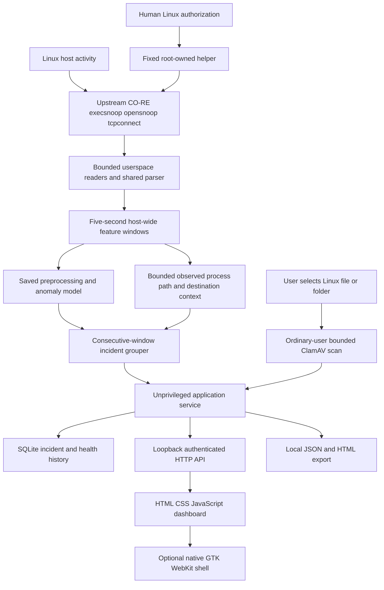

# Sentinel Complete Project Report and Presentation Handoff

**Project:** A Lightweight Host Based Intrusion Detection System Using eBPF and Machine Learning  
**Application name:** Sentinel  
**Course:** 23AID213 Operating Systems  
**Team:** Team 2 / Group 2  
**Status date:** 18 October 2026, Asia/Calcutta  
**Purpose:** A self-contained account for a reader or presentation-generation model with no access to the development conversation. This document explains the proposal, actual implementation, experiments, rejected approaches, measured results, application, verification, limitations, and remaining work. Repository paths identify provenance; understanding the report does not require opening those files.

## Contents

- [1. Read this first](#1-read-this-first)
- [2. Executive technical summary](#2-executive-technical-summary)
- [3. Motivation and scope](#3-motivation-and-scope)
- [4. How the proposal changed during development](#4-how-the-proposal-changed-during-development)
- [5. Hardware and execution environments](#5-hardware-and-execution-environments)
- [6. eBPF collection design](#6-ebpf-collection-design)
- [7. Native dataset inventory](#7-native-dataset-inventory)
- [8. Parsing and feature engineering](#8-parsing-and-feature-engineering)
- [9. Model choices and scoring](#9-model-choices-and-scoring)
- [10. Evaluation evolution and why it matters](#10-evaluation-evolution-and-why-it-matters)
- [11. Improvement using the existing two native sessions](#11-improvement-using-the-existing-two-native-sessions)
- [12. External dataset investigation and rejected augmentation](#12-external-dataset-investigation-and-rejected-augmentation)
- [13. Local WSL investigation before adaptation](#13-local-wsl-investigation-before-adaptation)
- [14. Three rounds of experimental host adaptation](#14-three-rounds-of-experimental-host-adaptation)
- [15. Complete runtime architecture](#15-complete-runtime-architecture)
- [16. Live ingestion and health behavior](#16-live-ingestion-and-health-behavior)
- [17. Authorization and helper lifecycle](#17-authorization-and-helper-lifecycle)
- [18. Incident grouping and explanations](#18-incident-grouping-and-explanations)
- [19. Desktop service, interface, and API](#19-desktop-service-interface-and-api)
- [20. Persistence and exports](#20-persistence-and-exports)
- [21. Independent ClamAV file scanning](#21-independent-clamav-file-scanning)
- [22. Packaging, installation, and public website](#22-packaging-installation-and-public-website)
- [23. Performance and resource evidence](#23-performance-and-resource-evidence)
- [24. Defects and methodological errors found and addressed](#24-defects-and-methodological-errors-found-and-addressed)
- [25. Final QA on 18 October 2026](#25-final-qa-on-18-october-2026)
- [26. Readiness assessment](#26-readiness-assessment)
- [27. Remaining work and an actionable improvement plan](#27-remaining-work-and-an-actionable-improvement-plan)
- [28. Faculty demonstration script](#28-faculty-demonstration-script)
- [29. Suggested presentation structure and chart data](#29-suggested-presentation-structure-and-chart-data)
- [30. Likely viva questions and precise answers](#30-likely-viva-questions-and-precise-answers)
- [31. Reproduction commands and operational boundaries](#31-reproduction-commands-and-operational-boundaries)
- [32. Source and artifact inventory](#32-source-and-artifact-inventory)
- [33. Evidence hierarchy and reference register](#33-evidence-hierarchy-and-reference-register)
- [34. Glossary](#34-glossary)
- [35. Final statement for presentation use](#35-final-statement-for-presentation-use)
- [Appendix A Exact native phase boundaries](#appendix-a-exact-native-phase-boundaries)
- [Appendix B Exact chronological split and metric definitions](#appendix-b-exact-chronological-split-and-metric-definitions)
- [Appendix C All nineteen historical candidate configurations](#appendix-c-all-nineteen-historical-candidate-configurations)
- [Appendix D Full local adaptation candidate summaries](#appendix-d-full-local-adaptation-candidate-summaries)
- [Appendix E Compact final verification records](#appendix-e-compact-final-verification-records)
- [Appendix F Development chronology and work-package reconciliation](#appendix-f-development-chronology-and-work-package-reconciliation)
- [Appendix G Test source inventory](#appendix-g-test-source-inventory)
- [Appendix H Portable presentation facts](#appendix-h-portable-presentation-facts)
- [Appendix I Visual assets and portability](#appendix-i-visual-assets-and-portability)
- [Appendix J What this report does not certify](#appendix-j-what-this-report-does-not-certify)

## 1. Read this first

Sentinel is a university research prototype that observes selected Linux process-execution, file-open, and TCP-connection events through existing CO-RE eBPF tools. Python converts those observations into host-wide five-second activity windows. A saved anomaly detector scores each window, groups consecutive unusual windows into incidents, and presents results through a local desktop/browser interface. A separate ClamAV integration performs user-requested file scanning.

The installed Ubuntu WSL application is ready for a supervised faculty demonstration. It is not established as dependable production security software. The latest tests verify that the components operate together; they do not establish broad malware-detection effectiveness.

The most important result is a working systems-and-ML pipeline accompanied by evidence about its limitations. Historical detection metrics improved, but unfamiliar normal workloads still produce false alerts. Real collection, model scoring, explanations, history, scanning, export, packaging, and native startup have been implemented and checked.

### 1.1 Team identification

Names and identifiers are transcribed from the supplied abstract, progress report, and original review presentation. Individual contribution assignments were not documented precisely enough to attribute modules to particular members.

| Member | University identifier |
|---|---|
| Mohalraj Shivanethran | CB.AI.U4AIM25020 |
| Pranesh Subramanian | CB.AI.U4AIM25030 |
| Srinath Balakrishnan | CB.AI.U4AIM25040 |
| Umasuthan Palaniappan | CB.AI.U4AIM25041 |

Faculty/supervisor names, final submission date, and an institution-approved report template were not established in the inspected records. A presentation must not invent them. A separate WiFi CSI occupancy project appears in the original abstract file but is a different course project and is outside Sentinel's scope.

### 1.2 Three versions that must never be conflated

| Variant | Model and code state | Appropriate use |
|---|---|---|
| Historical artifacts | Original IF/SVM experiments and old evaluation logic | Development history only; not current validation |
| Current source fallback and public 0.1.0 archive | Source model is the selected historical normal-only SVM; public archive also contains older application code | Reproduce original 600-window replay with 255 flagged windows; do not assume public code has latest features |
| Installed local Ubuntu application | Experimental normal-profile union SVM and latest installed runtime fixes | Current faculty demo; 600-window replay produces 253 flags |

The source application code has today's fixes. Its default model file still contains the original selected SVM. The source adapted model is stored separately. Consequently, running the application directly from the Windows checkout and launching the installed Ubuntu application can legitimately produce different counts.

### 1.3 Rules for a presentation generated from this report

- Use the current implementation and latest QA as the status authority. Dates and experiments identify historical claims.
- Describe detections as anomalous activity windows requiring review, rather than confirmed malicious processes.
- Label the 99.19% figure as **historical simulated-window recall**, not overall accuracy, real-malware coverage, or a probability that a device is safe.
- Label 1.99% as the installed adaptation's **historical normal-window false-positive rate**. It is not a guaranteed live rate.
- Describe the 0/26 normal-window result as a small 17 October test. Also disclose the new 18 October harmless probe that flagged 2/4 windows.
- Attribute file signature detection to **ClamAV**, not to the SVM.
- Do not say the final model was trained on ADFA-LD. That was an early proposal, later replaced by a self-collected dataset.
- Do not say the dashboard uses Flask or React. Those are not the implemented runtime stack.
- Do not claim Windows host monitoring, automatic quarantine, blocking, kernel-resident ML, zero false positives, or proven whole-application low overhead.
- Preserve the rejected experiments: rejecting a candidate that has attractive historical metrics but misses new workloads is an important project finding.
- Never combine measurements from different evaluation splits into a before/after comparison without explicitly stating the change of protocol.

## 2. Executive technical summary

The project began as an eBPF-plus-unsupervised-learning host IDS. The original proposal mentioned ADFA-LD and per-process analysis. Implementation evolved toward a fresh whole-host dataset and a practical end-to-end local application.

Two valid native Ubuntu sessions were collected on dedicated hardware, each with approximately one hour of baseline use followed by three fifteen-minute scripted phases. The accepted profiles were idle/light activity and browsing/media activity. The original raw files contain approximately 16.3 million lines. An earlier capture contaminated by a timestamping feedback loop was excluded.

The raw data were parsed, labelled by phase timestamps, and aggregated into five-second windows. A later correction aligned all three event streams to a single origin, represented empty windows, counted rejected rows, removed misleading evaluation reuse, and introduced explicit session-separated training infrastructure. These checks exposed severe workload-transfer false alarms.

Because additional native collection was initially unavailable, a separate exploratory improvement used chronological blocks from both existing sessions. Nineteen candidate configurations were compared. A normal-only One-Class SVM using eleven derived model inputs was selected from validation results. On 600 retained historical test windows it detected 246/248 simulated-attack windows and flagged 9/352 normal windows. A fair IF reference on the same split flagged 21/352 normal windows and detected 248/248 simulated-attack windows.

An external LID-DS MySQL scenario was audited in full, but was not merged. Its available behavior channels were poorly represented by the seven native features. A small native-metric improvement did not establish useful external detection.

The selected model was integrated into Sentinel, including replay, live Linux collection through a privileged helper, incident history, local reports, native/browser operation, and later ClamAV scanning. WSL testing exposed both an ingestion defect and real environment mismatch. Three adaptation rounds were run, with two selected candidates rejected before the third normal-profile union model passed the declared local gates and was installed with a rollback copy.

On 18 October, four additional application/runtime defects were fixed and installed locally. Final checks passed 117 automated Windows tests, 15 Ubuntu desktop/protection tests, 15 real-browser flow checks, native startup, real collector probes, helper shutdown, scanning, exports, and public download checks. A fresh harmless probe still generated behavioral flags. The outcome is a demonstrable research system with measured boundaries, not production security certification.

## 3. Motivation and scope

### 3.1 Problem being investigated

Known-signature matching is useful for known threats, but does not fully characterize the behavior of unfamiliar activity. A complementary approach observes what software does: executing processes, opening files, encountering access failures, and initiating network connections. An anomaly detector learns a representation of normal activity and flags departures for human review.

The project's research questions are:

1. Can existing eBPF tools support a complete collection-to-alert pipeline on ordinary Linux hardware?
2. Can aggregate event features distinguish the team's scripted unusual workloads from recorded normal activity?
3. How much do false alerts change when normal workloads or execution environments change?
4. Can alerts include understandable observations rather than an unexplained binary flag?
5. Can the implementation be packaged into a practical local application and demonstrated reproducibly?

These are research questions, not guarantees. Aggregate behavior can be unusual without being malicious, and malicious activity can resemble normal activity in the chosen feature space.

### 3.2 Research framing and its limits

The team originally identified reliance on an older benchmark such as ADFA-LD as motivation for collecting fresh traces. The project also investigated workload drift, interpretability of observed activity, and deployment overhead. Those are the team's motivations; the project has not established an exhaustive literature-review claim that nobody else studies these issues.

Freshness of data does not automatically make a dataset representative. Two recordings on one native machine and short WSL sessions leave major gaps in normal-use diversity, attack diversity, time separation, and device generalization.

### 3.3 Actual unit of detection

The deployed numeric detector evaluates **one aggregate window across the monitored Linux host**. It does not independently classify every process. Later evidence collection records bounded process/path/network context alongside a flagged window. That context is useful for investigation, but does not establish causal attribution.

An illustration: an editor, package updater, browser, and background service can all contribute to one window. A high open/error count can trigger a flag. Listing a process observed in that window does not prove that process caused the anomaly or is malware.

### 3.4 Implemented and excluded capabilities

| Capability | Status at report date |
|---|---|
| Linux process/file/TCP telemetry | Implemented and exercised through real CO-RE collectors |
| Host-wide five-second feature aggregation | Implemented; schema version 2 |
| Offline raw-log replay | Implemented |
| Packaged feature-window replay | Implemented; 600 historical windows |
| Normal-only anomaly detection | Implemented; original selected SVM and local union adaptation |
| Incident grouping and notification cooldown | Implemented |
| Live observed context and explanatory text | Implemented with explicit bounds |
| Native GTK/WebKit and browser interface | Implemented and checked |
| Persistent local history | Implemented through SQLite |
| JSON and readable HTML export | Implemented |
| Optional on-demand antivirus scan | Implemented through ClamAV |
| Download landing page and preview archive | Implemented; public archive older than local app |
| Automatic blocking or quarantine | Not implemented |
| Windows kernel/process monitoring | Not implemented |
| Complete syscall-sequence model | Not implemented |
| Incoming-connection/authentication/thread detector | Not implemented |
| Online autonomous retraining | Not implemented |
| Clean-machine install validation | Not completed |
| Broad real-malware efficacy evaluation | Not completed |
| Long-term population false-alert or whole-app overhead study | Not completed |

## 4. How the proposal changed during development

The original abstract and review slides are design-history artifacts. They contain future-tense intentions and some overly broad wording. The following corrections are necessary for an accurate final presentation.

| Early proposal or old note | What was actually built or learned |
|---|---|
| Train the detector on ADFA-LD | Train on two self-collected native Ubuntu sessions; ADFA-LD was not used for the deployed model |
| Features per process; flag malicious processes | Aggregate host-wide windows; bounded process observations accompany incidents |
| Flask live dashboard | Standard-library loopback HTTP server with dependency-free HTML/CSS/JavaScript and optional pywebview shell |
| Existing BCC tools | Specifically native CO-RE/libbpf-tools binaries; similarly named BCC Python scripts are not assumed compatible |
| Reliable novel/fileless/ransomware detection | No such broad efficacy was established; scripted activity and harmless probes were tested |
| Resource-light application | Small model and low standalone inference latency measured; ClamAV alone used about 1 GiB peak RSS |
| Original live_pipeline was live monitoring | It replayed saved logs; real continuous collector ingestion was implemented separately later |
| All work packages complete | Several core deliverables are complete, but independent validation, release refresh, and production work remain |
| Original IF is the permanent primary model | Model choice changed after fair comparisons; local installed model now combines two normal-only SVM profiles |

The original slide bibliography also contains a placeholder author entry, including “S. Author et al.” It must not be reused as a verified scholarly reference. This report provides authoritative tool references and project-specific evidence instead. Any additional research-paper citation needs independent bibliographic verification.

## 5. Hardware and execution environments

### 5.1 Original two-machine design

The original handoff and progress report document a dedicated Lenovo IdeaPad 330 for capture and controlled simulation, and an ASUS TUF F16 for feature engineering, ML, and report preparation. The TUF is described as an i7-14650HX/RTX 5060 Windows machine. These specifications are historical project records, not new hardware measurements in this QA pass.

The native collection environment was documented as Ubuntu 26.04 LTS with kernel 7.0.0-31-generic. The separation kept intrusive simulation work off the daily-driver training machine. GPU acceleration was not needed by the selected scikit-learn pipeline; possession of a GPU is not evidence it was used for training.

SSH/SCP were set up to transfer recordings. Historical connectivity trouble involved the Windows network profile and firewall scope. Those administrative changes are setup history, not current reproduction steps to apply blindly. Local IP addresses were DHCP-dependent and are not a portable part of the design.

### 5.2 Later local WSL deployment

The application was installed at `/opt/sentinel` in Ubuntu WSL 2 on the Windows workstation. Installation records identify Ubuntu 24.04.3 LTS and kernel 6.6.87.2-microsoft-standard-WSL2 at that checkpoint. Ubuntu's runtime uses Python 3.12.3; the Windows project environment uses Python 3.14. These environments must not be described as the same native capture host.

WSL monitoring observes Linux activity within WSL. Normal Windows browser, media, or Excel use can be background host load, but is not labelled Linux browsing telemetry and does not validate Windows protection.

During installation the Windows C: drive filled and Ubuntu experienced filesystem I/O errors. With user approval, Ubuntu was backed up and moved to `E:\WSL\Ubuntu`; the recorded backup path is `E:\WSL\Backups\Ubuntu-before-sentinel-move-20261016-verified.vhdx`. Read/write health was restored and approximately 7.6 GB was recovered on C:. This was environment recovery, not an ML algorithm improvement.

### 5.3 Runtime dependencies

The minimal development runtime specifies NumPy, pandas, scikit-learn, joblib, and PyArrow with bounded version ranges. The supplied model bundle itself requires an exact scikit-learn version match, checked at load time.

The desktop release runtime records:

| Package | Recorded version requirement |
|---|---|
| NumPy | 2.5.3 |
| pandas | 3.0.6 |
| scikit-learn | 1.9.1 |
| joblib | 1.6.0 |
| pywebview | at least 5 and below 7 |

Linux system dependencies include GTK 3, WebKit2, Python GI integration, pkexec/polkit, xterm for the WSL authorization route, ClamAV for optional scans, and notification utilities for best-effort desktop delivery. The long root `requirements.txt` is a historical environment snapshot containing many notebook/development packages; it is not the intended minimal deployment dependency list.

## 6. eBPF collection design

### 6.1 Why eBPF and CO-RE were used

eBPF supports kernel instrumentation without the team implementing a traditional loadable kernel module. Sentinel reuses upstream tracing tools. It does not claim to have written custom kernel tracing programs, and the ML model runs in Python userspace.

An early attempt using apt-packaged classic BCC tools failed against the documented recent native kernel because runtime compilation encountered a `struct filename` layout assertion mismatch. The team switched to CO-RE libbpf tools built from the iovisor/BCC repository. CO-RE uses BTF metadata for relocations across supported kernel layouts. This improves portability but does not guarantee compatibility with every kernel/tool combination.

Native build issues included missing OpenSSL development headers and a multiarch `asm/errno.h` include-path problem. These were diagnosed during toolchain setup. Such machine-specific fixes are historical details, not universal installation advice.

The later WSL collector build is recorded as BCC v0.35.0 at commit `c31a1ca305f787ba53e001ead45ebf65233a32cf`. Binaries are installed root-owned in `/opt/sentinel/collectors`.

### 6.2 Three selected observation channels

| Tool | Native text fields consumed | What the project measures |
|---|---|---|
| execsnoop | PCOMM, PID, PPID, RET, ARGS | Observed execution events and distinct execution command names |
| opensnoop | PID, COMM, FD, ERR, PATH | Open observations, distinct paths, and nonzero-error observations |
| tcpconnect | PID, COMM, IP, SADDR, DADDR, DPORT | TCP connect observations and distinct destination addresses |

These are selected event streams. They are not a capture of every syscall, every byte read/written, every network packet, or all security-relevant actions. A count of TCP connect events is not network byte volume. A distinct destination address is not the same as a distinct address-and-port pair.

### 6.3 Timestamp semantics

Historical logs prefix each native text row with a userspace receipt timestamp. The format is:

```text
<epoch_timestamp_float>,<native tool output containing spaces and possibly commas>
```

Only the first comma splits the injected timestamp from the native row. The remainder is parsed according to the actual tool schema. Receipt time is not identical to the original kernel event timestamp. Buffering, scheduling, and output delivery can introduce delay.

Live aggregation uses a wall-clock origin plus monotonic elapsed time so normal wall-clock adjustments do not directly reverse the local aggregation clock. This does not establish zero capture delay or prove no kernel events were lost.

### 6.4 Original collection orchestration

The original native Bash collector was documented on the IdeaPad as `~/Downloads/collect_dataset.sh`. It resolved the invoking user's home directory, verified tools, started all three tracers continuously for the full run, recorded phase boundaries, and used cleanup traps to stop tracers and simulation loops.

The original phases were:

| Phase label | Planned duration | Meaning |
|---|---:|---|
| baseline | 3,600 seconds | Normal operator/system activity |
| attack_recon | 900 seconds | Repeated localhost-only reconnaissance/port-scanning simulation |
| attack_privesc | 900 seconds | Privilege-related enumeration and filesystem discovery; not successful privilege exploitation |
| attack_fileaccess | 900 seconds | Repeated suspicious file-access simulation; not demonstrated credential theft |

Historical simulation commands are relevant to interpreting the data, but are not a request to repeat sensitive-file reads or broad filesystem scans on the current workstation. The project did not execute real malware.

### 6.5 The timestamp feedback loop

An invalid early session, `20260913_142059`, used an external `date` subprocess while timestamping each event. That subprocess created a new execution event, which caused another timestamp operation, generating a self-observation feedback loop. Historical inspection found roughly 99.6% `date` contamination in its execution log.

The collector was changed to Bash's non-forking `$EPOCHREALTIME`. The two accepted later sessions were recorded after that correction. This incident demonstrates that the monitoring implementation can alter the workload being measured; observer effects recur later in the dashboard TCP investigation.

### 6.6 Current Python collection utility

`collection/collect_dataset.py` is a later collection implementation. It checks Linux/root requirements, refuses to overwrite an existing session directory, captures stdout/stderr separately, records a manifest, uses userspace timestamps without forking per event, and monitors tool exits, reported loss/drop messages, and free disk space. It stops below 1 GiB of free space.

By default it records baseline activity. An explicit simulation option adds bounded localhost reconnaissance, enumeration restricted to common executable directories, and reads of synthetic demo files. Workload subprocesses use the invoking ordinary user, with execution deadlines and process-group cleanup. This safer implementation should not be described as the exact script that produced the original September recordings.

Both current live collection and this dataset collector pass `--quote` to native execsnoop so multiline command arguments remain escaped within one output row.

## 7. Native dataset inventory

### 7.1 Accepted sessions

| Session ID | Normal profile | Historical raw exec lines | Raw open lines | Raw TCP lines |
|---|---|---:|---:|---:|
| 20260914_120411 | Idle/light use | 10,496 | 8,195,946 | 165,191 |
| 20260916_185643 | Browsing/media, including video and multiple tabs | 10,804 | 7,777,434 | 164,288 |
| Total | Two native sessions | 21,300 | 15,973,380 | 329,479 |

These are raw line counts, including tool header lines and rows later rejected. Their sum is **16,324,159**. Calling all of them valid syscall events would be inaccurate.

The corrected feature metadata records:

| Session | Lines examined | Headers skipped | Malformed rows rejected | Accepted event rows by subtraction |
|---|---:|---:|---:|---:|
| 20260914_120411 | 8,371,633 | 3 | 13 | 8,371,617 |
| 20260916_185643 | 7,952,526 | 3 | 11 | 7,952,512 |
| Total | 16,324,159 | 6 | 24 | 16,324,129 |

The last column is derived arithmetically from the saved parser counters. Header and reject accounting establishes parsing transparency, not complete original kernel-capture coverage.

### 7.2 Timing and labels

The exact native phase timestamps are embedded in Appendix A. Each session has approximately 6,300 seconds of planned phases, or 105 minutes. The two sessions therefore represent approximately 210 minutes of planned native collection, not months of usage.

The label `attack_*` identifies a scheduled simulated phase. It does not establish that every event or every instant in that phase is malicious. Background normal processes continue running during simulations. Likewise, a normal-phase label is a collection assumption, not an independent forensic guarantee that the device was free of compromise.

### 7.3 Corrected feature-table inventory

The saved corrected table has 2,522 rows and 13 columns. Each native session contributes 1,261 rows:

| Phase | Windows per session | Both sessions |
|---|---:|---:|
| baseline | 720 | 1,440 |
| attack_recon | 180 | 360 |
| attack_privesc | 181 | 362 |
| attack_fileaccess | 180 | 360 |
| Total | 1,261 | 2,522 |

Phase assignment and edge/window policy explain why the saved table is not simply four exact duration/window ratios. The native raw-log replay emits its last observed window even when a separately verified end-of-capture boundary is unavailable. The production live path, in contrast, discards unfinished end windows. The retained chronological evaluation removes phase edges and split boundaries to reduce transition ambiguity.

The large open volume is substantially influenced by broad filesystem enumeration in the original privilege-enumeration simulation. It is valid observed behavior but a narrow, highly repetitive representation of an attack category. The old handoff specifically notes unscoped `getcap -r /` as a diversity/volume problem for future collection.

### 7.4 Preservation and privacy

Raw recordings remain local under `ids_dataset/` and are excluded from Git. Model artifacts, external recordings, and large generated tables also have ignore rules. Historical raw logs and original models were preserved during subsequent experiments.

Raw event metadata can include command arguments, usernames in paths, destinations, and process identity. It is sensitive even without file contents. The adaptation collector saves aggregate numeric rows without command arguments, paths, or PIDs, whereas diagnostic probes and live investigation context can retain bounded samples. Exported reports therefore require review before sharing.

## 8. Parsing and feature engineering

### 8.1 Parsing defects discovered

Real tool output is not safely parsed by assuming every whitespace token has a fixed position. Thread/command names may include spaces; arguments and paths may include spaces or numeric text. Historical parser work identified multiword names, numeric path fragments being mistaken for errno fields, and failed opens with FD = -1.

The current shared parser is in `feature_engineering/events.py`; DataFrame compatibility loaders delegate to it. Tool headers and blank lines return no event, malformed events raise an error, and numeric constraints are checked where implemented. TCP parsing anchors the address/port tail and rejoins the middle tokens into the command name. Open parsing accepts failed FD = -1 and constrains error values to the errno-sized range. Tests cover multiword names, numeric/spaced paths, and failed opens.

Historical notes describing a right-to-left open parser are implementation history. The current shared parser uses its regular-expression field structure and constraints. The report does not claim a universal parser for every possible upstream text variant.

Raw replay validates finite timestamps and nondecreasing timestamp order within each source. It splits at the first comma, counts malformed rows, and merges the sorted streams. Incomplete manifests from the new collector are rejected. Older native sessions without manifests use the available raw logs and phase files; absence of a manifest is not a capture-health certificate.

### 8.2 Shared windows and origin

Each session's origin is the earliest valid event across all three sources. For timestamp `t`, origin `t0`, and duration `W = 5 seconds`:

```text
window_index = floor((t - t0) / W)
window_start = t0 + window_index * W
```

All three channels contribute to that same index. Empty intervening windows are represented. This avoids three channel-specific clocks accidentally describing different time intervals and avoids omitting periods with no observed activity.

For labelled data, events are matched to phase intervals using the recorded epoch boundaries. Window labels follow the dominant event-phase count; ties are deterministic. The evaluation excludes unlabeled windows where they occur. For live operation the windows are unlabeled because the system does not know ground truth.

### 8.3 Seven schema inputs

| Input, in exact model order | Definition | Stored transformation |
|---|---|---|
| n_exec | Count of observed execution events | Raw nonnegative count |
| n_unique_pcomm | Number of distinct execution command names | Raw count; not unique PIDs |
| n_open | Number of observed file opens | `log1p(n_open_raw)` |
| n_unique_paths | Distinct observed file paths | `log1p(n_unique_paths_raw)` |
| n_open_errors | Opens whose error field is nonzero | Raw count |
| n_tcp_connect | Observed TCP connect events | Raw count, including local connections |
| n_unique_daddr | Distinct TCP destination IP addresses | Raw count; ports are not part of this distinct key |

The window's auxiliary fields include session ID, window index, start timestamp, phase, raw open count, and raw distinct-path count. These are not all independent classifier inputs. Schema version is **2**.

### 8.4 Eleven derived inputs for the selected SVM

Let `E`, `P`, `O`, `U`, `R`, `C`, and `D` be execution count, unique execution names, raw opens, raw unique paths, open errors, TCP connects, and unique destination addresses. The stateless conversion produces:

```text
1  log(1 + E)
2  log(1 + P)
3  log(1 + O)
4  log(1 + U)
5  log(1 + R)
6  log(1 + C)
7  log(1 + D)
8  R / (O + 1)
9  U / (O + 1)
10 P / (E + 1)
11 C / (D + 1)
```

The conversion receives the seven schema fields, reconstructs raw open/path values with `expm1`, and returns eleven values. Denominators include one to avoid division by zero. The last four quantities describe activity composition, not verified maliciousness. Log transforms reduce dominance by very large count ranges.

The selected SVM pipeline contains this conversion, a StandardScaler fitted on normal training rows only, and the estimator. Keeping the fitted preprocessing with the estimator prevents training/inference mismatch. Validation and test data do not fit the scaler.

### 8.5 Memory behavior

Raw-log replay iterates lines, merges only three source streams, and aggregates an active window rather than constructing millions of event objects in memory. Its CLI does accumulate the much smaller resulting window table before writing Parquet. The full DataFrame compatibility loaders still allocate event rows and are not the preferred large-log path.

Exact distinct-path/name/address sets consume memory proportional to unique values inside a window. “One active window” does not imply a universal constant-memory bound for arbitrary event diversity. Live ingestion also has a bounded queue, described later.

## 9. Model choices and scoring

### 9.1 Why normal-only anomaly learning

The main anomaly detectors fit normal activity rather than learning only the provided attack labels. That reduces reliance on an exhaustive attack-training catalogue. It does not prove the ability to detect unknown attacks: success still depends on feature coverage, normal-workload representation, calibration, and separation between benign and harmful behavior.

Although this project often calls these methods unsupervised, the normal-only fitting set is selected using known baseline phases. “Normal-only novelty detection” is the most precise description. Attack labels are used to evaluate candidates, and some explicitly supervised comparison models also used labelled simulation training rows. The final selected original SVM and installed union adaptation are normal-only estimators.

### 9.2 Candidate families

Isolation Forest isolates observations through random partitions. One-Class SVM learns a boundary around the fitted normal representation. Local Outlier Factor in novelty mode evaluates deviations from local training neighborhoods. The historical candidate sweep also compared Extra Trees, Random Forest, and logistic regression using known simulation labels; WSL development included histogram gradient boosting.

These are candidate comparisons, not all simultaneously deployed engines. No deep neural network was required. Current behavior scoring runs in userspace and does not perform inference inside the kernel.

### 9.3 Score orientation and thresholds

The adapter normalizes the interface so lower scores indicate less normal activity. An anomaly is declared when:

```text
normal_score < threshold
```

Scores are not malware probabilities. For the selected original SVM, the stored threshold is **0.734708821911347**. This threshold applies to that saved score representation, not to arbitrary SVM decision functions or another retrained model.

Calibration sorts finite normal validation scores and selects the empirical quantile indexed by `floor(target_fpr * n)`. The strict `<` comparison handles tied scores without exceeding the target on the calibration sample. The target is an in-sample validation setting, not a promise about future false positives.

### 9.4 Versioned detector bundles

The saved bundle includes schema version, ordered features, five-second duration, window-origin policy, exact scikit-learn version, pipeline/model, family, threshold, model identifier, and evaluation metadata where available. The adapter validates compatibility before scoring. It supports a selected-pipeline format and the earlier validated dual-model bundle format.

Joblib deserialization uses pickle machinery. Only trusted local project bundles should be loaded. A checksum identifies an artifact and detects a change relative to a trusted checksum; it is not by itself a code-signing or trust-distribution system.

## 10. Evaluation evolution and why it matters

### 10.1 Original results were demonstration results

Initial model reports trained on baseline data and evaluated on an all-phase set that included training baseline windows. Older notes quote roughly F1 = 0.950 for IF and 0.944/0.945 for SVM. Those figures are historical and cannot be presented as independent held-out performance.

The stored original generated evaluation file and later prose disagree slightly about individual counts and SVM rounding. For example, the generated report lists IF FP = 113 and SVM FP = 118, while a historical status narrative lists 114 and 119. Both describe the superseded evaluation family. The final report prioritizes the exact corrected experiments below and does not silently reconcile old inconsistent counts into a current result.

The legacy training/replay entry points were retired or redirected to prevent old models scoring the corrected schema. This was a methodological correction as well as a code change.

### 10.2 Correct session-separated infrastructure

`models/validated_training.py` requires nonempty, disjoint train/validation/test session IDs. Each partition must contain baseline data; the test partition must include simulated attack windows. It checks schema and finite values, fits preprocessing only on normal training rows, calibrates on separate normal validation rows, then reports held-out metrics and incident statistics.

With only two original native sessions, a genuine three-way session-separated final study was unavailable. The infrastructure was tested end-to-end with synthetic fixtures, but that test is not a third real collection session. This distinction must appear in the presentation's methodology/limitations.

### 10.3 Leave-one-session-out stress test

The corrected two-session comparison used fixed default thresholds. It demonstrated how normal workload changes affect false alarms:

| Model | Train baseline | Test normal workload | Normal-window FPR | Simulated-window recall |
|---|---|---|---:|---:|
| IF | Browsing/media | Idle/light | 2.92% | 100% |
| IF | Idle/light | Browsing/media | 53.61% | 100% |
| SVM | Browsing/media | Idle/light | 9.44% | 100% |
| SVM | Idle/light | Browsing/media | 30.69% | 99.45% |

The difficult IF fold yielded 37 baseline notifications per hour even after grouping/cooldown. The lesson is that grouping can reduce interruption frequency but does not repair a model's wrong classifications. The 53.61% figure belongs to this transfer test, not the later fair blocked comparison.

### 10.4 Stronger frozen-settings workload-transfer check

A later experiment froze selected SVM settings, trained on the first 75% of one session's baseline, calibrated on its remaining baseline with four intervening windows excluded, and tested the other session. It compared IF under the same partition/calibration approach.

| Model settings | Training normal profile to test profile | Normal FPR | Simulated recall |
|---|---|---:|---:|
| Selected SVM settings | Idle to media | 25.69% | 100% |
| Selected SVM settings | Media to idle | 0.28% | 95.75% |
| IF reference | Idle to media | 8.47% | 96.86% |
| IF reference | Media to idle | 0.14% | 2.22% |

These were newly fitted stress-test models, not the deployed both-profile bundle. Good ranking AUC can coexist with poor recall at a transferred threshold. No model was uniformly best across these directions.

## 11. Improvement using the existing two native sessions

### 11.1 Why this experiment was run

Fresh native collection hardware was unavailable at that stage. Rather than claiming two sessions could support independent three-way validation, the project ran an explicitly exploratory within-dataset comparison representing both normal profiles in every partition.

### 11.2 Split protocol

Within each phase of each session, the first 50% of windows formed training, the next 25% validation, and the last 25% testing. Two windows were removed at the start/end of each phase and on each side of internal split boundaries. This is an embargo to reduce direct transition/boundary overlap; it does not remove all temporal correlation in repetitive simulations.

The selected model fitted **712 normal training windows**. Validation had **598 windows**, and reserved testing had **600 windows: 352 normal and 248 simulated attack**. Both sessions contribute 300 test windows. Appendix B includes exact split records.

The test blocks were not used for candidate selection within this run. However, the underlying sessions had already been examined earlier in the project. Therefore “reserved for this run” must not be rewritten as “globally untouched independent test data.”

### 11.3 Candidate sweep and selection rule

Nineteen configurations were compared across IF, One-Class SVM, novelty LOF, Extra Trees, Random Forest, and logistic regression. The validation selection rule first required at least 95% recall in each known simulation phase and no more than 1% normal validation FPR. Among qualifying models it preferred normal-only learning, then worst-phase recall, F1, and smaller serialized estimator size.

The selected model was **ocsvm_log_g0.1_nu0.02**, with an RBF One-Class SVM, gamma = 0.1, nu = 0.02, eleven derived inputs, and training-only standardization. Selection was written to disk before evaluating the selected pipeline on the reserved test blocks. Nu is not a guaranteed future false-alert percentage; separate calibration determines the runtime threshold.

### 11.4 Fair historical test comparison

| Metric on the same 600 retained windows | IF reference | Selected original SVM |
|---|---:|---:|
| TP | 248 | 246 |
| FN | 0 | 2 |
| FP | 21 | 9 |
| TN | 331 | 343 |
| Simulated-window recall | 100% | 99.1935% |
| Normal-window FPR | 5.9659% | 2.5568% |
| Precision | 92.1933% | 96.4706% |
| F1 | 0.9594 | 0.978131 |
| ROC-AUC | approximately 0.9920 | 0.997503 |

The normal false-positive count decreased from 21 to 9, a **57.14% relative reduction**, while two more retained recon windows were missed. The SVM's phase recalls were recon 97.56%, privilege enumeration 100%, and file-access simulation 100%.

Per-session analysis is important: the idle session had 0/176 normal false positives and 124/124 simulated-window detections; the media session had 9/176 normal false positives and 122/124 simulated-window detections. The aggregate 2.56% FPR masks a **5.11%** media-profile FPR and 0% idle-profile FPR.

### 11.5 Incident results and interpretation

Using two consecutive flags and a sixty-second notification cooldown, the selected original SVM produced eight incident starts, seven eligible notifications, and one baseline notification in retained test fragments. The extrapolated baseline notification rate was approximately 2.045 per hour of retained normal duration.

These are fragment-based rates. Gaps reset incident state. Reported ten-second detection delays refer to retained fragment windows, not fresh measurements of the true original attack onset or end-to-end operating latency.

### 11.6 Artifact preservation

The selected original bundle is `models/output/improved/detector_bundle.joblib`, size **7,763 bytes** including bundle metadata. The candidate estimator alone had a different measured serialized size, 7,217 bytes; those two sizes must not be conflated.

Original selected bundle SHA-256:

```text
88167caf3a5250a99810bfb66604defa2425f9fc19e51b175ec22c4ba662b95a
```

## 12. External dataset investigation and rejected augmentation

### 12.1 Why external datasets were assessed

More data was considered as a way to broaden normal behavior. A schema match by column name alone is insufficient: timing, event direction, syscall success/failure semantics, TCP versus UDP, recording scope, and capture boundaries must match.

The comparison identified LID-DS 2021 as the closest candidate for a separate diagnostic benchmark. ADFA-LD provides syscall sequences rather than the required timed paths/error/destination fields. TON_IoT Linux offers a different measurement representation, and OpTC is Windows endpoint telemetry. None was treated as an appendable native training table.

### 12.2 LID-DS scenario examined

The user supplied the CVE-2012-2122 MySQL authentication scenario archive locally after an initial browser-download retrieval problem. The full audit covered:

- Archive size: **710,616,463 bytes**.
- SHA-256: `33bed8afd1ce0b928bb9cbbff1f49df4d4c5033c9656e5dd4477c67033ec0a6c`.
- **1,152 recordings**: 210 official train, 60 validation, 882 test.
- **41,511,610 exported events**, and 120 recordings with exploit metadata.
- **27,056 complete diagnostic five-second windows** after exclusions.
- 120 attack-onset-crossing windows excluded; 117 attack recordings retained complete post-onset windows, and three did not.
- No malformed rows, unresolved feature events, unresolved connect protocols, or nonmonotonic timestamps reported by this audit.

Those audit properties concern the exported logs and adapter. They are not proof the original recording mechanism captured every real event.

### 12.3 Semantic findings

The workload was predominantly `mysqld` in service/container recordings, unlike a whole desktop host. All **9,297 observed connect-exit events were UDP**, determined from socket/descriptor tracking. They were not relabelled TCP to fill a desired feature column.

The diagnostic adapter explicitly remained uncertified for equivalence with the native collectors. Syscall origins, path conventions, and collection scope differed. This external estimator/view was not approved for native deployment.

### 12.4 Fixed augmentation trial

The candidate added **356 normal diagnostic windows from 177 official external training recordings** to the 712 native normal training windows. Sampling was deterministic with seed 2026, limited to half the native normal training count. Hyperparameters remained the selected SVM's settings. Both native-only and augmented models used the same 1% native normal-validation calibration target. No mixture/hyperparameter search was conducted.

| Native retained test metric | Original selected model | External-normal augmentation |
|---|---:|---:|
| FP / 352 normal | 9 | 8 |
| Normal FPR | 2.56% | 2.27% |
| Simulated recall | 99.19% | 99.19% |
| F1 | 0.9781 | 0.9801 |
| ROC-AUC | 0.9975 | 0.9953 |

Native validation remained three false positives and two missed simulated windows for both. The predefined strict validation-improvement gate failed. Since same-target quantile calibration constrains validation false-positive counts, this gate alone is not a meaningful verdict on the dataset; the feature-overlap findings below are the stronger rejection reason.

### 12.5 Why the candidate was rejected

On external official test diagnostic windows, the original model flagged **6,266/6,266 normal windows and 18,630/18,630 post-onset windows**. The augmented model flagged **0/6,266 normal and 0/18,630 post-onset**.

Five of seven native features were always zero in this scenario: executions, unique execution names, open errors, TCP connects, and unique TCP destinations. **18,623 of 18,630 post-onset windows had all seven features equal to zero**, and every retained post-onset feature vector also occurred in official external normal training. A classifier cannot reliably assign different labels to identical feature vectors using only those values.

There were other observed channels, including 124,514 accept exits, 249,023 clone exits, and millions of reads/writes, but the native feature schema does not measure them. Accept-exit counts are not automatically unique successful connections, and clone exits are not automatically counts of new processes.

Post-onset exposure is not verified malicious activity in every window. The apparent 100% post-onset flag rate of a model that flags all normal windows is not useful detection. Conversely, learning to accept the shared zero vectors removes those flags without producing a capable attack detector.

**Decision:** preserve the audit and trial, do not merge this scenario or promote its estimator. One fewer native false alarm was insufficient evidence. No archived exploit or payload was executed. A future test needs a relevant behavior scenario or new features/collectors with a separate compatibility study.

## 13. Local WSL investigation before adaptation

### 13.1 Actual behavior of the unchanged historical model

A human-approved 51-window live session and later controlled checks showed frequent flags on ordinary WSL activity. The historic scores did not transfer directly to this environment.

Four short diagnostic phases with the original model recorded:

| Phase | Complete windows | Flagged windows |
|---|---:|---:|
| App closed, requested idle | 6 | 4 |
| Native app open, requested idle | 6 | 6 |
| Native app open, harmless controlled workload | 4 | 4 |
| Native app open, later requested idle | 6 | 6 |

These were sequential phases, not randomized replicated overhead experiments. Ubuntu unattended upgrades ran during some app-open phases, so package-maintenance file traffic cannot all be attributed to Sentinel.

### 13.2 Multiline exec argument failure and correction

A legitimate multiline command appeared as multiple execsnoop text rows. The monitor correctly refused malformed input, but a normal command could therefore interrupt monitoring. Adding native execsnoop `--quote` escaped embedded newlines and restored one-event-per-line parsing. The fix was applied to live monitoring, source dataset collection, and the installed app.

An isolated post-fix workload verified exactly 20 marker executions, 101 clean-file opens including creation, 100 expected missing-file errors, and 100 connections to a unique loopback port. It scored four complete windows, discarded an unfinished end window, and reported zero malformed/late rows and collector stderr. Kernel collector PIDs and WSL procfs PIDs were not assumed interchangeable; unique paths and the port identified markers.

### 13.3 Observer-generated TCP traffic

The dashboard originally opened repeated local connections while polling its local server. App-open checks attributed local TCP events to WebKitNetworkPr. This is normal monitoring-generated behavior, not evidence of external malicious traffic.

The server was changed to HTTP/1.1 connection reuse, with explicit content lengths, socket timeouts, and closure of invalid/unread requests. In sequential idle checks, dashboard-related TCP observations decreased from an average of **10.96 per five-second window to zero**. This is a limited observed comparison, not a randomized total-resource benchmark.

No loopback/process whitelist was used to conceal traffic. The implementation reduced unnecessary connections while continuing to count events that actually occurred.

### 13.4 Why simply relaxing the threshold was rejected

Two exploratory lower cutoffs were calibrated from short presumed-normal WSL samples while the model stayed frozen. The original cutoff retained historical 246/248 simulated detections. Both alternatives detected only **78/248**, or **31.45%**, and missed every retained privilege-enumeration and file-access simulation window.

The lower thresholds were approximately `1.1102230246251565e-16` and `5.5031043277864455e-08`. Neither was installed. Reducing visible alerts at the cost of discarding important known detections was explicitly rejected.

## 14. Three rounds of experimental host adaptation

### 14.1 Data and safety boundaries

Adaptation sessions recorded aggregate numeric features rather than raw command/path/PID histories. Harmless ordinary-user workloads created temporary files and used a temporary loopback listener. They generated idle, ordinary file/process/network activity, TCP bursts, execution bursts, and file/error bursts. These bursts are unusual benign stress workloads, not malware or actual privilege-escalation exploits.

Two edge windows per session were removed. Collection health required no malformed or late rows and no collector stderr. The app stayed open to include its own real activity. Session identities include capture-directory names to avoid collisions across rounds. Training was limited to two CPU threads, and any repeated normal rows used for host balancing stayed within training.

The three schedules total approximately **38 minutes** of planned Linux recording, including warmup/edges. Retained window counts are smaller. This is short single-host development data, not prolonged normal use.

### 14.2 Validation and promotion gates

Candidate cutoffs used validation only. Historical validation required at least 95% recall per simulated phase and at most 2% normal flags. Local validation required at most 5% flags per included normal workload. The selected candidate was frozen to a manifest before final test evaluation in each round.

Final gates required validation qualification, at least 95% historical test recall in each simulation phase, at most 3% historical test normal flags, at most 5% flags in each local test normal profile, and at least 80% flags in each harmless stress profile.

Those are project-specific local-preview gates, not standards for commercial antivirus approval. With small samples a validation target may effectively choose the minimum observed normal score; it cannot certify a long-term population error rate.

### 14.3 Round one rejected an attractive historical result

Round one compared **18 configurations** using approximately 120-second normal sessions and 60-second stress sessions. The selected histogram gradient-boosting candidate achieved historical TP = 248, FN = 0, FP = 2, TN = 350, F1 approximately 0.99598. It flagged 0/19 idle and 0/19 ordinary local test windows.

However, it flagged only **1/7 TCP stress windows and 0/7 file/error stress windows**, despite 7/7 execution-burst flags. It failed the stress gate and was **not installed**. This is a clear example of why maximizing historical F1 alone was insufficient.

### 14.4 Round two restored stress sensitivity but missed normal coverage

Round two restricted comparison to normal-only novelty detectors, added normal-profile union candidates, and ran after the HTTP connection-reuse change. It compared **17 configurations**. It used approximately 90-second normal sessions and 60-second stress sessions.

The selected profile union flagged 0/13 idle windows and all 7/7 windows in each stress profile, but flagged **2/13 ordinary benign windows**, or 15.38%. Those windows included command diversity insufficiently represented by the initial synthetic generator. The candidate failed the local normal-workload gate and was **not installed**.

The first 25 windows of an earlier unlabeled user report were explicitly assumed normal for development, and earlier requested-idle diagnostics were also eligible development baseline. This is a disclosed adaptive protocol change. The later 26 user-report windows were not fitted but remained only a retrospective audit without verified labels.

### 14.5 Round three expanded benign command coverage

The generator added bounded read-only ordinary commands such as `uname`, `date`, `id`, `df`, and `ps`. Round three used fresh approximately 90-second normal sessions and 45-second stress sessions, compared **17 configurations**, and tightened the local validation calibration target to 1%.

Earlier round-two normal test rows were explicitly reused as development training; their previous held-out status no longer applies to round three. Stress rows were excluded from normal fitting. Fresh round-three final sessions stayed out of fitting, calibration, and candidate selection.

The selected **profile_union_g0.1** passed all the declared gates:

| Retained round-three test workload | Original historical SVM flagged | Selected union flagged |
|---|---:|---:|
| Idle | 0/13 | 0/13 |
| Ordinary file/network/system commands | 13/13 | 0/13 |
| TCP burst | 4/4 | 4/4 |
| Execution burst | 4/4 | 4/4 |
| File/error burst | 4/4 | 4/4 |

The incident grouper produced zero incidents for either normal profile and one incident for each stress run. This establishes operation on these samples, not absence of future false positives.

Across rounds there were **18 + 17 + 17 = 52 candidate configurations/fits**, not 52 independent algorithm families. Development adapted in response to prior results. Historical tests were repeatedly revisited, so their scores are regression evidence. The fresh final round supports only a limited within-host check.

### 14.6 Normal-profile union mathematics

The model retains the frozen historical normal SVM and adds a second normal-only SVM fitted on local normal training rows. The local pipeline also uses the same stateless eleven-input conversion and a scaler fitted on its own training rows.

For a new window `x`:

```text
h(x) = historical normal score / historical reference threshold
l(x) = local normal score / local validation threshold
union_score(x) = max(h(x), l(x))
flag if union_score(x) < union_threshold
```

The installed union threshold is **1.0**. The historical reference threshold is **0.734708821911347**. The fitted local score threshold is **0.18428180068377753**. The local SVM uses gamma = 0.1, nu = 0.01, and local calibration target = 0.01.

A window accepted as normal by either profile is accepted by the union. With union cutoff capped at one, historical reference-normal acceptance is preserved. This reduces certain false flags without removing recorded events or broadly whitelisting processes.

The tradeoff is important: an attack that resembles either accepted normal profile can also be accepted. The union is not guaranteed to preserve all historical attack detections mathematically; the retained attack results were measured. Those tests happened to retain the same TP/FN counts.

### 14.7 Historical results after local adaptation

| Same 600 historical windows | Original selected SVM | Installed union adaptation |
|---|---:|---:|
| TP | 246 | 246 |
| FN | 2 | 2 |
| FP | 9 | 7 |
| TN | 343 | 345 |
| Flagged total | 255 | 253 |
| Simulated recall | 99.1935% | 99.1935% |
| Normal FPR | 2.5568% | 1.9886% |
| Precision | 96.4706% | 97.2332% |
| F1 | 0.978131 | 0.982036 |
| ROC-AUC | 0.997503 | 0.995212 |

The union improved the chosen operating-point false-positive count while its ranking AUC decreased. Reporting only improved F1 and omitting this distinction would lose useful context. Reduction from nine to seven false positives is **22.22% relative**, a small absolute change of two windows.

### 14.8 Installation and rollback

The active adapted bundle is installed at `/opt/sentinel/models/output/improved/detector_bundle.joblib`. The path retains the installation's standard location even though the model inside is adapted. A verified original backup is stored at `/opt/sentinel/models/backups/detector-original-20261017.joblib`.

The adapted source artifact and frozen selection are separately preserved under `models/output/host_adapted_20261017/`. Source native data and original selected SVM were not overwritten. Activation followed checksum, gate, and Ubuntu inference checks.

Adapted bundle size: **22,225 bytes**. SHA-256:

```text
f1be5d61c9f198e97df270f015546c28bd5ace1b329814b97f33778e1d25fb8d
```

Rollback is a deliberate maintenance action: stop monitoring, close the app, restore the verified original backup to the active model path with root ownership, and reopen. Restoring the model does not update old public code or undo unrelated UI fixes.

## 15. Complete runtime architecture



There are distinct privilege boundaries. The UI/service/scanner run as the ordinary user. A fixed helper runs the eBPF collectors with Linux authorization. The browser cannot select arbitrary root commands through the API. The scanner does not run through that privileged helper.

The raw-log pipeline, packaged replay, and live ingestion share numeric feature/scoring concepts, but differ in source data and timing. A replay graph is historical playback, not monitoring of current activity.

## 16. Live ingestion and health behavior

`inference/streaming.py` launches the three exact collector binaries with line-buffered stdout/stderr. Each has readers feeding a queue with a maximum of **100,000 pending events**. The monitor checks malformed input, late delivery, collector exit, reported lost/drop messages, queue overflow, and ingestion backlog.

Window scoring uses a default **0.25-second grace** before finalizing elapsed windows, and drains pending observations before completion. Backlog exceeding two window durations triggers an error rather than silently presenting delayed results as current. This is an operational guard, not a benchmarked maximum event throughput guarantee.

Malformed input or incomplete ingestion stops the session with an error. Arbitrary collector stderr is recorded as health context; loss/drop messages are fatal. The adaptation acceptance protocol is stricter and rejects sessions with any collector stderr. These two policies must not be described as identical.

Only completed windows are scored live. An unfinished end window is discarded and counted in shutdown health. Collector processes run in separate process groups and are terminated on exit, escalating to kill if they do not stop within the allowed wait. Startup failures also clean up already-launched collectors.

The privileged application helper limits a session to **one hour**. The ordinary streaming CLI has configurable duration; the one-hour limit is the helper's application policy. Monitoring is explicitly started and stopped; a persistent auto-start/background protection service was not established.

## 17. Authorization and helper lifecycle

### 17.1 Root-owned installation boundary

The installed application is under `/opt/sentinel`, owned by root and not writable by ordinary users. The helper invokes a fixed interpreter, code root, model path, and collector directory. It supplies a restricted environment and uses isolated Python invocation, rather than accepting arbitrary executable paths from HTTP input.

The helper checks root execution and the requesting user identity from PKEXEC_UID. It uses a per-user runtime directory under `/run/sentinel`, a lock outside the user-writable stop directory, and a user-accessible stop-request file. A lock prevents simultaneous collector sessions for that user.

### 17.2 Why WSL needed an authorization terminal

The WSL environment lacked a conventional login-session route suitable for the graphical authorization agent. Sentinel registers polkit's `pkttyagent` in a small xterm for the application process. The subject includes PID plus process start time to avoid identifying a recycled PID.

Two faults were diagnosed during human testing. First, registering both Sentinel's agent and pkexec's internal agent produced duplicate-agent trouble. WSL launch now uses `pkexec --disable-internal-agent` after successful registration. Second, a fallback-only agent was skipped when polkit 124 could not resolve a login session. Registering a direct process-scoped agent fixed that route.

The user enters the Ubuntu password into polkit's terminal prompt, not into the web UI. Sentinel does not collect or store that password. No general passwordless policy was introduced. Non-WSL Linux retains its normal agent behavior.

### 17.3 Stopping root-owned collectors from an ordinary UI

An ordinary UI cannot reliably signal a root collector directly. Stop session creates the agreed request file; the root helper observes it and terminates its streaming subprocess gracefully. The helper also observes parent disappearance and termination signals. Pending authorization can be cancelled and its agent cleaned up.

The 18 October QA found that a rejected second helper launch could remove a stop request before acquiring the session lock. Cleanup was moved after lock acquisition. An isolated real Ubuntu lock test verified that the duplicate launch is rejected while the existing stop request remains intact.

These controls reduce accidental privilege exposure. The project has not undergone a formal external security audit and does not claim proof against every local adversarial race or denial-of-service condition.

## 18. Incident grouping and explanations

### 18.1 State machine

The default policy starts an incident after **two consecutive anomalous windows**. An active incident ends after **two consecutive normal windows**. A **60-second notification cooldown** limits new desktop notifications; suppressed incident starts are still recorded with their notification flag.

The normality score threshold and incident policy solve different problems. Thresholds determine individual classifications. Grouping controls how sequences are surfaced. Neither a cooldown nor suppression makes a false anomaly correct.

Replays reset grouping across session boundaries and omitted/nonconsecutive window gaps. Without this reset, separate historical fragments could incorrectly form one incident.

### 18.2 Observational context bounds

Evidence collection extends the numeric window without altering its seven feature values. It tracks up to **200 distinct PID/name/source keys** per window, retaining counts for observed keys; output lists the top **five**. It saves up to **five unique sampled file paths** and **five destination address/port samples**. Name/path/destination text is length-bounded. A truncation indicator reports when process-context capacity is exceeded.

The numeric window still uses its own exact sets for distinct counts. The context cap does not cap the feature's distinct-path cardinality or suppress numeric events.

### 18.3 Explanation wording

Explanations report counts of executions, opens, open errors, and TCP connections including local connections. They may show observed process names/PIDs and sampled paths/destinations. They explicitly state that these are observations, not proof that a listed process caused malware.

These are rule-formatted summaries of input observations, not SHAP values, causal explanations, model feature-importance decompositions, or verified attribution. Historical packaged replay contains no raw process/path attribution.

### 18.4 Notification routes

Live alertable incidents and scan detections can trigger native or best-effort desktop notifications. The native GTK popup takes priority because WSL notification-daemon behavior failed in earlier testing. Browser-only operation always has the persistent in-app alert but may not deliver a native desktop popup. Accelerated recorded replay does not send live desktop threat notifications.

The Test alert action is visibly labelled as a test. It demonstrates delivery/UI behavior, not a detected attack.

## 19. Desktop service, interface, and API

### 19.1 Service responsibilities

`desktop/service.py` loads the configured model, owns session state and worker lifecycle, records windows/events, persists history, exposes prerequisite checks, runs scanner integration, delivers alerts, and exports reports. An RLock protects its main shared state. Replay/live work runs in a background worker so the UI can poll and request stopping.

Session states include idle, starting, running, stopped, completed, and error. Overlapping monitoring sessions are refused. Live startup requires all prerequisite checks to pass. Prerequisites include Linux, kernel BTF, the three executable collector paths, and the privilege helper/pkexec. Passing existence checks does not certify actual binary schema compatibility or zero loss.

### 19.2 Interface views and controls

| View or control | Purpose |
|---|---|
| Overview | Status, session mode, counts, chart, latest window, session events |
| Recorded replay | Rescore 600 historical feature rows, either accelerated or paced |
| Live Linux monitoring | Start real collection with human Linux authorization |
| Stop session | Cancel replay or request collector shutdown |
| Incident history | Display up to 1,000 stored incident/health records |
| System checks | Explain live prerequisites and missing setup |
| About the model | Installed bundle name, historical metrics, local-preview caveats |
| Protection tools | On-demand scan path/results and test-alert controls |
| Export report | Save local JSON plus readable HTML and display locations |

The activity chart shows native normality scores for the latest 120 windows, with flagged points marked. It is not a probability plot. Latest-window counters distinguish raw displayed opens from log-transformed model values. Model text/metrics come from the actual loaded bundle, including experimental-host-adaptation scope.

### 19.3 Local HTTP boundary

`desktop/app.py` binds the server to **127.0.0.1**, normally on an automatically allocated port. A fresh random launcher token is supplied through the URL fragment, saved in browser sessionStorage, and removed from the visible URL. API calls send it through the X-Sentinel-Token header.

The server checks the exact loopback host/port, compares the token, and rejects a supplied nonmatching Origin. Static assets have an explicit allowlist, preventing arbitrary file-path serving. POST bodies are limited to **1,024 bytes**, must decode to JSON objects, and unsupported transfer encoding or oversized/unread input closes the connection.

Responses use no-store caching, nosniff, explicit content lengths, and a content security policy restricting content to the local application and preventing framing. HTTP/1.1 persistent connections reduce self-generated connection events. Broken browser disconnects are handled without routine noisy traceback output. This is local HTTP with a bearer token, not an internet-hosted encrypted multiuser service.

### 19.4 API surface

| Method | Endpoint | Action |
|---|---|---|
| GET | /api/state | Current session/windows/events/checks/model information |
| GET | /api/history | Retained SQLite event history |
| GET | /api/protection | Scanner engine/results, notification state, app RSS where available |
| POST | /api/start | Start replay or live monitoring; controlled replay speed |
| POST | /api/stop | Stop current session |
| POST | /api/export | Save report files |
| POST | /api/test-alert | Request explicitly labelled test notification |
| POST | /api/scan | Start ordinary-user scan of selected Linux path |
| POST | /api/scan-stop | Request scan cancellation |

### 19.5 Native shell and interface design

The optional native window uses pywebview, GTK 3, and WebKit on Linux. Its initial size is 1,280 by 850, with a minimum of 850 by 600. App-local dark settings and explicit minimize/maximize/close controls address WSL defaults. Dark dropdown styling, focus indicators, narrow-window controls, and navigation behavior were checked during UI work.

The visual layout adapts Watermelon UI's Landing Page 01 and Gridline Dashboard patterns. Sentinel reimplements them as dependency-free HTML/CSS/JavaScript rather than shipping the original React template. Its research-specific copy, chart, evidence views, and controls are custom integration work. The upstream MIT license notice is retained. A screenshot of the landing page's illustrative UI is not evidence of live detection.

## 20. Persistence and exports

SQLite history is stored by default in `~/.local/state/sentinel/history.sqlite3`, respecting XDG_STATE_HOME when supplied. Up to **1,000 incident/health/non-window records** are retained. The in-memory session event list retains up to **100 events**, and the rolling chart/window deque holds **120 windows**. Full-session totals can exceed the retained detailed windows.

Reports are saved under `~/Documents/Sentinel Reports` by default, using unique UTC timestamped filenames. Each export creates JSON and a readable HTML wrapper containing escaped JSON. HTML escaping prevents saved event strings such as a script-like path/message from becoming active markup.

An export includes application/time, session snapshot, recent windows, totals, loaded model information, prerequisite checks, scanner and notification status, and retained history. It is not a complete raw-event archive or an unlimited record of all scored windows. Retained history can span earlier sessions, so an export is not necessarily only the immediately visible replay.

A Windows user can access the current Ubuntu report directory through `\\wsl.localhost\Ubuntu\home\srinath\Documents\Sentinel Reports`. That path is local-machine-specific; it should not be a mandatory path in a portable presentation.

## 21. Independent ClamAV file scanning

### 21.1 Purpose and separation from the ML detector

The ML path evaluates behavior windows. ClamAV scans selected existing files using its antivirus engine and signatures. These are complementary components with separate models, resources, updates, and meanings of detection. Sentinel's own SVM does not inspect file contents for virus signatures.

Behavior inference and the dashboard do not send outbound telemetry. Installing dependencies and updating ClamAV signatures can require network access, so “local processing” is not a claim that every setup/update activity is permanently offline.

The scanner locates `clamscan` and official signature database files. The interface reports readiness and the signature-file modification time. A ready engine is not a guarantee its signatures include every new threat or that its scan covers all inaccessible/unsupported content.

### 21.2 Boundaries and implementation

The scan runs as the ordinary user in a background worker. It gathers regular files into a temporary file-list manifest, excludes symlinks and inaccessible/oversized paths, and invokes ClamAV without a delete/quarantine command.

Configured bounds include:

| Bound | Value |
|---|---:|
| Selected regular files | 2,000 maximum |
| Traversed directories | 10,000 maximum |
| Individual selected file size | 25 MiB |
| ClamAV scan-size limit | 100 MiB per engine's configured scan context |
| Recursion limit | 16 |
| Engine runtime deadline | 300 seconds |
| Retained detection detail records | 50 |
| Diagnostic output tail | 60 retained lines, with line-length bounds |

The configured 100 MiB argument must not be presented as a benchmarked total scan throughput or universal entire-job byte cap. Encrypted files and engine limits can generate heuristic review findings. Skipped, partial, stopped, or error states are not a clean security verdict.

Cancellation/timeout terminates the scanner subprocess, escalating to kill if needed. The engine unloads after the on-demand run. It is not an always-loaded on-access scanner.

### 21.3 Tests and the detection-count fix

The existing test folder contains clean text and the harmless official EICAR test fixture. Final QA scanned three files, detected one test signature, and skipped zero files. No fixture was executed or automatically removed. Earlier checks also verified fixture hashes remained unchanged.

QA found that limiting retained details to fifty also capped the displayed total at fifty. The implementation now counts every FOUND result while retaining only bounded details; a test with **55 detections** verifies 55 scanned/detected and 50 stored detail records. The interface reports when details are truncated.

A signature hit identifies what ClamAV reported. EICAR is an integration test, not an empirical measurement of real-world malware recall.

## 22. Packaging, installation, and public website

### 22.1 Release construction

`release_tools/build_release.py` builds a small Linux source/runtime archive from an explicit set of directories/modules. It constructs a 600-row replay by joining selected reserved row identities to original feature inputs, retaining numeric inputs/labels/IDs rather than saved predictions or raw process/path data. Replay is rescored at runtime.

The release includes application/static assets, necessary inference/features modules, the selected original bundle, installers/launchers, requirements, and instructions. It excludes raw logs, private documents, credentials, unrelated models, and external datasets. Archive metadata normalizes ownership/time and preserves executable bits for launch/install scripts.

Build output includes the archive, SHA256SUMS.txt, and release.json. Exact trained-runtime versions are recorded because model deserialization is version-sensitive. The builder currently hardcodes version **0.1.0**; a future release should be versioned deliberately rather than overwriting that public identity silently.

### 22.2 Installation behavior

The preview targets x86_64 apt-based Ubuntu/Debian. It is a source/runtime archive requiring internet dependencies, not a self-contained AppImage, Windows installer, signed commercial package, or fully offline bundle.

The installer is run by an ordinary user and requests sudo for system installation. It installs Linux dependencies, creates a virtual environment with system GI access, installs model-compatible Python packages, checks model loading, copies files into root-owned `/opt/sentinel`, installs fixed launchers and a desktop menu entry, and removes ordinary-user write permissions from the installation. It refuses an existing `/opt/sentinel` instead of silently replacing a running installation.

The actual WSL setup followed the installer's user/system stages separately. This demonstrated the installed environment but did **not** constitute a clean-machine end-to-end run of the interactive installer. Matching CO-RE collectors still need separately reviewed installation; the app does not download and execute arbitrary collector binaries.

The uninstall script moves `/opt/sentinel` to a timestamped recovery directory, removes installed launcher/menu links, and preserves user history. Uninstallation requires stopping/closing the application first.

### 22.3 Public website and release state

The download landing page is:

[Sentinel Linux IDS preview](https://sentinel-linux-ids.srinathb308.chatgpt.site)

It is a static site with an illustrative dashboard, explanation of collection/model stages, historical metrics, setup/limitations, actual download links, checksum, release metadata, and design credits. `landing/` has its own Sites source repository and should remain separate from unrelated parent-repository changes.

On 18 October, a real browser successfully retrieved the page and all release assets with HTTP 200. The downloaded archive matched both its manifest and checksum. Direct non-browser HTTP attempts returned 403 in this environment; the later real-browser verification resolved reachability for the tested browser route.

Published archive:

```text
sentinel-0.1.0-linux-x86_64.tar.gz
44,990 bytes
SHA-256 053a04917d110ba9902ee9e562532c8ef7f3165c4bc959d284a5762f8b3b3d43
```

The public archive contains the original selected SVM and **older application code without the newer scanner module and final fixes**. The public site's older caveats and original model metrics describe that older preview. No new public release was published during final QA. A reader downloading it should not expect the exact current local demo.

## 23. Performance and resource evidence

| Measurement | Recorded result | Scope and exclusions |
|---|---|---|
| Original selected bundle file | 7,763 bytes | Serialized bundle disk size only |
| Installed adapted bundle file | 22,225 bytes | Serialized bundle disk size only |
| Ubuntu adapted standalone scoring, 17 October | Median 0.3490 ms, p95 0.6134 ms | Repeated single-row prediction after loading; not total detection latency |
| Same standalone process peak RSS, 17 October | 145.11 MiB | Includes Python/ML dependencies; excludes GUI/collectors/ClamAV |
| Ubuntu adapted scoring recheck, 18 October | Median 0.4243 ms, p95 0.8062 ms | Repeated standalone prediction; ordinary run-to-run variation |
| Same process peak RSS, 18 October | 146.97 MiB | Same exclusions |
| ClamAV process peak in final fixture scan | About 999.2 MiB | Scanner alone; UI/renderer/collectors additional |
| Earlier ClamAV fixture scan peak | About 999.8 MiB | Different run; do not combine into a total-app benchmark |
| Dashboard-generated idle TCP observations | About 10.96/window before, zero after reuse in sequential check | Narrow self-traffic observation; no broad performance guarantee |

The original “lightweight” title expresses a design goal. A defensible final statement is: **the saved detector is small and standalone scoring is fast, while full-application overhead remains insufficiently benchmarked and file scanning uses substantially more memory**.

Five-second windows and consecutive-window grouping dominate incident timing relative to submillisecond model prediction. Do not call 0.8 ms the live attack-detection latency. Capture buffering, window completion, grouping, notification scheduling, and GUI rendering all add time.

No controlled long-duration whole-system CPU/RAM/energy benchmark or maximum sustained event-rate study was completed. Aggregate feature storage and queue bounds reduce certain costs but do not establish a maximum whole-app memory footprint.

## 24. Defects and methodological errors found and addressed

| Issue | Consequence | Correction or current disposition |
|---|---|---|
| Per-event external timestamp subprocess | Collector observed its own timestamp calls repeatedly | Non-forking timestamps; invalid early session excluded |
| Classic BCC/kernel-layout mismatch | Tools failed against documented native kernel | Built CO-RE/libbpf variants and verified actual output |
| Multiword names and numeric path text | Misaligned fields or incorrect numeric values | Shared parser, field checks, regression fixtures |
| Failed FD = -1 omitted/rejected | Open failures misrepresented | Explicit failed-open support and error counting |
| Independent stream window origins / missing idle windows | Features described mismatched time periods | Shared origin, explicit empty windows, schema versioning |
| Baseline evaluation reused training rows | Inflated interpretation of historical metrics | Corrected session infrastructure and explicit evaluation labels |
| Old “live” path was saved-log replay | Misleading live-readiness claim | Separate real streaming collector implementation; legacy entry points retired |
| Very large raw DataFrame processing | High memory cost | Incremental raw-log replay and small window-table output |
| Collector startup/loss/failure insufficiently represented | Incomplete data could look valid | Health messages, stop-on-incomplete behavior, cleanup tests |
| Gaps joined replay incidents | False temporal continuity | Reset grouper across session/nonconsecutive-window boundaries |
| SVG hidden-state rendering | Score chart visibility issue | Correct SVG visibility handling and browser check |
| Native controls/dropdowns/navigation | Poor WSL usability | Explicit GTK controls/dark styling and navigation/setup fixes |
| WebKit report download dependence | Reports difficult/unreliable to save | Direct local JSON/HTML export with displayed paths |
| Notification daemon failures | Desktop message delivery unreliable | In-app persistence and native GTK popup fallback |
| WSL duplicate/internal/fallback agent issues | Human live authorization failed | One registered process-scoped terminal agent, correct pkexec route |
| Multiline exec arguments | Legitimate commands caused malformed event streams | execsnoop --quote in live and dataset collection |
| Polling opened fresh local TCP connections | Monitoring added visible normal connection activity | HTTP/1.1 keepalive, correct framing, timeout/error handling |
| Hardcoded model labels/metrics | UI could describe the wrong installed model | Bundle-driven model display and experiment scope |
| Naive lower cutoff | Reduced flags but missed most historical simulations | Rejected; no deployment of those cutoffs |
| Attractive first adapted historical scores | Missed fresh TCP/file stress behaviors | Rejected candidate rather than promoting historical F1 |
| Narrow local normal generator | Ordinary system commands flagged | Broader generator and explicitly adaptive third-round experiment |
| Live completion labelled as replay | Misleading session status | Mode-aware completion text, final browser regression |
| Latest-window values survived new session start | Stale telemetry presented as current | Empty/reset placeholders until a new complete window |
| Detection-details cap also capped scan total | More than 50 hits undercounted | Separate total detection counter and detail truncation disclosure |
| Duplicate helper cleared stop request before lock | Active-session stop request could disappear | Lock first, then cleanup; real lock regression |
| WSL storage exhaustion | Installation/runtime filesystem errors | Approved backup/move and verified storage recovery |

The first four new runtime fixes on 18 October concern completion text, stale counters, scan totals, and helper stop-request ordering. They were applied both to source and the installed local application. The adapted model checksum remained unchanged.

## 25. Final QA on 18 October 2026

### 25.1 Automated regression tests

The full Windows suite passed **117 tests with one Linux-only test skipped**. The Ubuntu desktop/protection subset passed **15 tests**, including the authorization/procfs test skipped on Windows. These are overlapping suite executions, not 132 unique independent tests.

The suite covers parser correctness, shared windows, raw replay/batch equivalence, malformed rows, timestamp order, disjoint partitions, calibration ties, end-to-end saved bundles, collector startup cleanup, model feature transforms, external adapter/audit behavior, local-profile unions, service replay, history limits, API authorization, report escaping, notifications, and scanner output/counting.

Initial Windows attempts encountered sandbox temporary-directory and loopback-socket restrictions. Tests were rerun with a writable explicit temporary directory and permitted loopback networking. Those initial environment errors were not counted as product defects. The final passing totals are the relevant result.

### 25.2 Fifteen browser checks against the installed Ubuntu app

1. Installed adapted model is displayed.
2. All Linux prerequisite checks pass.
3. Historical recall displays 99.19%.
4. Historical normal false alarms display 1.99%.
5. Replay stop works.
6. All 600 replay windows finish.
7. Adapted replay yields 253 flagged windows.
8. The score chart renders.
9. Persistent history renders.
10. JSON/HTML export succeeds.
11. ClamAV completes the existing fixture scan.
12. The existing harmless signature fixture is detected.
13. The explicitly labelled in-app test alert appears.
14. Dismiss hides the alert.
15. No browser JavaScript exceptions occur.

Separate browser state fixtures verified the completed-live label and empty-new-session telemetry. Those fixtures test rendering; they are not a claim that mocked state constitutes real live collection.

### 25.3 Native and real collector checks

The native launcher/WebKit renderer loaded the installed Profile union SVM and correct model metrics using the normal automatically allocated port. A graphics warning did not prevent that successful check. Test-harness inspection was adjusted to respect the app's strict content policy rather than enabling unsafe evaluation in production.

A real 22-second harmless collector probe captured all expected markers:

| Marker | Expected | Observed |
|---|---:|---:|
| printf executions | 20 | 20 |
| Clean-file opens, creation plus reads | 101 | 101 |
| Missing-file open errors | 100 | 100 |
| Connections to unique temporary loopback port | 100 | 100 |

Overall the probe observed 34 execution events, 2,792 open events, and 101 TCP events including background/other observations. It scored four complete windows, discarded one unfinished window, and recorded **zero malformed rows, zero late rows, and zero collector stderr lines**.

The actual privileged helper was exercised separately: it ran, scored two complete windows from 446 accepted events, honored an ordinary-user stop request, and exited with code zero. The duplicate-launch lock regression preserved an existing stop request. Test processes/windows were closed after verification, and installed runtime files matched reviewed source.

### 25.4 The latest false-alert result must not be omitted

The fresh harmless collector probe flagged **2 of its 4 complete windows** with the installed adaptation. Collection health was clean. This means normal scripted activity can still look anomalous, even after the 17 October selected model had produced 0/26 normal flags on its particular fresh test sessions.

Four windows are far too few to estimate a general live false-positive rate. Do not advertise “50% normal false positives” as a population statistic, but do not suppress the result either. It is direct evidence against a claim that false positives have been eliminated.

### 25.5 What was not repeated automatically

Interactive human password entry and acknowledgement of a native popup were not repeated in this final automated pass. Earlier human tests had exercised those interactions. Current agent logic, real helper lifecycle, in-app alerting, native startup, and cancellation-related tests passed. A manual password/native-alert rehearsal remains appropriate before presenting live mode.

## 26. Readiness assessment

| Question | Evidence-based answer |
|---|---|
| Can the installed local app be shown to faculty? | Yes, as a supervised research prototype with a predictable recorded replay and clear caveats |
| Does live Linux event collection operate? | Yes, actual collector markers, health, scoring, and helper stop were checked |
| Does the SVM identify viruses in files? | No; separate ClamAV performs file signature scanning |
| Does replay reproduce the selected model's saved results? | Yes; original model 255 flags, installed union 253 on the same 600 rows |
| Have behavioral false positives been solved? | No; the fresh harmless 2/4-window result demonstrates remaining mismatch |
| Is it proven to detect real malware generally? | No |
| Is the whole application proven lightweight? | No; standalone inference is fast but ClamAV uses about 1 GiB peak RSS |
| Is the public download current with the installed app? | No; reachable and checksummed, but older |
| Was the interactive installer verified on clean Ubuntu? | No |
| Is it ready to be marketed as dependable production protection? | No |

A completed engineering pipeline and honest negative results are suitable academic outcomes. The presentation should explain both what operates and what remains unvalidated.

## 27. Remaining work and an actionable improvement plan

Everything in this section is **proposed or pending**, not completed merely because it was discussed. In particular, the most recent conversation proposed a normal-use recording mode, multi-day data collection, and a new public release. Those actions had not been implemented or published when this report was written.

### 27.1 Broader normal-use collection

Add a guided aggregate-only recording mode for genuine operator activity, with session metadata for activity, date, device, environment, app/model version, window policy, and collection health. Existing `collection/collect_dataset.py` can capture baseline-only raw logs; the specific adaptation script instead runs prescribed synthetic profiles. A convenient privacy-conscious guided aggregate recorder remains an extension to build.

Collect Linux browsing, editing/development, compilation/tests, file management, downloads, package updates, startup/shutdown transitions, idle periods, and mixed workloads. Record on several days. Several 20–30-minute sessions are a practical initial development batch, not a validation standard or enough to certify production accuracy. Preserve normal automatic maintenance rather than making the machine artificially quiet for the demo.

### 27.2 Stronger validation design

Assign entire recordings, rather than randomly adjacent windows, to training/calibration/test. Reserve later sessions and another device if available. Fit only on training data; select cutoffs/candidates using validation; freeze candidate identity and artifact checksum before the final test.

If final test failures lead to changes, that data becomes development evidence. Obtain another new final session. Report results per workload/device and include confidence/uncertainty rather than pooling away difficult profiles. Use notifications per hour alongside window FPR, and distinguish confirmed labels from assumed-normal activity.

### 27.3 Model and feature investigation

First evaluate whether broader representative normal training fixes major distribution gaps. Compare current SVM/union with baselines under the same frozen protocol. Retest the fresh harmless QA workload as a known regression case while reserving different final workloads.

Only change feature coverage when the threat model calls for it. Incoming connections, authentication failures, read/write volume, process ancestry, temporal sequences, and better process context are possible research directions. They need collector compatibility, schema changes, retraining, privacy review, and independent evaluation. The LID-DS trial showed why missing channels cannot be repaired merely by renaming columns or adding more indistinguishable examples.

Do not automatically train on everything the detector currently sees. That could learn abnormal or unwanted behavior as normal. Do not lower cutoffs solely to obtain a quiet demonstration.

### 27.4 Benchmark whole-system costs

Measure idle baseline, app-only, app-plus-live-collectors, and scanning in separately controlled runs. Include main Python process, WebKit children, collector processes, scanner, CPU use, memory peaks, event throughput, detection/notification latency, and event-loss behavior. Repeat representative workloads long enough to quantify variation. Do not add incomparable separately measured peak values and call the sum a measured total.

### 27.5 Refresh and validate the release

Parameterize release versioning, create a new preview identity rather than silently overwriting 0.1.0, include current code/scanner/instructions, and retain explicit model scope. A host-adapted model should not be shipped as a universal profile without validation; the general release and device-specific adaptation need clear distinction.

Install the actual candidate archive in a clean Ubuntu VM and exercise dependency installation, ownership/permissions, replay, scanner setup, collector setup, authorization, stop/cancel, export, uninstall/recovery, and error paths. Verify archive/checksum/manifest/site consistency, then publish the reviewed release. No new version number or publication is claimed here.

### 27.6 Security and operational hardening

Future work includes a focused helper/API security review, bounded operational logging/rotation beyond the current event history, crash/recovery tests, packaging failure recovery, signed releases or a stronger trust-distribution procedure, and documented update/migration behavior. These are pending engineering directions, not evidence of a current exploit or a completed audit.

## 28. Faculty demonstration script

### 28.1 Before class

Use the existing installed Ubuntu app rather than the old public archive. Launch `sentinel` in Ubuntu, or run `wsl -d Ubuntu -- /usr/local/bin/sentinel` from Windows PowerShell. If native display support fails, use `sentinel --browser` and keep its terminal open. Use the address printed by that launch rather than hardcoding a test port or an expired token.

Confirm the model reads **Profile union SVM** and experimental preview. Test native notification delivery and the human authorization prompt once before the presentation. Review retained history/reports for personal paths before showing them. Have the saved replay screenshot and an already exported readable report available as backup.

### 28.2 Five-minute core demonstration

1. Explain the three telemetry channels and host-wide five-second windows.
2. Show About the model and distinguish historical simulated recall from general accuracy.
3. Start Fast recorded replay. It uses 0.08 seconds per window, so 600 rows take about 48 seconds plus overhead, roughly 50 seconds overall.
4. Expect 600 analyzed windows and 253 flags on the installed adapted model. If demonstrating source/original model, expect 255 instead.
5. Show chart markers, incident grouping, and history. Explain that replay is historical and live context is absent from those recorded feature rows.
6. Scan `/home/srinath/Sentinel-Test-Files`; expect three files, one harmless EICAR signature result, and zero skips with the checked setup.
7. Show Test alert and Dismiss. State it is a delivery test.
8. Export JSON/HTML and show the saved paths/readable report.

### 28.3 Optional live segment

Open System checks. Choose Live Linux monitoring, let the human enter the Ubuntu password in polkit's prompt, observe completed windows, and Stop session. Live counts depend on current background activity and may generate false alerts. Do not promise a scripted zero-alert result. Use harmless approved workload examples, not malware or sensitive credential reads.

### 28.4 Failure explanations

- Missing collectors/BTF/authorization means live setup is incomplete; recorded replay can still demonstrate scoring and UI.
- A collector health error means results are incomplete, not a verdict that the device is safe.
- A scan with skips/limits/errors is partial coverage, not “no threats on the computer.”
- Closing a browser tab alone does not stop the server; use Stop session and close the launching app/terminal appropriately.

## 29. Suggested presentation structure and chart data

This is a proposed slide structure, not a claim a new deck has already been generated. A faculty time limit can be accommodated by moving details to backup slides.

| Slide | Main message | Visual or evidence |
|---:|---|---|
| 1 | Sentinel and team/course identification | Project title and actual team identifiers |
| 2 | The question is useful kernel visibility plus manageable anomaly alerts | Motivation without zero-day guarantees |
| 3 | The final scope differs from the early proposal | Proposal-to-implementation table |
| 4 | Linux telemetry flows to a local userspace detector | Architecture diagram with privilege boundary |
| 5 | CO-RE solved a real collector compatibility problem | BTF/CO-RE explanation and tool names |
| 6 | Two native profiles produced the original dataset | Session/phases/line counts, excluding invalid run |
| 7 | Collection itself can contaminate measurement | Timestamp feedback-loop story |
| 8 | Seven schema fields become eleven model inputs | Feature table and formulas |
| 9 | Evaluation corrections exposed workload-transfer failure | IF media/idle transfer FPR table |
| 10 | A fair blocked comparison improved the operating point | IF FP 21 versus SVM FP 9, same 352 normal windows |
| 11 | External data was audited but rejected | LID-DS channel/feature overlap and no-promotion decision |
| 12 | WSL revealed normal activity outside the historical profile | Short original-model diagnostic counts |
| 13 | Reducing observer traffic improved the application | HTTP connection reuse and bounded claim |
| 14 | Two attractive adaptation candidates failed fresh checks | Three-round gate table |
| 15 | The installed model accepts either normal profile | Union-score formula and tradeoff |
| 16 | Historical counts improved, with limited generalization | Original versus union confusion-matrix counts |
| 17 | Local app makes the system demonstrable | Actual app screenshot, replay/history/export |
| 18 | ClamAV is a distinct on-demand component | Three-file harmless integration check and memory scope |
| 19 | Final QA verifies operation, not malware coverage | 117 Windows, 15 Linux, 15 browser checks; no summed unique-test claim |
| 20 | False alerts remain and guide the next experiment | 17 October 0/26 versus fresh 18 October 2/4, shown as separate samples |
| 21 | Next steps are fresh sessions and a verified release | Proposed roadmap, clearly future work |
| 22 | Demonstrate the installed research prototype | Replay + optional live sequence |
| Backup | Thresholds, candidate matrices, split details, helper, privacy | Appendices and source references |

Suitable chart datasets are embedded throughout this report. For fair historical bars use IF 21/352, original SVM 9/352, union 7/352, with recall 248/248, 246/248, 246/248. Label the union as a later adaptive local model evaluated on repeatedly examined historical data, not a candidate selected in the initial nineteen-model sweep.

Do not plot 53.61%, 2.56%, and 1.99% as if they were the same before/after experiment. Do not combine the small local normal samples across rounds as independent unbiased trials. Do not turn model/file sizes into whole-application memory bars.

## 30. Likely viva questions and precise answers

**Did you write the eBPF programs yourself?** No. We built and integrated upstream native CO-RE tools. Our work is the collection orchestration, parsing, feature pipeline, model evaluation/adaptation, live ingestion, application, and verification.

**Where does ML run?** In Python userspace, using a saved scikit-learn pipeline. eBPF provides telemetry; the classifier is not in the kernel.

**Why not ADFA-LD?** The implementation moved to fresh self-collected timed event data. ADFA-LD's sequence representation does not directly supply the same timed path/error/TCP fields. It remains proposal/literature context, not deployed training data.

**Why five-second windows?** It is the project's chosen aggregation interval balancing temporal detail and event noise. No experiment established five seconds as globally optimal. The bundle stores the duration so training/inference remain consistent.

**Are you classifying each process?** No. The detector scores host-wide windows. Process observations provide investigation context, not causal malicious-process identification.

**What does 99.19% mean?** The original SVM and installed union each flagged 246 of 248 retained simulated-attack windows from two historical native recordings. It is not real-malware coverage or overall device safety.

**Why not report only F1?** Class balance and normal workload distribution affect F1. We also report TP/FN/FP/TN, per-phase recall, normal FPR, profile-separated results, incident/notification behavior, and transfer failures.

**Why did the original high result not transfer?** The training normal profiles were narrow, and WSL/app/maintenance activity differed. Aggregate patterns outside the learnt profile can be benign. We measured this rather than assuming historical scores guarantee deployment behavior.

**Did adaptation solve false positives?** It improved certain saved historical and fresh scripted checks. A later harmless test still flagged 2/4 windows, so the problem remains open.

**Why reject the first adapted model with F1 about 0.996?** It missed most new TCP stress windows and all file/error stress windows. Historical scores alone were not the promotion criterion.

**Why not merge the external dataset that reduced FP from nine to eight?** Semantic equivalence was uncertified, validation did not improve, and the chosen features could not distinguish external normal from post-onset exposure. The augmented model accepted every external post-onset test window.

**Does an incident mean malware?** No. It means consecutive windows differed from learned normal behavior. Human investigation is required.

**Does ClamAV prove the model detects viruses?** No. ClamAV is a separate engine. EICAR verifies that integration and reporting work, not the SVM or general antivirus accuracy.

**Is it lightweight?** The model file is small and standalone scoring is below a millisecond at p95 in the measured runs. The full application is not fully benchmarked, and on-demand ClamAV used about 1 GiB peak RSS.

**Can it protect Windows applications?** No. The tested WSL collectors observe Linux activity. Windows monitoring needs a separate telemetry/backend design.

**Is it an IPS?** No. It detects/reports anomalies and scans selected files. It does not automatically block processes, connections, or files.

**Why is the public download different?** It is an older verified preview artifact. The local installation received later fixes and adaptation that have not yet been packaged and published as a new release.

**What is the main contribution?** A complete local Linux telemetry-to-investigation prototype, a self-collected dataset, corrected reproducible evaluation, evidence of workload transfer/feature coverage limits, and integrated application verification. It is engineering and empirical analysis, not a newly invented anomaly-detection algorithm.

## 31. Reproduction commands and operational boundaries

Commands below document the current project interfaces. They are not instructions to retrain or replace the installed model during a faculty demo. Raw datasets and trusted bundles are local/ignored artifacts and may be absent from a fresh Git clone.

Run project commands from the repository root. On this Windows workspace, the project interpreter is `.venv/Scripts/python.exe`. On Linux, use a compatible environment. The exact scikit-learn version must match saved models.

```powershell
# Regression tests in a writable temporary directory
.venv/Scripts/python.exe -m pytest feature_engineering/tests tests -q --basetemp=.test-output/reproduction-tests

# Source application with the original selected source model
.venv/Scripts/python.exe -m desktop.app --browser

# Offline score the saved feature table, not current Windows activity
.venv/Scripts/python.exe -m inference.score_features

# Current installed Ubuntu application
wsl -d Ubuntu -- /usr/local/bin/sentinel
```

Rebuild corrected native feature rows, preserving raw files:

```bash
python -m feature_engineering.replay \
  --session-dir ids_dataset/20260914_120411 \
  --session-dir ids_dataset/20260916_185643 \
  --output feature_engineering/output/features_window5s_v2.parquet
```

Reproduce historical comparisons in their own outputs:

```bash
python -m models.cross_session \
  --features feature_engineering/output/features_window5s_v2.parquet \
  --output docs/CROSS_SESSION_RESULTS.json
python -m models.improve_existing
python -m models.transfer_check
```

These commands can overwrite generated experiment artifacts at their defaults. Preserve the frozen current artifacts before rerunning when exact historical provenance matters. The report records the existing results; reproducing under a different runtime can fail version checks or produce differences.

The explicit session-separated final-training interface, once genuinely new sessions exist, is:

```bash
python -m models.validated_training \
  --features PATH_TO_CORRECTED_FEATURES.parquet \
  --train TRAIN_SESSION_IDS \
  --validation VALIDATION_SESSION_IDS \
  --test TEST_SESSION_IDS \
  --output models/output/validated
```

Capitalized tokens are placeholders, not existing recordings. The two original sessions alone cannot fill three disjoint nonempty real-session partitions.

Actual approved Linux live scoring uses a trusted bundle and reviewed collector binaries:

```bash
python -m inference.streaming \
  --bundle PATH_TO_TRUSTED_BUNDLE.joblib \
  --tools-dir /opt/sentinel/collectors \
  --duration 30
```

The collectors need appropriate Linux privileges. Prefer the app's fixed authorization route for demonstration rather than running the entire UI as root. Do not execute original historical simulation commands on the daily-driver workstation.

## 32. Source and artifact inventory

| Location | Role |
|---|---|
| README.md | Current entry point and links to later reports |
| collection/collect_dataset.py | Current baseline/optional bounded simulation collection |
| feature_engineering/events.py | Shared schema, parser, numeric window aggregation |
| feature_engineering/parsing.py | DataFrame compatibility loaders and parser counters |
| feature_engineering/labeling.py | Phase-log loading and timestamp-based event labels |
| feature_engineering/features.py | DataFrame feature aggregation compatible with corrected schema |
| feature_engineering/replay.py | Incremental raw-log replay and feature-table CLI |
| feature_engineering/model_features.py | Seven-to-eleven stateless derived inputs |
| feature_engineering/eda.py | Exploratory plot generation from project features |
| feature_engineering/audit_lidds.py | Streaming external recording audit |
| feature_engineering/lidds_scenario.py | Isolated diagnostic scenario adapter |
| models/validated_training.py | Disjoint-session fitting/calibration/testing and metrics |
| models/cross_session.py | Two-session exploratory transfer experiment |
| models/improve_existing.py | Nineteen-candidate chronological blocked comparison |
| models/transfer_check.py | Frozen-settings workload-transfer test |
| models/incident_metrics.py | Incident/notification evaluation with gap awareness |
| models/lidds_trial.py | Fixed external augmentation experiment |
| models/wsl_calibration_check.py | Frozen-model lower-cutoff diagnostic |
| models/adapt_wsl.py | Local adaptation candidate selection and gates |
| models/train_isolation_forest.py and train_ocsvm.py | Historical entry points retained/retired for corrected workflow |
| models/evaluation.py | Historical evaluation implementation/artifacts; not current readiness authority |
| inference/detector.py | Bundle compatibility, scoring adapter, incident grouper |
| inference/streaming.py | Real Linux ingestion, scoring, health, cleanup |
| inference/replay.py | Score raw-log replay through a saved bundle |
| inference/score_features.py | Offline feature-table scoring |
| inference/profile_union.py | Frozen historical plus local normal-profile estimator |
| inference/evidence.py | Bounded context alongside unchanged numeric inputs |
| inference/live_pipeline.py | Legacy entry point; old replay terminology must not be mistaken for current live architecture |
| experiments/collect_wsl_adaptation.py | Scripted aggregate local normal/stress recording plans |
| desktop/app.py | Loopback server and optional native application main |
| desktop/service.py | Model/session/history/export/notification integration |
| desktop/authorization.py | WSL process-scoped polkit terminal-agent lifecycle |
| desktop/collector_helper.py | Fixed privileged collector invocation and stop/lock behavior |
| desktop/scanner.py | Bounded ordinary-user ClamAV worker |
| desktop/alerts.py | Observational explanations and notification routes |
| desktop/web/ | Interface HTML, CSS, JS, and SVG identity |
| release_tools/ | Explicit release builder, dependency list, installer, launchers, uninstall, menu entry |
| landing/dist/ | Static download site and older packaged preview assets |
| tests/ and feature_engineering/tests/ | Regression/integration coverage |
| tests/manual/verify_live_environment.py | Bounded actual Linux collector diagnostics |
| tests/manual/verify_candidate_runtime.py | Ubuntu model-output reproduction and scoring measurement |
| ids_dataset/host_adaptation_20261017/ | Preserved aggregate sessions from all three rounds, ignored by Git |
| models/output/improved/ | Original selected source model and retained scores/selection, ignored artifacts |
| models/output/host_adapted_20261017/ | Adapted source artifact and frozen selection |
| external_data/lidds/ | Raw external archive/audit/trial data, ignored |
| docs/app-previews/ | Existing app/site screenshots and final replay image |

The repository's recorded latest commit history remains from earlier work, while many later files/changes are present locally. Existence in the workspace is not proof every artifact has been committed or pushed. No new commit, remote push, or release publication was performed for this report.

## 33. Evidence hierarchy and reference register

When records disagree, use current executable behavior and the latest exact QA JSON for operational claims, specific experiment JSON for numeric results, current source for implementation, and old proposals/handoffs only for history. This avoids treating statements such as “collectors absent” in early installation notes as current facts after collectors were built and tested.

Primary project evidence used for this report includes:

- Original `Team 2 abstract.docx`, `OS_Project_Progress_Report_T2.docx`, and `os ppt mid rev.pptx.pptx` for identities/proposal history.
- `docs/PROJECT_HANDOFF.md` and `docs/PROJECT_STATUS.md`, with their explicitly historical sections distinguished.
- Corrected feature metadata/table for native line/header/reject/window counts.
- `CROSS_SESSION_RESULTS.json`, `MODEL_IMPROVEMENT_RESULTS.json`, and `WORKLOAD_TRANSFER_RESULTS.json` for separate evaluation protocols.
- `LIDDS_AUDIT_SUMMARY.json`, `LIDDS_TRIAL_RESULTS.json`, and experiment protocol for external-data results.
- `WSL_TESTING_REPORT.md`, collector before/after probes, diagnostics, and calibration results for mismatch/ingestion/cutoff findings.
- Three `WSL_ADAPTATION*_RESULTS.json` reports, protocol, deployment manifest, incident check, and runtime check for adaptive model development.
- `FINAL_QA_20261018.md` and the final browser/model/helper/native/collector/public-download JSON records for 18 October verification.
- Source modules described in the inventory for current behavior and bounds.

Authoritative tool references, independent of project metrics:

1. [Linux kernel BPF documentation](https://docs.kernel.org/bpf/) — background on BPF facilities, verifier, BTF, and libbpf. Checked during report preparation; it does not validate Sentinel's performance claims.
2. [iovisor BCC libbpf-tools source](https://github.com/iovisor/bcc/tree/master/libbpf-tools) — upstream tool implementation/build context. The project's recorded installed WSL revision is separately identified above.
3. [ClamAV scanning documentation](https://docs.clamav.net/manual/Usage/Scanning.html) — scanner invocation/behavior context; checked during report preparation.
4. [ClamAV signature management](https://docs.clamav.net/manual/Usage/SignatureManagement.html) — further reading identified in project documentation.
5. [EICAR test-file documentation](https://www.eicar.org/download-anti-malware-testfile/) — provenance reference for the harmless test fixture; this site's page could not be retrieved by the web tool in this preparation pass, so no newly verified wording is attributed to it.
6. [Official LID-DS repository](https://github.com/LID-DS/LID-DS) and [exporter source](https://github.com/LID-DS/LID-DS/blob/master/lid_ds/export/export.py) — external-dataset provenance recorded during the project's earlier compatibility review.
7. [Watermelon Landing Page 01](https://ui.watermelon.sh/template/landing-01) and [Gridline Dashboard](https://ui.watermelon.sh/dashboard/gridline-dashboard) — design attribution; upstream MIT notice retained locally.

The project GitHub URL recorded in historical documentation is `https://github.com/srinath008/ebpf-detection`. This report does not assert the remote contains every current local change. URLs above are references, not a requirement that the receiving presentation model visit them to understand the project.

## 34. Glossary

| Term | Meaning in this project |
|---|---|
| IDS | Intrusion detection system; here, observations and review flags, without automatic prevention |
| IPS | Intrusion prevention system; not implemented |
| eBPF | Linux instrumentation technology used by upstream collectors |
| CO-RE | Compile Once Run Everywhere approach using runtime type/relocation information across supported kernels |
| BTF | BPF Type Format metadata needed by these CO-RE tools |
| Normal-only / novelty detector | Estimator fitted on selected baseline examples |
| Window | Five seconds of aggregated host observations |
| Flag | A window score below the saved threshold |
| Incident | Grouped run of anomalies under the consecutive-window policy |
| Notification | User-facing delivery attempt permitted by incident/cooldown policy |
| FPR | False positives divided by labelled normal windows |
| Recall | True positives divided by labelled simulated-attack windows |
| Precision | True positives divided by all positive predictions |
| F1 | Harmonic mean of precision and recall |
| ROC-AUC | Ranking discrimination across thresholds, not the deployed operating-point recall |
| RSS | Resident memory of a specified process; not automatically the whole app |
| Replay | Historical inputs rescored now; not current host monitoring |
| Adaptation | Experimental local normal-profile extension, not autonomous continual learning |
| EICAR | Harmless antivirus integration test fixture, not a malware benchmark |
| Held out | Excluded from a specified fitting/selection stage; global historical reuse must still be disclosed |

## 35. Final statement for presentation use

The team implemented Sentinel as a working local Linux behavioral-monitoring research application using upstream CO-RE eBPF collectors and userspace machine learning. It progressed from fresh native data collection through corrected feature engineering and evaluation, comparison of multiple model families, a rejected external-data augmentation, controlled local host adaptation, and application integration with history, reports, explanations, and separate ClamAV scanning. Final QA verified that the installed components operate together. The experiments also show that feature coverage and normal-workload drift materially limit detection claims. Sentinel is suitable for a supervised faculty demonstration; broader data, independent validation, full resource benchmarking, clean installation testing, and a refreshed public release remain necessary before production use.

---

The appendices below embed exact timestamps, split records, candidate summaries, and compact final evidence so the receiving model does not need the repository or prior chat. They supplement, rather than replace, the experiment qualifications above.


## Appendix A Exact native phase boundaries

These are epoch-second values from the preserved phase CSVs. Session folder names are identifiers and should not substitute for actual timestamps. Each phase boundary is recorded separately; small gaps/edge effects must not be inferred away.
| Session | Phase | Start epoch | End epoch | Recorded duration seconds |
| --- | --- | --- | --- | --- |
| 20260914_120411 | baseline | 1789367654.860455 | 1789371254.870929 | 3600.010474 |
| 20260914_120411 | attack_recon | 1789371254.871726 | 1789372154.882062 | 900.010336 |
| 20260914_120411 | attack_privesc | 1789372154.884131 | 1789373054.894777 | 900.010646 |
| 20260914_120411 | attack_fileaccess | 1789373054.895465 | 1789373954.907639 | 900.012174 |
| 20260916_185643 | baseline | 1789565206.737966 | 1789568806.751017 | 3600.013051 |
| 20260916_185643 | attack_recon | 1789568806.762515 | 1789569706.779934 | 900.017419 |
| 20260916_185643 | attack_privesc | 1789569706.781987 | 1789570606.797992 | 900.016005 |
| 20260916_185643 | attack_fileaccess | 1789570606.798345 | 1789571506.804265 | 900.005920 |

## Appendix B Exact chronological split and metric definitions

The table records the native per-phase/session split actually used by the historical improvement experiment. Window index is session-relative. Two-window embargoes and omitted phase edges explain gaps. These are chronological blocks inside two previously examined recordings, not independent collection sessions.
| Partition | Session | Phase | Rows | First index | Last index |
| --- | --- | --- | --- | --- | --- |
| train | 20260914_120411 | attack_fileaccess | 86 | 1083 | 1168 |
| validation | 20260914_120411 | attack_fileaccess | 41 | 1173 | 1213 |
| test | 20260914_120411 | attack_fileaccess | 41 | 1218 | 1258 |
| train | 20260914_120411 | attack_privesc | 86 | 902 | 987 |
| validation | 20260914_120411 | attack_privesc | 41 | 992 | 1032 |
| test | 20260914_120411 | attack_privesc | 42 | 1037 | 1078 |
| train | 20260914_120411 | attack_recon | 86 | 722 | 807 |
| validation | 20260914_120411 | attack_recon | 41 | 812 | 852 |
| test | 20260914_120411 | attack_recon | 41 | 857 | 897 |
| train | 20260914_120411 | baseline | 356 | 2 | 357 |
| validation | 20260914_120411 | baseline | 176 | 362 | 537 |
| test | 20260914_120411 | baseline | 176 | 542 | 717 |
| train | 20260916_185643 | attack_fileaccess | 86 | 1083 | 1168 |
| validation | 20260916_185643 | attack_fileaccess | 41 | 1173 | 1213 |
| test | 20260916_185643 | attack_fileaccess | 41 | 1218 | 1258 |
| train | 20260916_185643 | attack_privesc | 86 | 902 | 987 |
| validation | 20260916_185643 | attack_privesc | 41 | 992 | 1032 |
| test | 20260916_185643 | attack_privesc | 42 | 1037 | 1078 |
| train | 20260916_185643 | attack_recon | 86 | 722 | 807 |
| validation | 20260916_185643 | attack_recon | 41 | 812 | 852 |
| test | 20260916_185643 | attack_recon | 41 | 857 | 897 |
| train | 20260916_185643 | baseline | 356 | 2 | 357 |
| validation | 20260916_185643 | baseline | 176 | 362 | 537 |
| test | 20260916_185643 | baseline | 176 | 542 | 717 |

For labels where positive means a simulated-attack phase:

```text
Recall = TP / (TP + FN)
Precision = TP / (TP + FP)
FPR = FP / (FP + TN)
F1 = 2 * precision * recall / (precision + recall)
Flagged normal windows per hour = FP * 3600 / (normal_window_count * 5)
```

The final expression is an extrapolation from labelled normal-window duration. It is not automatically the number of desktop notifications per hour, nor a measured rate over a full independent hour. Accuracy can be computed from counts but is not the primary project claim. Scores and decision thresholds are specific to the fitted artifact.

## Appendix C All nineteen historical candidate configurations

Only validation metrics were used in this selection run. FPR/recall columns below are fractions, not percentages. Serialized estimator bytes exclude some outer bundle metadata. Supervised rows use known simulated training labels; normal-only rows do not.
| Candidate | Family | Cutoff | Validation FPR | Validation recall | Worst phase recall | Validation F1 | Estimator bytes | Qualifies |
| --- | --- | --- | --- | --- | --- | --- | --- | --- |
| if_log_100_128 | unsupervised | -0.706727847905 | 0.008523 | 0.922764 | 0.853659 | 0.953782 | 579526 | no |
| if_log_100_256 | unsupervised | -0.689452432865 | 0.008523 | 0.967480 | 0.951220 | 0.977413 | 866582 | yes |
| if_log_200_128 | unsupervised | -0.701560851364 | 0.008523 | 0.878049 | 0.719512 | 0.929032 | 1162614 | no |
| if_log_200_256 | unsupervised | -0.685469714343 | 0.008523 | 0.967480 | 0.951220 | 0.977413 | 1748694 | yes |
| if_original_features | unsupervised | -0.699053319902 | 0.008523 | 0.930894 | 0.902439 | 0.958159 | 1394477 | no |
| ocsvm_log_g0.01_nu0.02 | unsupervised | 5.23150697796 | 0.008523 | 0.963415 | 0.951220 | 0.975309 | 4401 | yes |
| ocsvm_log_g0.01_nu0.05 | unsupervised | 13.9680255805 | 0.008523 | 0.959350 | 0.951220 | 0.973196 | 6673 | yes |
| ocsvm_log_g0.1_nu0.02 | unsupervised | 0.734708821911 | 0.008523 | 0.991870 | 0.975610 | 0.989858 | 7217 | yes |
| ocsvm_log_g0.1_nu0.05 | unsupervised | 1.95406711947 | 0.008523 | 0.991870 | 0.975610 | 0.989858 | 8193 | yes |
| ocsvm_log_g1.0_nu0.02 | unsupervised | 0.00291734546884 | 0.008523 | 0.987805 | 0.975610 | 0.987805 | 15537 | yes |
| ocsvm_log_g1.0_nu0.05 | unsupervised | 0.00725353343356 | 0.008523 | 0.987805 | 0.975610 | 0.987805 | 15425 | yes |
| lof_log_k10 | unsupervised | -375078693.351 | 0.008523 | 0.000000 | 0.000000 | 0.000000 | 208372 | no |
| lof_log_k20 | unsupervised | -512581782.379 | 0.008523 | 0.000000 | 0.000000 | 0.000000 | 265332 | no |
| lof_log_k40 | unsupervised | -2374216944.61 | 0.002841 | 0.000000 | 0.000000 | 0.000000 | 379252 | no |
| extratrees_leaf2 | supervised_known_simulations | 0.62519871196 | 0.008523 | 1.000000 | 1.000000 | 0.993939 | 1015890 | yes |
| extratrees_leaf5 | supervised_known_simulations | 0.445193907336 | 0.008523 | 1.000000 | 1.000000 | 0.993939 | 653970 | yes |
| extratrees_leaf10 | supervised_known_simulations | 0.345637242711 | 0.008523 | 0.995935 | 0.987805 | 0.991903 | 496530 | yes |
| randomforest_leaf5 | supervised_known_simulations | 0.320047523963 | 0.008523 | 0.991870 | 0.987805 | 0.989858 | 448866 | yes |
| logistic | supervised_known_simulations | 0.233004004428 | 0.008523 | 0.971545 | 0.939024 | 0.979508 | 2001 | no |

Selected historical candidate: **ocsvm_log_g0.1_nu0.02**. Exact selected threshold: 0.734708821911347.

## Appendix D Full local adaptation candidate summaries

Each round froze its selected configuration before that round's final test. Later rounds were adaptive development informed by earlier failures. The tables show validation, not candidate-by-candidate test searching. FPR/recall are fractions. Candidate names denote configurations, not independent algorithm families.

### Round one

Selected candidate: **hist_gradient**. Retained partition counts: `{"test": 59, "train": 38, "validation": 38}`. All final gates passed: **false**.

| Candidate | Family | Historical validation FPR | Worst historical phase recall | Worst local validation FPR | Estimator bytes |
| --- | --- | --- | --- | --- | --- |
| svm_g0.001_nu0.01 | unsupervised | 0.008523 | 0.292683 | 0.000000 | 4193 |
| svm_g0.001_nu0.05 | unsupervised | 0.008523 | 0.817073 | 0.000000 | 10241 |
| svm_g0.01_nu0.01 | unsupervised | 0.008523 | 0.939024 | 0.000000 | 4305 |
| svm_g0.01_nu0.05 | unsupervised | 0.008523 | 0.243902 | 0.000000 | 10353 |
| svm_g0.1_nu0.01 | unsupervised | 0.008523 | 0.963415 | 0.000000 | 6993 |
| svm_g0.1_nu0.05 | unsupervised | 0.008523 | 0.951220 | 0.000000 | 11105 |
| svm_g1_nu0.01 | unsupervised | 0.008523 | 0.975610 | 0.000000 | 15089 |
| svm_g1_nu0.05 | unsupervised | 0.008523 | 0.975610 | 0.000000 | 15185 |
| if_log_128 | unsupervised | 0.008523 | 0.000000 | 0.000000 | 1067926 |
| if_log_256 | unsupervised | 0.008523 | 0.000000 | 0.000000 | 1479590 |
| if_log_512 | unsupervised | 0.008523 | 0.000000 | 0.000000 | 2098406 |
| lof_10 | unsupervised | 0.008523 | 0.024390 | 0.000000 | 406548 |
| lof_30 | unsupervised | 0.000000 | 0.000000 | 0.000000 | 629908 |
| lof_60 | unsupervised | 0.000000 | 0.000000 | 0.000000 | 964948 |
| extratrees_2 | supervised_known_simulations | 0.008523 | 1.000000 | 0.000000 | 922482 |
| extratrees_5 | supervised_known_simulations | 0.008523 | 0.975610 | 0.000000 | 645042 |
| extratrees_10 | supervised_known_simulations | 0.008523 | 0.939024 | 0.000000 | 501682 |
| hist_gradient | supervised_known_simulations | 0.008523 | 1.000000 | 0.000000 | 163289 |

Final selected-model gates:

| Gate | Passed |
| --- | --- |
| validation | true |
| historical_each_phase_recall | true |
| historical_baseline_fpr | true |
| wsl_each_normal_profile_fpr | true |
| each_stress_probe_flag_rate | false |

Exact selected-model historical test counts: `{"true_positives": 248, "false_negatives": 0, "false_positives": 2, "true_negatives": 350, "f1": 0.9959839357429718, "roc_auc": 0.9999541788856304}`.

| Final local workload | Windows | Flagged | Flagged fraction |
| --- | --- | --- | --- |
| idle | 19 | 0 | 0.0 |
| benign | 19 | 0 | 0.0 |
| probe_tcp_burst | 7 | 1 | 0.14285714285714285 |
| probe_exec_burst | 7 | 7 | 1.0 |
| probe_file_burst | 7 | 0 | 0.0 |

### Round two

Selected candidate: **profile_union_g0.1**. Retained partition counts: `{"test": 47, "train": 107, "validation": 64}`. All final gates passed: **false**.

| Candidate | Family | Historical validation FPR | Worst historical phase recall | Worst local validation FPR | Estimator bytes |
| --- | --- | --- | --- | --- | --- |
| svm_g0.001_nu0.01 | unsupervised | 0.008523 | 0.000000 | 0.000000 | 4209 |
| svm_g0.001_nu0.05 | unsupervised | 0.008523 | 0.000000 | 0.000000 | 10033 |
| svm_g0.01_nu0.01 | unsupervised | 0.008523 | 0.000000 | 0.000000 | 4321 |
| svm_g0.01_nu0.05 | unsupervised | 0.008523 | 0.000000 | 0.000000 | 10257 |
| svm_g0.1_nu0.01 | unsupervised | 0.005682 | 0.975610 | 0.031250 | 7121 |
| svm_g0.1_nu0.05 | unsupervised | 0.008523 | 0.975610 | 0.031250 | 11329 |
| svm_g1_nu0.01 | unsupervised | 0.008523 | 0.975610 | 0.031250 | 16401 |
| svm_g1_nu0.05 | unsupervised | 0.008523 | 0.975610 | 0.031250 | 16609 |
| if_log_128 | unsupervised | 0.008523 | 0.024390 | 0.031250 | 1062134 |
| if_log_256 | unsupervised | 0.008523 | 0.000000 | 0.031250 | 1574294 |
| if_log_512 | unsupervised | 0.008523 | 0.109756 | 0.031250 | 2298886 |
| lof_10 | unsupervised | 0.000000 | 0.000000 | 0.031250 | 394804 |
| lof_30 | unsupervised | 0.002841 | 0.000000 | 0.000000 | 611444 |
| lof_60 | unsupervised | 0.008523 | 0.000000 | 0.000000 | 936404 |
| profile_union_g0.01 | unsupervised | 0.002841 | 0.012195 | 0.031250 | 19507 |
| profile_union_g0.1 | unsupervised | 0.008523 | 0.975610 | 0.031250 | 20371 |
| profile_union_g1.0 | unsupervised | 0.008523 | 0.975610 | 0.031250 | 23075 |

Final selected-model gates:

| Gate | Passed |
| --- | --- |
| validation | true |
| historical_each_phase_recall | true |
| historical_baseline_fpr | true |
| wsl_each_normal_profile_fpr | false |
| each_stress_probe_flag_rate | true |

Exact selected-model historical test counts: `{"true_positives": 246, "false_negatives": 2, "false_positives": 9, "true_negatives": 343, "f1": 0.9781312127236581, "roc_auc": 0.995910465542522}`.

| Final local workload | Windows | Flagged | Flagged fraction |
| --- | --- | --- | --- |
| idle | 13 | 0 | 0.0 |
| benign | 13 | 2 | 0.15384615384615385 |
| probe_tcp_burst | 7 | 7 | 1.0 |
| probe_exec_burst | 7 | 7 | 1.0 |
| probe_file_burst | 7 | 7 | 1.0 |

### Round three

Selected candidate: **profile_union_g0.1**. Retained partition counts: `{"test": 38, "train": 121, "validation": 52}`. All final gates passed: **true**.

| Candidate | Family | Historical validation FPR | Worst historical phase recall | Worst local validation FPR | Estimator bytes |
| --- | --- | --- | --- | --- | --- |
| svm_g0.001_nu0.01 | unsupervised | 0.008523 | 0.000000 | 0.000000 | 4209 |
| svm_g0.001_nu0.05 | unsupervised | 0.005682 | 0.000000 | 0.000000 | 9713 |
| svm_g0.01_nu0.01 | unsupervised | 0.008523 | 0.000000 | 0.000000 | 4209 |
| svm_g0.01_nu0.05 | unsupervised | 0.008523 | 0.000000 | 0.000000 | 9825 |
| svm_g0.1_nu0.01 | unsupervised | 0.002841 | 0.902439 | 0.000000 | 6577 |
| svm_g0.1_nu0.05 | unsupervised | 0.002841 | 0.951220 | 0.000000 | 10897 |
| svm_g1_nu0.01 | unsupervised | 0.002841 | 0.256098 | 0.000000 | 16401 |
| svm_g1_nu0.05 | unsupervised | 0.002841 | 0.256098 | 0.000000 | 16833 |
| if_log_128 | unsupervised | 0.002841 | 0.000000 | 0.000000 | 1090646 |
| if_log_256 | unsupervised | 0.008523 | 0.000000 | 0.000000 | 1649446 |
| if_log_512 | unsupervised | 0.005682 | 0.012195 | 0.000000 | 2438278 |
| lof_10 | unsupervised | 0.008523 | 0.000000 | 0.000000 | 384444 |
| lof_30 | unsupervised | 0.002841 | 0.000000 | 0.000000 | 595164 |
| lof_60 | unsupervised | 0.008523 | 0.000000 | 0.000000 | 911244 |
| profile_union_g0.01 | unsupervised | 0.002841 | 0.012195 | 0.000000 | 19539 |
| profile_union_g0.1 | unsupervised | 0.008523 | 0.975610 | 0.000000 | 20723 |
| profile_union_g1.0 | unsupervised | 0.008523 | 0.975610 | 0.000000 | 22995 |

Final selected-model gates:

| Gate | Passed |
| --- | --- |
| validation | true |
| historical_each_phase_recall | true |
| historical_baseline_fpr | true |
| wsl_each_normal_profile_fpr | true |
| each_stress_probe_flag_rate | true |

Exact selected-model historical test counts: `{"true_positives": 246, "false_negatives": 2, "false_positives": 7, "true_negatives": 345, "f1": 0.9820359281437125, "roc_auc": 0.9952116935483871}`.

| Final local workload | Windows | Flagged | Flagged fraction |
| --- | --- | --- | --- |
| idle | 13 | 0 | 0.0 |
| benign | 13 | 0 | 0.0 |
| probe_tcp_burst | 4 | 4 | 1.0 |
| probe_exec_burst | 4 | 4 | 1.0 |
| probe_file_burst | 4 | 4 | 1.0 |

## Appendix E Compact final verification records

These records are embedded so exact final results remain available in this single file. The Windows full-suite and Ubuntu subset totals were recorded from actual test-run outputs during final QA; the subset overlaps the full suite. The embedded collector record below intentionally retains numeric health/marker results rather than every raw diagnostic path/PID sample. Earlier full diagnostic files remain provenance references.

### Final suite summary

```json
{
  "date": "2026-10-18",
  "windows_full_suite": {
    "passed": 117,
    "skipped": 1,
    "skip_reason": "Linux procfs authorization test"
  },
  "ubuntu_desktop_protection_subset": {
    "passed": 15,
    "skipped": 0
  },
  "duplicate_helper_stop_request_regression": "passed",
  "model_artifact_sha256_unchanged": "f1be5d61c9f198e97df270f015546c28bd5ace1b329814b97f33778e1d25fb8d",
  "conclusion": "Faculty research demo ready; production protection not established"
}
```

### FINAL_QA_BROWSER_20261018

```json
{
  "date": "2026-10-18",
  "checks": [
    "Installed adapted model displayed",
    "All Linux prerequisites pass",
    "Adapted historical recall displayed",
    "Adapted historical false alarms displayed",
    "Replay stop works",
    "All 600 replay windows scored",
    "Adapted replay yields expected 253 flags",
    "Chart renders scores",
    "Persistent history renders",
    "JSON and HTML report export works",
    "ClamAV completes existing fixtures",
    "Existing harmless signature fixture detected",
    "In-app test alert appears",
    "Alert dismiss works",
    "No browser JavaScript exceptions"
  ],
  "scanner": "ClamAV ready · signatures downloaded 16/10/2026, 10:24:29 am · completed · 3 files scanned · 1 detections · 0 skipped · scan peak: 999.2 MiB",
  "status": "passed",
  "browser_errors": []
}
```

### FINAL_QA_UI_REGRESSIONS_20261018

```json
{
  "status": "passed",
  "method": "Browser state fixtures test UI rendering; actual replay and live backend were checked separately",
  "checks": [
    "Completed live session correctly labeled",
    "New session clears previous telemetry"
  ]
}
```

### FINAL_QA_NATIVE_20261018

```json
{
  "status": "passed",
  "native_model_label": "Profile union SVM",
  "renderer_loaded": true
}
```

### FINAL_QA_MODEL_20261018

```json
{
  "status": "passed",
  "name": "profile_union_g0.1",
  "historical": {
    "true_positives": 246,
    "false_negatives": 2,
    "false_positives": 7,
    "true_negatives": 345
  },
  "wsl": {
    "idle": {
      "windows": 13,
      "flagged": 0
    },
    "benign": {
      "windows": 13,
      "flagged": 0
    },
    "probe_tcp_burst": {
      "windows": 4,
      "flagged": 4
    },
    "probe_exec_burst": {
      "windows": 4,
      "flagged": 4
    },
    "probe_file_burst": {
      "windows": 4,
      "flagged": 4
    }
  },
  "prediction_median_ms": 0.42434800002411066,
  "prediction_p95_ms": 0.8061830000087866,
  "process_peak_rss_mib": 146.97265625,
  "note": "Standalone Python inference process RSS includes imported dependencies; excludes GUI, collectors and ClamAV. Scores match the saved Windows evaluation counts."
}
```

### FINAL_QA_HELPER_20261018

```json
{
  "status": "passed",
  "health": {
    "type": "monitor_stopped",
    "complete_windows": 2,
    "partial_windows_discarded": 1,
    "malformed": 0,
    "late": 0,
    "stderr_lines": 0,
    "events": 446
  },
  "ordinary_user_stop": true,
  "helper_exit": 0,
  "note": "Fixed root helper exercised directly; interactive password entry and native popup were not automated.",
  "duplicate_launch_preserves_stop_request": true
}
```

### FINAL_QA_PUBLIC_DOWNLOAD_20261018

```json
{
  "downloads/release.json": {
    "status": 200,
    "manifest": {
      "version": "0.1.0",
      "filename": "sentinel-0.1.0-linux-x86_64.tar.gz",
      "bytes": 44990,
      "sha256": "053a04917d110ba9902ee9e562532c8ef7f3165c4bc959d284a5762f8b3b3d43",
      "model_sha256": "88167caf3a5250a99810bfb66604defa2425f9fc19e51b175ec22c4ba662b95a",
      "replay_windows": 600,
      "runtime": {
        "numpy": "2.5.3",
        "pandas": "3.0.6",
        "scikit-learn": "1.9.1",
        "joblib": "1.6.0"
      },
      "status": "research-preview-linux-installation-unverified"
    }
  },
  "downloads/SHA256SUMS.txt": {
    "status": 200,
    "text": "053a04917d110ba9902ee9e562532c8ef7f3165c4bc959d284a5762f8b3b3d43  sentinel-0.1.0-linux-x86_64.tar.gz\r\n"
  },
  "downloads/sentinel-0.1.0-linux-x86_64.tar.gz": {
    "status": 200,
    "sha256": "053a04917d110ba9902ee9e562532c8ef7f3165c4bc959d284a5762f8b3b3d43",
    "size": 44990
  },
  "manifest_matches_archive": true,
  "checksum_matches_archive": true
}
```

### Fresh controlled collector probe

```json
{
  "label": "controlled_collector_probe",
  "requested_seconds": 22,
  "complete_windows": 4,
  "flagged_windows": 2,
  "health": [
    {
      "type": "monitor_stopped",
      "complete_windows": 4,
      "partial_windows_discarded": 1,
      "malformed": 0,
      "late": 0,
      "stderr_lines": 0,
      "events": 2927
    }
  ],
  "event_counts": {
    "opensnoop": 2792,
    "execsnoop": 34,
    "tcpconnect": 101
  },
  "controlled_observed": {
    "printf_execs": 20,
    "clean_file_opens": 101,
    "expected_missing_file_errors": 100,
    "controlled_loopback_connections": 100
  },
  "error": null,
  "malformed_samples": [],
  "limitations": "Harmless workload; short single-host probe; no population FPR estimate or malware-recall claim."
}
```

## Appendix F Development chronology and work-package reconciliation

This timeline uses recorded checkpoints. Proposal file modification dates are not treated as verified project-start dates. Some original handoffs predate the implementation they describe as future work.

| Checkpoint | Work | Evidence/status distinction |
| --- | --- | --- |
| Early proposal | eBPF plus ML, ADFA-LD/per-process/Flask concepts | Proposal only; several choices later changed |
| 13 September 2026 | Initial capture contaminated by timestamp-process feedback | Excluded from accepted native dataset |
| 14 September 2026 | Accepted idle/light native session | Preserved raw recording |
| 16 September 2026 | Accepted browsing/media native session | Preserved raw recording |
| 25–26 September 2026 | Repository/environment, parsing, labelling, features, EDA, original models/evaluation/replay | Historical work-package commits and original artifacts |
| 2 October 2026 checkpoint | Evaluation/architecture corrections and shared feature/session infrastructure | Old completion/generalization claims corrected |
| After corrections, before external trial | Nineteen-model existing-data blocked comparison | Selected original normal-only SVM; independent validation still open |
| 10 October period | External dataset review, full supplied MySQL archive audit and fixed augmentation | No external merge/promotion |
| 13 October 2026 | Sentinel interface, replay/history/checks, preview release and landing page | 103-test checkpoint; later live features still pending then |
| 16 October 2026 | WSL installation, native UI fixes, real collectors, scanner, reports, authorization work, storage recovery | Installed local environment progressed beyond public archive |
| 17 October 2026 | Multiline fix, real diagnostics, threshold rejection, HTTP reuse, three adaptation rounds | Third candidate activated locally with backup |
| 18 October 2026 | Full final QA, four runtime/display fixes, native/browser/collector/scanner/download checks | 117 Windows tests, 15 Linux subset tests, 15 browser checks; remaining false flags disclosed |
| After final QA discussion | Multi-day normal-use recording and refreshed release proposed | Not completed or published at report date |
| 18 October 2026 report preparation | This comprehensive Markdown handoff assembled from code, reports, and original documents | Documentation deliverable; no new model training or release publication |

### Original work packages versus actual final status

| Package | Original purpose | Current interpretation |
| --- | --- | --- |
| WP-00 | Verify transferred data | Native sessions are present locally and corrected features/results were generated; raw files remain local |
| WP-01 | Version control | Repository and historical commits exist; many later files/changes remain local and are not proven pushed |
| WP-02 | Python environment | Windows project venv and Linux installed runtime operate; exact model version compatibility enforced |
| WP-03 | Parsing | Implemented, corrected, shared with live/replay, tested |
| WP-04 | Phase labelling | Implemented; timestamp phase assumptions and transition ambiguity disclosed |
| WP-05 | Feature engineering | Implemented; shared schema v2, empty windows, seven base/eleven derived inputs |
| WP-06 | EDA | Historical distributions/time series/boxplots/correlation artifacts exist; do not substitute old charts for current evaluation |
| WP-07 | IF training | Historical and fair-reference experiments implemented; not current installed primary |
| WP-08 | One-Class SVM | Selected historical model plus experimental local profile extension |
| WP-09 | Evaluation | Multiple protocols implemented and separately qualified; independent broad study remains open |
| WP-10 | Optional third native baseline | A genuine new long native dev/compile session was not established; short WSL scripted adaptation is not equivalent |
| WP-11 | Real-time inference | Original entry point was replay; later actual streaming/helper implemented and exercised |
| WP-12 | Documentation/reporting | Reports, instructions, final QA, this handoff; new presentation still to be generated |

## Appendix G Test source inventory

The following source test names explain coverage. Parametrization and class methods expand into executed test cases, so counting these names does not necessarily equal 117. Manual/bounded real-environment checks are separate from automated unit-suite counts.

### feature_engineering/tests/test_features.py

- `TestAssignWindowIndex.test_all_same_window`
- `TestAssignWindowIndex.test_two_windows`
- `TestAssignWindowIndex.test_window_boundary_is_start_of_next`
- `TestAssignWindowIndex.test_single_event`
- `TestAssignWindowIndex.test_different_window_size`
- `TestBuildFeatureTable.test_output_columns`
- `TestBuildFeatureTable.test_two_windows_produced`
- `TestBuildFeatureTable.test_n_exec_counts`
- `TestBuildFeatureTable.test_n_unique_pcomm`
- `TestBuildFeatureTable.test_n_open_raw_counts`
- `TestBuildFeatureTable.test_n_unique_paths`
- `TestBuildFeatureTable.test_n_open_errors`
- `TestBuildFeatureTable.test_n_tcp_connect`
- `TestBuildFeatureTable.test_zero_fill_tcp_in_window1`
- `TestBuildFeatureTable.test_log1p_applied_to_n_open`
- `TestBuildFeatureTable.test_log1p_applied_to_n_unique_paths`
- `TestBuildFeatureTable.test_phase_label_carried_through`
- `TestBuildFeatureTable.test_session_id_carried_through`
- `TestBuildFeatureTable.test_different_window_size`
- `TestBuildFeatureTable.test_session_independence`
- `TestBuildFeatureTable.test_no_nan_in_feature_columns`
- `TestBuildFeatureTable.test_empty_tcp_df`

### feature_engineering/tests/test_labeling.py

- `TestLoadPhaseLog.test_returns_four_rows`
- `TestLoadPhaseLog.test_columns`
- `TestLoadPhaseLog.test_epoch_types_are_float`
- `TestLoadPhaseLog.test_phase_values`
- `TestLoadPhaseLog.test_missing_column_raises`
- `TestAddPhaseLabels.test_columns_added`
- `TestAddPhaseLabels.test_session_id_correct`
- `TestAddPhaseLabels.test_baseline_assignment`
- `TestAddPhaseLabels.test_attack_recon_assignment`
- `TestAddPhaseLabels.test_attack_privesc_assignment`
- `TestAddPhaseLabels.test_attack_fileaccess_assignment`
- `TestAddPhaseLabels.test_unlabeled_between_phases`
- `TestAddPhaseLabels.test_unlabeled_before_all_phases`
- `TestAddPhaseLabels.test_inclusive_start_boundary`
- `TestAddPhaseLabels.test_inclusive_end_boundary`
- `TestAddPhaseLabels.test_multiple_events_correct_phases`
- `TestAddPhaseLabels.test_original_columns_preserved`
- `TestAddPhaseLabels.test_does_not_modify_input`
- `TestCombineSessions.test_row_count`
- `TestCombineSessions.test_session_ids_preserved`
- `TestCombineSessions.test_empty_list_raises`

### feature_engineering/tests/test_parsing.py

- `TestLoadExecsnoop.test_row_count_excludes_header`
- `TestLoadExecsnoop.test_columns_present`
- `TestLoadExecsnoop.test_timestamp_is_float`
- `TestLoadExecsnoop.test_numeric_columns_no_nan`
- `TestLoadExecsnoop.test_pid_parsed_correctly`
- `TestLoadExecsnoop.test_args_preserves_spaces`
- `TestLoadExecsnoop.test_multiword_args_in_third_row`
- `TestLoadOpensnoop.test_row_count_excludes_header`
- `TestLoadOpensnoop.test_columns_present`
- `TestLoadOpensnoop.test_timestamp_is_float`
- `TestLoadOpensnoop.test_numeric_columns_no_nan`
- `TestLoadOpensnoop.test_err_column_handles_negative`
- `TestLoadOpensnoop.test_path_preserves_spaces`
- `TestLoadTcpconnect.test_row_count_excludes_header`
- `TestLoadTcpconnect.test_columns_present`
- `TestLoadTcpconnect.test_numeric_columns_no_nan`
- `TestLoadTcpconnect.test_ipv4_and_ipv6_parsed`
- `TestLoadTcpconnect.test_dport_values`
- `TestMultiWordCommOpensnoop.test_row_count`
- `TestMultiWordCommOpensnoop.test_no_nan_in_fd`
- `TestMultiWordCommOpensnoop.test_no_nan_in_err`
- `TestMultiWordCommOpensnoop.test_comm_includes_thread_number`
- `TestMultiWordCommOpensnoop.test_fd_values_correct`
- `TestMultiWordCommOpensnoop.test_err_values_correct`
- `TestMultiWordCommTcpconnect.test_row_count`
- `TestMultiWordCommTcpconnect.test_no_nan_in_ip`
- `TestMultiWordCommTcpconnect.test_comm_is_socket_thread`
- `TestMultiWordCommTcpconnect.test_ip_versions_correct`
- `TestMultiWordCommTcpconnect.test_dport_values_correct`

### tests/test_desktop.py

- `test_actual_model_replay_and_persistent_history`
- `test_stop_and_refuse_overlapping_sessions`
- `test_history_is_bounded`
- `test_live_rejects_missing_prerequisites`
- `test_live_uses_one_authorization_agent`
- `test_wsl_agent_is_not_fallback_only`
- `test_loopback_auth_origin_and_no_file_traversal`
- `test_dashboard_reuses_tcp_connection_and_rejects_unread_bodies`

### tests/test_extension.py

- `test_shared_origin_empty_windows_and_tcp_only`
- `test_failed_open_multiword_names_and_numeric_path`
- `test_replay_matches_batch_and_counts_bad_rows`
- `test_nonmonotonic_capture_rejected`
- `test_split_rejects_overlap_and_missing_baseline`
- `test_calibration_ties_and_zero_fpr`
- `test_incidents_consecutive_end_and_cooldown`
- `test_heldout_metrics_exclude_unlabeled`
- `test_end_to_end_bundle`
- `test_incomplete_session_rejected`
- `test_incident_metrics_reports_existing_incident`
- `test_streaming_collector_failure_cleans_processes`

### tests/test_external_audit.py

- `test_audit_preserves_direction_and_reports_missing_and_bad_rows`
- `test_zip_stream_and_ambiguous_recordings`
- `test_invalid_limit_and_direction`

### tests/test_lidds_scenario.py

- `test_udp_connect_is_not_a_tcp_feature`
- `test_tcp_and_failed_open_count_once_and_keep_path_spaces`
- `test_unobserved_socket_protocol_is_reported_not_assumed_tcp`
- `test_attack_transition_is_omitted_not_labelled_as_entire_recording`

### tests/test_lidds_trial.py

- `test_gate_requires_false_alarm_improvement_without_detection_regression`
- `test_normal_only_external_validation_has_no_attack_recall`

### tests/test_model_improvement.py

- `test_blocked_split_has_embargo_and_both_normal_profiles`
- `test_derived_features_handle_idle_and_large_counts`
- `test_selection_prefers_qualifying_unsupervised_over_known_scenario_classifier`
- `test_selected_bundle_matches_training_scores_for_both_families`
- `test_incident_grouping_resets_at_omitted_test_blocks`

### tests/test_protection_tools.py

- `test_export_creates_unique_readable_reports_and_escapes_content`
- `test_live_evidence_is_bounded_and_does_not_change_model_features`
- `test_scanner_parses_detections_and_errors_without_deleting_files`
- `test_scanner_counts_detections_beyond_the_display_limit`
- `test_incident_explanation_and_notification_policy`
- `test_native_popup_does_not_depend_on_broken_system_notifications`

### tests/test_wsl_adaptation.py

- `test_host_sessions_keep_partitions_disjoint_and_remove_edges`
- `test_validation_gate_rejects_quiet_model_that_misses_attacks`
- `test_normal_profiles_are_not_pooled_to_hide_bad_performance`
- `test_profile_union_preserves_reference_normal_windows`
- `test_profile_union_scaler_uses_training_only_and_survives_save`

## Appendix H Portable presentation facts

The JSON below is a concise extraction aid. Its metric scopes are mandatory context, not optional footnotes. Numeric arrays should not be combined across incompatible protocols.

```json
{
  "project": "Sentinel eBPF behavioral IDS research prototype",
  "course": "23AID213 Operating Systems",
  "team": 2,
  "as_of": "2026-10-18",
  "detection_unit": "host-wide five-second Linux activity window",
  "training_data": "two native self-collected sessions; short additional local WSL normal profiles for adaptation",
  "not_trained_on": "ADFA-LD",
  "base_feature_order": [
    "n_exec",
    "n_unique_pcomm",
    "n_open",
    "n_unique_paths",
    "n_open_errors",
    "n_tcp_connect",
    "n_unique_daddr"
  ],
  "base_feature_count": 7,
  "derived_model_input_count": 11,
  "schema_version": 2,
  "native_raw_lines": 16324159,
  "native_parser_accepted_event_rows": 16324129,
  "native_feature_windows": 2522,
  "native_historical_reserved_test": {
    "windows": 600,
    "normal": 352,
    "simulated": 248,
    "qualification": "chronological blocks inside two previously examined sessions"
  },
  "original_selected_model": {
    "name": "ocsvm_log_g0.1_nu0.02",
    "threshold": 0.734708821911347,
    "TP": 246,
    "FN": 2,
    "FP": 9,
    "TN": 343,
    "bundle_bytes": 7763
  },
  "installed_local_model": {
    "name": "profile_union_g0.1",
    "display_name": "Profile union SVM",
    "threshold": 1.0,
    "TP": 246,
    "FN": 2,
    "FP": 7,
    "TN": 345,
    "bundle_bytes": 22225,
    "scope": "experimental local Ubuntu adaptation, not universal protection"
  },
  "normal_local_check_20261017": {
    "flagged": 0,
    "windows": 26,
    "qualification": "small scripted idle/benign fresh round-three test after adaptive development"
  },
  "fresh_harmless_probe_20261018": {
    "flagged": 2,
    "windows": 4,
    "qualification": "short new probe; remaining false alerts; not a population rate"
  },
  "scanning": "separate ClamAV ordinary-user on-demand integration",
  "eicar_final_check": {
    "files_scanned": 3,
    "detections": 1,
    "skipped": 0,
    "peak_scanner_rss_mib": 999.2
  },
  "automatic_blocking": false,
  "automatic_quarantine": false,
  "windows_host_monitoring": false,
  "clean_machine_installer_verified": false,
  "public_release_matches_current_local_app": false,
  "faculty_demo": "ready as supervised research prototype",
  "production_protection": "not established"
}
```

## Appendix I Visual assets and portability

The text, architecture, formulas, sample counts, and chart-ready tables in this file are self-contained. Existing screenshots are optional supplementary assets; the receiving model must not assume they were uploaded alongside this Markdown. The latest real application replay screenshot is `docs/app-previews/final-qa-replay-20261018.png`. Other available historical assets are `sentinel-adapted-model.png`, `sentinel-desktop.jpg`, `sentinel-landing.jpg`, `sentinel-protection-tools.jpg`, and `sentinel-ui-fixed.jpg` in the same directory.

The current app uses a dark charcoal/green workspace, lime accent, persistent sidebar, overview counters, score chart, telemetry panel, incident history, system checks, model page, and a top protection-tools panel. A generated presentation can reconstruct an architecture or metric chart directly from this report. It should use an actual supplied screenshot when claiming to show the implemented interface and label any recreated mockup as illustrative. No screenshot is embedded as base64 because that would inflate the context without improving the numerical/technical handoff.

## Appendix J What this report does not certify

This is an evidence-based project handoff compiled from the inspected local implementation and reports, not a formal forensic audit, security certification, independently reproduced scientific publication, or proof that every historical claim in earlier documents was correct. Exact results are attached to their protocol and date. Missing information is not filled with invented paper citations, faculty names, member task assignments, malware outcomes, resource benchmarks, device generalization, new release versions, or completed future work. The receiving model has enough context to create an accurate presentation without resolving local filesystem links.

**End of complete project report and presentation handoff.**
