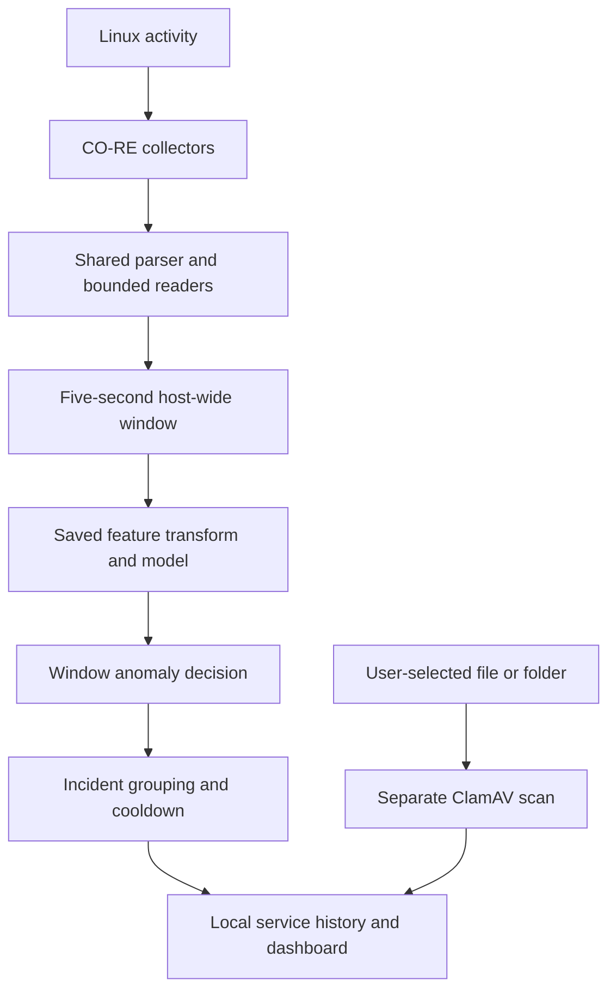

# Sentinel Concepts and Viva Study Guide for Teammates

**Course:** 23AID213 Operating Systems  
**Project:** Sentinel, an eBPF based Linux behavioral intrusion detection research prototype with a separate ClamAV on-demand scanner  
**Team:** Team 2  
**Project facts checked against:** implementation and reports available on 18 October 2026  
**Audience:** A teammate who has little or no prior knowledge of operating systems, cybersecurity, eBPF, machine learning, or the project.

## Start here based on your needs

- **Completely new:** begin at Sections 2–8, then work through windows, features, and ML before the question bank.
- **Need to understand our exact results:** Sections 18–22 and 33 explain experiments and numbers.
- **Want the implementation story:** Sections 23–32 connect OS/software concepts to source and debugging.
- **Want oral practice:** use Section 39 after attempting the worked exercises in Section 37.
- **Viva tomorrow:** follow Section 38 and revise Section 41, while preserving the limitations in Section 34.

## Contents

- [1. How to use this guide](#1-how-to-use-this-guide)
- [2. Understand the project in one minute](#2-understand-the-project-in-one-minute)
- [3. Computer and operating system basics](#3-computer-and-operating-system-basics)
- [4. System calls, file operations, and errors](#4-system-calls-file-operations-and-errors)
- [5. Networking basics needed for Sentinel](#5-networking-basics-needed-for-sentinel)
- [6. Security basics and what an IDS can claim](#6-security-basics-and-what-an-ids-can-claim)
- [7. eBPF from first principles](#7-ebpf-from-first-principles)
- [8. The complete pipeline as a story](#8-the-complete-pipeline-as-a-story)
- [9. Data and labels from the beginning](#9-data-and-labels-from-the-beginning)
- [10. Logs, parsing, and data quality](#10-logs-parsing-and-data-quality)
- [11. Windows and aggregation with worked examples](#11-windows-and-aggregation-with-worked-examples)
- [12. Features and the complete numerical example](#12-features-and-the-complete-numerical-example)
- [13. Logs, scaling, and basic statistics](#13-logs-scaling-and-basic-statistics)
- [14. Machine learning from zero](#14-machine-learning-from-zero)
- [15. Isolation Forest explained](#15-isolation-forest-explained)
- [16. One-Class SVM explained](#16-one-class-svm-explained)
- [17. Other models we compared and why comparison matters](#17-other-models-we-compared-and-why-comparison-matters)
- [18. Training, validation, test, and leakage](#18-training-validation-test-and-leakage)
- [19. Confusion matrices and metrics from basics](#19-confusion-matrices-and-metrics-from-basics)
- [20. The actual experiments in a learnable sequence](#20-the-actual-experiments-in-a-learnable-sequence)
- [21. External datasets and domain mismatch](#21-external-datasets-and-domain-mismatch)
- [22. Local adaptation and the normal-profile union](#22-local-adaptation-and-the-normal-profile-union)
- [23. Live streaming, queues, timing, and failure handling](#23-live-streaming-queues-timing-and-failure-handling)
- [24. Incidents, cooldown, and why fewer notifications do not mean fewer errors](#24-incidents-cooldown-and-why-fewer-notifications-do-not-mean-fewer-errors)
- [25. Dashboard, service, API, and storage from basics](#25-dashboard-service-api-and-storage-from-basics)
- [26. Privilege separation and WSL authorization](#26-privilege-separation-and-wsl-authorization)
- [27. ClamAV and antivirus scanning from basics](#27-clamav-and-antivirus-scanning-from-basics)
- [28. Performance and the meaning of lightweight](#28-performance-and-the-meaning-of-lightweight)
- [29. Testing and QA concepts](#29-testing-and-qa-concepts)
- [30. Packaging, versions, hashes, and reproducibility](#30-packaging-versions-hashes-and-reproducibility)
- [31. Connect concepts to the source files](#31-connect-concepts-to-the-source-files)
- [32. Case studies in debugging and engineering judgement](#32-case-studies-in-debugging-and-engineering-judgement)
- [33. Current facts every teammate should know](#33-current-facts-every-teammate-should-know)
- [34. What you should never say in the viva](#34-what-you-should-never-say-in-the-viva)
- [35. Demonstration understanding and speaking scripts](#35-demonstration-understanding-and-speaking-scripts)
- [36. Optional mathematical depth for stronger questioning](#36-optional-mathematical-depth-for-stronger-questioning)
- [37. Worked exercises with solutions](#37-worked-exercises-with-solutions)
- [38. Study plans and group revision](#38-study-plans-and-group-revision)
- [39. One hundred viva questions with model answers](#39-one-hundred-viva-questions-with-model-answers)
- [40. Glossary for quick lookup](#40-glossary-for-quick-lookup)
- [41. The final revision sheet](#41-the-final-revision-sheet)
- [42. References and further study](#42-references-and-further-study)
- [43. Final self-check before the viva](#43-final-self-check-before-the-viva)

## 1. How to use this guide

This is a teaching guide, not just a list of answers to memorize. It starts with what an operating system does, builds the concepts needed for Sentinel, walks through the actual project, and then gives practice questions, calculations, and revision material. Technical words are explained before they are used heavily. Numerical teaching examples are explicitly marked as illustrations so they cannot be mistaken for experimental results.

You do not need to read the previous 20,000-word project report first. This file contains the core project context and concepts independently. The earlier `SENTINEL_COMPLETE_PROJECT_REPORT_AND_PPT_HANDOFF.md` remains the more exhaustive historical/evidence reference, including exact candidate tables and timestamps.

Learning priorities:

1. Understand the story: what we observe, how we turn observations into numbers, and what the result means.
2. Understand why the design works and where it can fail.
3. Know the real results and their scope.
4. Practice explaining ideas in your own words.
5. Use formulas and implementation details to support the explanation when asked.

An answer that admits a genuine limitation is stronger than a confident unsupported claim. If you cannot remember an exact parameter, explain its role and say you would verify the stored configuration. Do not invent an answer.

### 1.1 Five truths to remember before anything else

- **We detect unusual host-wide Linux activity windows, not confirmed malicious individual processes.**
- **eBPF tools collect observations. The ML model runs in Python userspace.**
- **The deployed models were not trained on ADFA-LD.** The main historical dataset was collected by the team.
- **ClamAV scans file contents separately.** The SVM does not recognize virus signatures in files.
- **The project works as a research demonstration, but false alerts and validation gaps remain.**

## 2. Understand the project in one minute

Imagine a security observer inside a Linux computer. Instead of reading every file's contents, it watches selected kinds of activity: programs executing, files opening, failed file opens, and TCP connection attempts observed by our collectors. Every five seconds, we summarize that activity as a small list of numbers. A model compares the pattern with examples of normal activity it learned earlier. If the pattern looks unusual, we mark that window for review.

One strange window does not immediately create a new incident. We group consecutive strange windows and limit repeated notifications. A dashboard displays activity, incidents, and health. Users can also request a separate ClamAV scan of a file/folder and export local reports.

An unusual pattern may come from a real problem, but also from installing software, compiling a program, or a busy browser. The model does not understand intent. That is why we present alerts as reasons to investigate.

### 2.1 A short answer you can adapt in a viva

> Our project, Sentinel, is a Linux host-based behavioral intrusion detection prototype. We use existing CO-RE eBPF tools to observe process execution, file opens, and TCP connections. Python aggregates those events into five-second host-wide windows and scores them using a saved normal-only anomaly model. Consecutive unusual windows become incidents shown in a local dashboard. We also integrated separate ClamAV on-demand file scanning. The pipeline has been tested end to end, but behavioral false alerts and broader validation remain open.

This answer is deliberately careful. It describes the actual system without claiming that every anomaly is malware.

## 3. Computer and operating system basics

### 3.1 CPU, RAM, storage, and programs

The **CPU** executes instructions. **RAM** holds data and instructions currently being worked on. **Storage**, such as an SSD or HDD, keeps files when power is off. A **program** is a collection of instructions, often stored as an executable file. Running that program creates an active execution context called a process.

A text editor's executable is a program. When you open the editor, it becomes one or more running processes using CPU time, RAM, and files. Modern browsers often use many processes for tabs, rendering, and networking.

Sentinel observes parts of what running software does. It is not a hardware fault detector and does not inspect arbitrary CPU instructions.

### 3.2 What the operating system does

An **operating system**, or OS, manages resources and provides services to programs. It schedules CPU time, manages memory, controls access to files/devices, implements networking, and enforces permissions.

Why is an OS necessary? If every application could directly overwrite arbitrary memory or control a storage device without checks, applications could interfere with each other and the system would be unreliable. The OS provides controlled interfaces and isolation.

Linux is the OS environment monitored by this project. Ubuntu is a Linux distribution: Linux plus system utilities, package management, libraries, and default applications. Windows is a different operating-system family with different kernel instrumentation mechanisms.

### 3.3 Kernel and userspace

The **kernel** is the privileged core of the OS. It manages protected resources and services. **Userspace** contains ordinary applications and libraries, including our Python process and dashboard renderer.

Analogy: applications are people requesting services; the kernel is the controlled service authority. An application requests a file operation through an allowed interface rather than directly manipulating the disk controller.

This analogy has limits. The kernel is software executing on the same computer, not a separate remote machine. A kernel/userspace distinction is about privilege and interfaces, not physical distance.

**Sentinel connection:** upstream eBPF programs observe kernel-side events. Collector userspace components deliver observations. Our aggregation, ML, SQLite history, HTTP server, and GUI logic run outside the kernel.

### 3.4 User mode and kernel mode

Processors provide privilege mechanisms that let an OS restrict operations. Ordinary application code normally runs with fewer privileges. A controlled transition allows the kernel to handle a protected request.

Do not confuse **user mode** with “an account that is not root.” A program launched by root still executes ordinary application instructions in userspace and uses system calls to request kernel services. Root is an account/authorization concept; CPU execution mode is another concept.

### 3.5 A process is more than a program file

A process includes a running program's address space, execution state, resource handles, identity, and related OS bookkeeping. Its **PID**, or process ID, identifies it in a particular process namespace. A **PPID** identifies its parent process.

Two instances of the same executable can have different PIDs. The same PID number can later be reused after the earlier process exits. A PID is not a permanent software identity and not a cryptographic identity.

**Sentinel connection:** evidence can display PIDs and command names, but the numeric classifier does not use PIDs as its seven features. The authorization helper combines a process ID with its start time to avoid confusing a recycled PID with the original subject.

### 3.6 Threads

A **thread** is an execution flow within a process. Threads commonly share the process's address space and other resources while having their own execution state. A browser may have networking, rendering, or worker threads.

A thread's displayed name can contain spaces. That mattered to us because a parser that assumed a command name was one whitespace token misread real logs.

Do not equate the count of observed execution events with the total number of running threads or total new processes. Executing a new program image and creating a process/thread are related but different operations.

### 3.7 Scheduling and context switches

The OS scheduler selects runnable threads for CPU time. A **context switch** saves the execution state of one scheduled task and restores another's. A system call is a request to the kernel and involves a privilege transition, but does not necessarily cause the CPU to switch to a different scheduled process.

This distinction is a common viva trap: **mode switch and process context switch are not identical**.

Sentinel reader/worker threads can be scheduled at different moments. This is one reason events may arrive with timing differences even when the underlying activity occurs close together.

## 4. System calls, file operations, and errors

### 4.1 What a system call is

A **system call**, or syscall, is a controlled interface through which application code requests a kernel service. Examples include opening a file, reading from a file descriptor, creating/executing processes, and operating on sockets.

Conceptual path:

```text
Your application wants to open a file
    -> a userspace library provides an interface
    -> a relevant system call requests the operation
    -> the kernel checks and performs the operation
    -> the application receives a result or error
```

One high-level application action can involve many syscalls. Not every library function is a syscall. Some library work happens entirely in userspace, while one library call can invoke one or more kernel interfaces.

### 4.2 Why system activity can help security monitoring

Software interacts with the OS to execute programs, access files, and use networks. These interactions provide observations of behavior. However, behavior does not reveal intent automatically. Both a backup utility and a malicious program may access many files.

A syscall/event trace is evidence of operations visible at the selected observation points. It is not a complete explanation of a person's intentions or a guarantee that a malicious action is distinguishable from a benign one.

### 4.3 What a file descriptor is

When a process successfully opens a file, the OS typically gives it a small integer called a **file descriptor**, or FD. The integer refers to an open resource in that process's descriptor table. The process can use it for later operations without resupplying the path every time.

For example, an open may return FD 3. Another process can also have FD 3 referring to a different resource. An FD is not a global file ID and is not a count of how many files are open.

Standard input, output, and error are conventionally associated with descriptors 0, 1, and 2. Sockets and other resource types can also be represented by descriptors.

### 4.4 Failed file opens

An attempt to open a file can fail because the file does not exist, permission is denied, or another error occurs. User-facing APIs often indicate failure with a negative/error result and expose an error code; exact kernel/tool conventions differ.

In our opensnoop text format, FD can be **-1** for a failed open and ERR identifies the error. The parser must not discard -1 as impossible. Our feature `n_open_errors` counts observed opens with a nonzero error field.

Why does that matter? Repeated missing-file or access-denied activity may be unusual. But normal software also probes for optional files or denied locations. Open errors are a useful signal, not proof of an intrusion.

### 4.5 Path versus content

A **path** identifies where a file is addressed, for example `/home/example/notes.txt`. **Content** is the data stored in the file. Observing that a process opened a path is different from reading its bytes and scanning them.

Our behavioral numeric features use counts and distinct values, not file-content antivirus signatures. The separate ClamAV component reads selected files for scanning. Live explanation samples can include paths, so those samples can still reveal personal information even without storing file contents.

## 5. Networking basics needed for Sentinel

### 5.1 IP addresses, ports, and sockets

An **IP address** identifies a network endpoint/address within the relevant network setup. A **port number** helps distinguish services or communication endpoints at a host. A **socket** is an OS communication abstraction used by applications.

Analogy: the address identifies a building and the port identifies a service entrance. Real networking has routing, address translation, namespaces, and other details beyond this analogy.

The project records source/destination addresses and a destination port from the selected TCP collector. Its seven-input model includes connection count and distinct destination-address count. It does not include every port, packet payload, or byte count as separate features.

### 5.2 TCP and UDP

**TCP** provides a connection-oriented transport with reliability mechanisms. **UDP** sends datagrams without TCP's connection establishment and ordered reliable-stream model. Both are used by normal applications; neither protocol by itself means malicious activity.

Sentinel's TCP feature cannot be filled by counting arbitrary UDP events. This distinction was crucial in the external LID-DS trial: the observed connect exits were identified as UDP, so counting them as TCP would have changed the feature's meaning.

Do not say every socket uses TCP, every connect-like event represents a successful unique TCP connection, or every TCP event is external internet traffic.

### 5.3 Loopback and localhost

**Loopback** communication sends traffic to the local machine's own network stack; `127.0.0.1` is the IPv4 address used by our local UI. A connection to the app's local server can appear in monitored Linux TCP activity.

Local traffic can therefore be real telemetry even though it never leaves for an internet server. The project explicitly labels connection counts as including local connections.

### 5.4 Event count versus destination diversity

**Illustrative example:** a window contains six observed TCP connects: four to address A and two to address B. Then `n_tcp_connect = 6` and `n_unique_daddr = 2`.

If A is contacted on several ports, it is still one distinct destination address for this feature. The bounded explanatory samples may show address-and-port text, but that does not change the numeric feature definition.

### 5.5 Why our own dashboard created network noise

The dashboard repeatedly requests updated state from a local HTTP server. If every poll creates a new connection, the monitor sees additional TCP activity caused by itself.

We changed the server to reuse browser connections through HTTP/1.1 keepalive and correct response framing. A short sequential check showed dashboard-related idle TCP observations falling from about 10.96 per window to zero. We reduced unnecessary activity instead of hiding it behind a broad whitelist. This was not a complete network/CPU overhead benchmark.

## 6. Security basics and what an IDS can claim

### 6.1 Threat, vulnerability, exploit, and malware

A **threat** is a potential source/event of harm. A **vulnerability** is a weakness that may be used to cause harm. An **exploit** uses a weakness. **Malware** is software designed for malicious purposes.

These are different concepts. A suspicious file-access pattern is not automatically malware. An enumeration command is not proof that privilege escalation succeeded. A simulated attack phase is a controlled workload intended to resemble selected behaviors, not necessarily an actual compromise.

### 6.2 Host based versus network based monitoring

A **host-based IDS** observes activity associated with a machine or execution environment. A **network-based IDS** focuses on network traffic passing an observation point. A host system can include network-related events without becoming a packet-inspection network IDS.

Sentinel is host based because it combines Linux execution, file, and connection observations. It is not a full packet capture/deep packet inspection tool.

### 6.3 IDS versus IPS

An **IDS** detects and reports potential problems. An **IPS** additionally attempts prevention, such as blocking an operation. Sentinel reports anomalies and scanner findings. It does not automatically block processes or quarantine files.

There are practical reasons: incorrect automatic action can disrupt legitimate work. We have measured false alerts, so treating every flag as authorization to stop a program would be especially inappropriate.

### 6.4 Signatures and behavioral anomalies

A **signature** is a recognisable pattern associated with known unwanted content or activity. A behavioral anomaly model learns patterns of normal measurements and identifies departures. Signature and behavioral methods are complementary; neither is universally sufficient.

An unfamiliar attack may evade known signatures, but a behavioral model can also miss it if its measured pattern looks normal. A legitimate software update may look anomalous. Avoid the claim “signatures cannot detect any new malware, so our model detects all zero-days.” Neither half supports that conclusion.

### 6.5 A threat model

A **threat model** states what kinds of unwanted behavior a system aims to observe and the assumptions it relies on. Our selected channels are relevant to execution/file/network behavior. We assume an appropriately functioning Linux observation environment and trusted installed collector/model code.

A powerful attacker controlling the kernel, or attacks outside the selected channels, are not solved merely by using eBPF. The project has not proved resistance to advanced evasion, root compromise, or arbitrary adversarial inputs.

## 7. eBPF from first principles

### 7.1 What eBPF contributes

eBPF is a Linux mechanism for attaching constrained programs to supported event paths, including tracing-related uses. For Sentinel, upstream tools provide selected kernel visibility. The application does not need to patch the kernel or implement its own traditional kernel module.

The important architecture is:

```text
Kernel-side observation -> upstream userspace collector -> our Python pipeline
```

Do not say eBPF is our ML algorithm or that the saved SVM executes inside the kernel. It supplies observations for userspace analysis. The [kernel BPF documentation](https://docs.kernel.org/bpf/) provides the official background.

### 7.2 Verifier, JIT, maps, and event buffers

The **verifier** checks an eBPF program before it is accepted for execution, including constraints on operations and memory use. **JIT**, or just-in-time compilation, can translate accepted BPF instructions into native machine instructions. **Maps** provide structured data storage/communication used by BPF programs. Event delivery mechanisms move observations to userspace.

These are background concepts. The team reused upstream collectors rather than designing every map or buffer layout from scratch. Verification reduces important classes of unsafe behavior; it does not prove an entire deployed monitoring application is bug-free or has zero overhead. See the [official verifier documentation](https://docs.kernel.org/bpf/verifier.html).

### 7.3 Tracepoint and kprobe concepts

A **tracepoint** is a predefined instrumentation point. A **kprobe** is a mechanism for instrumenting eligible kernel function execution points. Different upstream tools/versions can attach at different suitable hooks.

For the viva, explain the concept without inventing an exact hook for a binary you have not inspected. Our saved project evidence identifies the actual tool binaries and schemas; we did not author a new custom kernel-hook system.

### 7.4 Why kernel layout matters

A program observing kernel structures needs the correct interpretation of relevant fields. Kernel versions can change layouts. An early attempt with classic BCC tools runtime-compiling against headers encountered a structure-layout assertion mismatch on the documented native kernel.

**CO-RE** means Compile Once Run Everywhere: in this context, build an eBPF object with relocation information that can be adapted to compatible target kernel layouts using type metadata. **BTF**, BPF Type Format, supplies relevant type information. **libbpf** is the userspace library supporting loading and related operations.

CO-RE improves portability, but it does not mean one binary works on every imaginable OS/kernel. Required kernel features, types, privileges, and supported tool behavior still matter. The project checks `/sys/kernel/btf/vmlinux`. The [official libbpf overview](https://docs.kernel.org/bpf/libbpf/libbpf_overview.html) explains this ecosystem.

### 7.5 BCC tools versus native CO-RE tools

Names such as execsnoop exist in different implementations. A Python/BCC script and a native libbpf tool can differ in startup requirements, columns, options, and output semantics. Matching a filename alone does not establish parser compatibility.

Our application expects the reviewed native CO-RE variants of execsnoop, opensnoop, and tcpconnect. WSL collectors were recorded as built from upstream BCC v0.35.0 at a specific saved commit. The team integrated existing tools; that is valid engineering work and should be described honestly.

## 8. The complete pipeline as a story

### 8.1 Follow one ordinary action

**Illustrative example, not a captured incident:** a user starts a command that opens files and contacts a local service. Relevant selected events are observed by our tools. The parser turns text into typed fields such as numbers and strings. The current window increments execution/open/connection counters and updates distinct-value sets.

After the five-second window is complete, it produces seven schema values. A saved pipeline derives eleven model inputs, standardizes them where required, and computes a normality score. If the score is below the saved cutoff, that window is anomalous. The incident grouper considers neighboring windows. The service stores relevant incidents/health and the dashboard polls for an updated display.

No step in this story establishes that the user performed a malicious action. It is a measurement and review workflow.

### 8.2 Architecture diagram



The arrow from ClamAV is a separate path into reporting, not input into the behavioral SVM. The diagram does not mean the frontend directly executes privileged collectors.

### 8.3 Offline, replay, and live

**Offline analysis** works on saved data. **Replay** feeds historical data through scoring again, possibly faster than real time. **Live monitoring** consumes observations being produced now.

Sentinel has two relevant replay forms: saved raw logs can be reaggregated; the packaged demo already contains 600 historical feature windows. In the packaged replay, the model still computes predictions now, but the underlying activity happened earlier. Faster playback does not mean the live detector has a shorter five-second observation window.

The original module called `live_pipeline.py` replayed logs. Later code in `inference/streaming.py` implemented real live ingestion. Names alone are not evidence of real-time operation.

## 9. Data and labels from the beginning

### 9.1 What a dataset is

A dataset is an organised collection of examples used for analysis. An **event row** describes one observation. A **window row** summarises multiple observations over an interval. A **session** is a recording run with its own origin, activity, and boundaries.

Those units are different. Sixteen million raw lines do not mean sixteen million independent ML training examples. Our corrected native feature table has 2,522 window rows.

### 9.2 What the team collected

Two accepted native Ubuntu sessions were recorded on the dedicated Lenovo IdeaPad: one with idle/light baseline, another with browsing/media baseline. Each planned a sixty-minute normal phase followed by three fifteen-minute scripted phases: reconnaissance, privilege-related enumeration, and suspicious file-access patterns.

| Quantity | Recorded scope |
|---|---|
| Accepted native sessions | 2 |
| Planned duration per native session | Approximately 105 minutes |
| Raw lines across tools | 16,324,159 |
| Tool header lines | 6 |
| Malformed rows rejected | 24 |
| Accepted event rows by parser counters | 16,324,129 |
| Corrected five-second feature rows | 2,522 |

These are selected-channel observations, not a recording of every syscall on the machine. The original capture machine and later WSL deployment are different environments.

### 9.3 Why labels are useful even for normal-only learning

A **label** describes the class/phase assigned to an example. We know when the collection script scheduled baseline and simulation phases, so timestamps can associate events/windows with those phases.

The main anomaly models fit only baseline training examples. We still need phase labels to choose baseline rows and to evaluate whether simulation-phase windows were flagged. Thus “normal-only estimator” does not mean the whole research process used no labels anywhere.

The phase label is not an input feature. Feeding `phase = attack_recon` into the classifier would leak the answer.

### 9.4 Labels are assumptions about the recording

Normal applications continue to run during a scripted attack phase. A phase labelled attack does not prove every event in that interval is malicious. A requested-idle phase can contain background maintenance. A presumed-normal user session is not a verified malware-free forensic sample.

For the viva, say “simulated attack windows” rather than “all confirmed malware events.” This is more accurate and demonstrates understanding of ground-truth limitations.

### 9.5 Why an initial session was rejected

An early collector ran an external `date` process to timestamp each captured row. That process itself created an execution event, which demanded another timestamp, creating a feedback loop. The execution log became dominated by the logger's own activity.

The fix used a non-forking shell timestamp. The contaminated session was excluded. This is an **observer effect**: measuring a system can change the system. The later local-dashboard TCP issue is another example.

## 10. Logs, parsing, and data quality

### 10.1 Parsing means turning text into meaning

A raw line is a sequence of characters. The parser decides which characters represent a timestamp, PID, command name, error, path, address, or port. If it guesses incorrectly, every later numeric feature can be wrong even though the model itself runs without error.

Our historical line format has one leading timestamp separator:

```text
timestamp,native tool output with spaces and possibly more commas
```

Split once at the first comma, not at every comma. Treat the remaining text according to the tool's schema.

### 10.2 Why splitting on whitespace can fail

**Illustrative row:**

```text
100 Socket Thread -1 13 /tmp/example file.txt
```

`Socket Thread` can be one command name and `/tmp/example file.txt` can be one path. A naive split would shift field positions. Headers such as PID/COMM are not actual process events. Numeric text in paths is not automatically a descriptor/error field.

The project uses a shared parser and tests for these cases. This illustrates **data validation**: check that input has the expected structure and that important numeric ranges are plausible, rather than silently forcing bad text into numbers.

### 10.3 Missing, zero, and malformed are different

Zero means we observed no relevant events in a valid interval. Missing means the measurement is unavailable. Malformed means available input could not be interpreted correctly. They must not all become zero.

Suppose a TCP collector crashes. Filling future TCP counts with zero would make an incomplete system look quiet. Our live monitor reports the failure instead of presenting a normal-looking score from incomplete input.

### 10.4 Multiline command arguments

A legitimate command can contain newline characters in its arguments. Without escaping, one event may be printed across multiple lines and look like malformed separate events. Native execsnoop's `--quote` option was added so argument newlines are escaped and one observation remains one row.

This fix improved ingestion reliability; it did not improve ML accuracy directly by changing the selected seven feature definitions.

### 10.5 Why chronological order matters

An incremental replay expects each source stream to be in nondecreasing timestamp order. Otherwise an event might appear after its window has already been scored. The raw replay rejects reversed timestamps rather than silently using the wrong interval.

Historical timestamps are userspace receipt times. They are not guaranteed to be the precise instant of the kernel action. That timing assumption is part of interpreting all later results.

## 11. Windows and aggregation with worked examples

### 11.1 Why aggregate events

Millions of raw rows are too detailed for our chosen model representation. A window groups events over a fixed interval and summarises them. This reduces data volume and represents short-term behavior as a manageable vector.

The cost is lost detail. If you keep only counts, event order disappears. Two very different action sequences can have the same counts. A window summary is a deliberate representation choice, not a complete behavioral transcript.

### 11.2 Five seconds and one shared origin

The origin is the earliest valid event across all three selected streams in a session. If the origin is `t0`, event time is `t`, and window length is `W = 5`:

```text
index = floor((t - t0) / W)
```

`floor` means round down to the integer below or equal to a value. Indices begin at zero.

**Illustration with t0 = 100:**

| Event time | Calculation | Window index |
|---:|---|---:|
| 100.0 | floor(0/5) | 0 |
| 104.9 | floor(4.9/5) | 0 |
| 105.0 | floor(5/5) | 1 |
| 109.9 | floor(9.9/5) | 1 |
| 115.0 | floor(15/5) | 3 |

The conceptual intervals are [100,105), [105,110), [110,115), and so on. The bracket includes the starting value; the parenthesis excludes the ending value. Phase-label interval conventions are a separate detail and should not be confused with this indexing formula.

### 11.3 Why all streams need the same origin

Suppose execution events start at time 100 but the first observed TCP event is at 103. If each stream starts its own five-second clock, its “window zero” describes different intervals. Combining those values would be misleading.

Using one origin aligns process, file, and TCP activity for the same interval. Our corrected pipeline fixed this class of problem.

### 11.4 Empty and partial windows

If nothing relevant happens between 110 and 115, that interval can still be a valid zero-count window. Skipping it would remove real idle time and make the time axis irregular.

A **partial window** at live shutdown has not finished its full five seconds. Comparing it directly with complete training windows can distort counts. Live monitoring discards unfinished end windows and reports the discard. Historical raw replay's last observed interval is handled differently; later evaluation removes ambiguous edges. Do not claim every offline/live edge policy is identical.

### 11.5 Fixed windows versus sliding windows

Our principal design uses consecutive nonoverlapping five-second intervals. A **sliding window** would move in smaller steps and overlap observations, for example a five-second span updated every second. That might change responsiveness and correlation, but it is not the current numeric model's established evaluation protocol.

Window duration is a design choice stored with the model. Changing it changes feature distributions and needs reevaluation; it is not just a harmless dashboard setting.

## 12. Features and the complete numerical example

### 12.1 What a feature is

A **feature** is a numerical description given to a model. A **feature vector** is an ordered list of those numbers for one example. Think of it as the model's measured view of the world.

If the view omits something essential, the model cannot recover it merely by being more complicated. If two examples have identical feature vectors, a deterministic classifier using only those vectors cannot know they came from different hidden situations.

### 12.2 Our seven schema inputs

| Name | Plain-language meaning |
|---|---|
| n_exec | Observed execution-event count |
| n_unique_pcomm | Distinct execution command names, not distinct PIDs |
| n_open | Natural log of one plus observed open count |
| n_unique_paths | Natural log of one plus distinct observed paths |
| n_open_errors | Opens with nonzero error |
| n_tcp_connect | Observed TCP connect count, including local connections |
| n_unique_daddr | Distinct destination IP addresses, ignoring port in this distinct count |

The model expects exactly this order. If the same seven values are rearranged, their meanings change. A feature schema is like the column labels and units on a laboratory measurement sheet.

### 12.3 Count and distinct count

**Illustration:** ten opens of the same file mean an open count of ten and a unique-path count of one. Four execution events named `python`, `python`, `bash`, and `python` mean an execution count of four and a distinct command-name count of two.

Distinct command names are not the same as distinct programs by cryptographic hash. Names can repeat, be shortened, or have other ambiguities. They are an aggregate observable, not a secure identity.

### 12.4 A full illustrative window

Assume a five-second window has:

```text
Executions E = 8
Distinct execution names P = 3
Opens O = 20
Distinct paths U = 5
Open errors R = 4
TCP connects C = 6
Distinct destination addresses D = 2
```

These numbers are an educational example, not an actual labelled attack sample. The seven schema values are approximately:

```text
[8, 3, 3.044522, 1.791759, 4, 6, 2]
```

Why are the third and fourth numbers decimals? `n_open = ln(21)` and `n_unique_paths = ln(6)`, because the schema already compresses those two counts with `log1p`.

The selected SVM derives eleven model inputs:

```text
log1p(E)           = ln(9)       = 2.197225
log1p(P)           = ln(4)       = 1.386294
log1p(O)           = ln(21)      = 3.044522
log1p(U)           = ln(6)       = 1.791759
log1p(R)           = ln(5)       = 1.609438
log1p(C)           = ln(7)       = 1.945910
log1p(D)           = ln(3)       = 1.098612
R / (O + 1)        = 4/21        = 0.190476
U / (O + 1)        = 5/21        = 0.238095
P / (E + 1)        = 3/9         = 0.333333
C / (D + 1)        = 6/3         = 2.000000
```

The added one avoids division by zero and stabilises small denominators. Because of that smoothing, call these ratios/rates rather than exact unsmoothed percentages. Connections per destination can exceed one; not every derived value is a probability between zero and one.

### 12.5 Why seven and eleven are both correct

The public input schema has seven fields. A stateless preprocessing function turns them into eleven numerical inputs for the selected model pipeline. Saying “seven base features and eleven derived model inputs” resolves the apparent contradiction.

The model is not given the phase label, session ID, file contents, or process names as eleven additional hidden predictors. The bounded display context is kept separate from the model's numeric vector.

## 13. Logs, scaling, and basic statistics

### 13.1 What a logarithm does

A logarithm compresses a large range of positive magnitudes. `log1p(x)` means `ln(1 + x)`, using the natural logarithm. It is zero when x is zero and grows more slowly than x.

For example, counts of 10 and 10,000 differ by a factor of 1,000. Their `log1p` values are approximately 2.398 and 9.210. The difference is still present, but huge raw counts are less dominant.

The transformation does not remove all outliers, prove normality, or make the values “accurate.” It changes how differences are represented. The inverse `expm1(y)` computes `exp(y) - 1` to reconstruct a raw count when needed.

### 13.2 Mean and standard deviation

The **mean** is the arithmetic average. The **standard deviation** measures spread around the mean. A feature whose typical values are in thousands has a different numerical scale from a ratio around 0.1.

**Standardization** commonly transforms a value x using training mean mu and training standard deviation sigma:

```text
z = (x - mu) / sigma
```

Illustration: if a fitted feature has mean 10 and standard deviation 2, a value 14 becomes z = 2. It is two standard deviations above that training mean. This does not automatically mean it is malicious or that all features follow a bell-shaped distribution.

### 13.3 Standardization versus normalization

People sometimes use “normalization” loosely. StandardScaler specifically centres/scales features using fitted training statistics. Scaling values into [0,1] is a different procedure. We should say exactly what our pipeline does rather than using the terms interchangeably.

The selected SVM uses StandardScaler after the eleven-input transform. Our IF candidate pipelines do not all use the same scaler; algorithms and pipelines differ.

### 13.4 Why fitting the scaler on test data is leakage

If test rows help determine the mean/spread used by the model, the supposedly unseen dataset has already influenced the system. Even without using test labels, that can make evaluation less independent.

Our selected historical SVM fits preprocessing statistics only on normal training rows. It then applies those fixed statistics to validation/test/live examples. A saved pipeline preserves that exact procedure.

### 13.5 Correlation is not causation

Two measurements can rise together because of a shared cause, without either causing the other. During updates, process executions and file opens may both rise. An observed process in a flagged window is not proof it caused a malicious action.

Our explanations describe observations. They do not provide a causal proof or a formal feature-attribution algorithm such as SHAP.

## 14. Machine learning from zero

### 14.1 What learning means here

Instead of hand-writing every rule, an ML algorithm fits parameters from examples. A **model** is the fitted object used to score new inputs. **Training** fits those parameters; **inference** applies the fitted model.

The system does not learn every time the dashboard refreshes. Loading the saved bundle and running predictions is inference. Our deployed application does not autonomously retrain itself on current traffic.

### 14.2 Supervised versus unsupervised versus novelty detection

In **supervised learning**, examples include target labels such as normal/known simulation, and the model learns to predict them. In broad **unsupervised learning**, the algorithm finds structure without those target labels. **Novelty detection** fits expected/normal examples and asks whether a new example lies outside that learned behavior.

Our main deployed estimators are normal-only novelty detectors. We use known baseline phases to select normal training rows, so the full research workflow is not free from human labelling assumptions. Some comparison candidates were explicitly supervised on known simulations, and their results have that narrower scope.

### 14.3 Training examples versus rules about the world

If training shows normal windows with few executions and modest file activity, the model can learn that region. A later legitimate compiler workload may be far outside it. The model has not learned “all benign software”; it has learned a statistical representation of its examples.

This is why representative data matters as much as the choice of algorithm. “We used AI” is not an explanation of accuracy or generalisation.

### 14.4 Parameters and hyperparameters

**Parameters** are values fitted from training, such as support-vector-related quantities or tree structure. **Hyperparameters** are settings chosen around training, such as SVM gamma/nu or the number of IF trees.

The anomaly **threshold** is the cutoff used to turn a score into a flag. In our workflow it is separately calibrated using normal validation data. It is not always identical to a model library's built-in zero/default decision boundary.

### 14.5 Overfitting and underfitting

**Overfitting** means capturing peculiarities of development examples so well that unfamiliar examples are handled poorly. **Underfitting** means the representation/model is too limited to capture useful patterns even in the intended setting.

A model can appear excellent on repeatedly examined scripted history yet fail new stress workloads. Our first adaptation round provided exactly that warning. More complexity is not automatically better; neither is a quieter model.

### 14.6 Generalisation

Generalisation means useful performance on relevant unseen conditions. “Unseen rows from the same repetitive run,” “a new recording on the same host,” and “a different device/workload” are increasingly different tests. They are not interchangeable.

The project has strong evidence of component operation and reproducibility on saved inputs, but limited evidence of broad generalisation. That is a scientific limitation, not something a dashboard can solve.

## 15. Isolation Forest explained

### 15.1 Intuition

Imagine points on a sheet representing activity windows. A dense cluster contains many typical examples. An isolated point is alone far away. Repeated random cuts often separate the isolated point in fewer steps than a point embedded among many neighbours. Isolation Forest builds many such random-partition trees and combines path-length information to score examples.

The official [IsolationForest reference](https://scikit-learn.org/stable/modules/generated/sklearn.ensemble.IsolationForest.html) describes the estimator. The following examples are teaching illustrations rather than project measurements.

### 15.2 A small example

Suppose normal examples have execution counts around 1–10 and TCP counts around 0–4. A point with execution count 200 and TCP count 500 may be isolated by a small number of random cuts. A point around [5,2] tends to remain near other examples through more cuts.

Real feature spaces have more dimensions, and unusual benign activity can also be isolated. IF detects statistical isolation, not criminal intent.

### 15.3 Why a forest

One random tree can give a noisy result. Combining many trees reduces dependence on one set of random cuts. More trees can improve stability but require more computation/storage. A fixed random seed helps reproduce an experiment; it does not make the model scientifically valid by itself.

Our historical candidates varied tree/sample settings. The fair historical reference used 200 trees with a fixed seed. IF was initially favoured because of high scripted recall, but the corrected experiments revealed substantial normal workload-transfer errors.

### 15.4 Score and contamination

In our scoring interface, lower normality scores indicate more unusual observations. The original IF paper's anomaly-score convention and a software library's returned score can have different orientation, so always state the actual interface.

The library's contamination setting helps determine its default decision threshold. It does not mean the software discovers the true percentage of malware or deletes that percentage of training examples. The project also uses explicit saved/calibrated thresholds in several protocols.

### 15.5 Why IF was not the final installed choice

On the fair 600-window historical comparison, the reference IF detected 248/248 simulated windows but falsely flagged 21/352 normal windows. The selected SVM detected 246/248 and falsely flagged 9/352. We chose a normal-only SVM under a declared validation rule, accepting a small measured recall tradeoff for fewer normal flags. Later local adaptation built on that reference SVM, rather than claiming IF was intrinsically bad.

## 16. One-Class SVM explained

### 16.1 Start with a normal region

One-Class SVM, or OCSVM, learns a boundary describing the fitted normal examples. A new example outside the learned region can receive a lower normality score. Unlike an ordinary two-class classifier, it does not need examples from every attack class to fit its main boundary.

The precise estimator settings and parameter definitions are documented in the [OneClassSVM reference](https://scikit-learn.org/stable/modules/generated/sklearn.svm.OneClassSVM.html). Our examples below explain how to reason about the project rather than defining a universal good configuration.

### 16.2 Why a kernel

A straight-line boundary may be too simple for normal examples arranged in a curved region. A **kernel** provides a way to compute similarities corresponding to a richer feature representation without explicitly writing every transformed coordinate. This is often called the kernel trick.

The RBF kernel, radial basis function kernel, measures similarity based on distance:

```text
K(x, y) = exp(-gamma * ||x - y||^2)
```

Here x and y are two feature vectors. `||x - y||^2` means sum of squared coordinate differences. `exp` is the exponential function. Gamma is a positive scale setting. When the vectors are close, similarity is high; when farther apart, it decreases.

Illustration with gamma = 0.1: squared distance 0 gives similarity 1; squared distance 10 gives exp(-1), approximately 0.368. This is a similarity value, not a malware probability.

### 16.3 Gamma

A larger gamma makes similarity fall faster with distance and can produce more local/detailed boundaries. A smaller gamma gives points a broader influence. The effect on false alerts depends on data, scaling, fitting, and threshold; there is no universal statement that increasing gamma always improves detection.

Our selected original SVM uses gamma = **0.1**. Scaling matters because a very large numerical feature would otherwise dominate distances.

### 16.4 Nu

Nu controls a training tradeoff associated with allowed boundary violations/support vectors. Its theory relates to training errors and support-vector fractions under the estimator's assumptions. It is not a promise that exactly nu percent of future normal observations will be flagged.

Our selected original SVM uses nu = **0.02**. The local SVM inside the installed union uses nu = **0.01**. A separate empirical validation threshold controls the app's anomaly decision.

### 16.5 Support vectors

Support vectors are training examples that contribute to defining the fitted boundary/decision function. They are not a hand-selected collection of malicious samples. The model uses them to evaluate new feature vectors after training.

You do not need to derive the optimisation problem for a basic viva. You should be able to explain normal-only fitting, nonlinear similarity, scaling, and the difference between model score and calibrated cutoff. An optional mathematical appendix appears later.

### 16.6 The actual original pipeline

```text
Seven ordered schema fields
    -> stateless eleven-input conversion
    -> StandardScaler fitted on normal training rows
    -> RBF One-Class SVM, gamma 0.1, nu 0.02
    -> normality score
    -> flag if score < 0.734708821911347
```

That final number belongs to this saved model and score definition. Do not reuse it for an arbitrary refitted SVM. Do not say every negative score means anomaly: this implementation explicitly compares against its stored threshold.

### 16.7 Why SVM still makes false alerts

The normal region depends on the training representation. A legitimate activity pattern absent from normal training can fall outside it. An unwanted pattern resembling accepted normal activity can lie inside it. The kernel does not provide hidden knowledge about intent.

The project's goal was to evaluate and improve this behavior, not assume the algorithm removes the problem.

## 17. Other models we compared and why comparison matters

### 17.1 Local Outlier Factor

Local Outlier Factor, LOF, compares how densely an example sits among nearby training examples relative to its neighbours. A point can be unusual relative to its local neighbourhood even if the global dataset has several different densities.

In novelty mode it fits a reference representation and evaluates new examples. The setting matters: different LOF usage modes are not interchangeable. Our candidate sweeps used novelty detection. LOF was compared, but it is not the final installed local detector.

### 17.2 Decision trees and forests

A decision tree applies a sequence of feature tests, conceptually such as “is this value above a learned split?” A supervised classifier chooses structure using labelled training examples. A Random Forest combines many trees trained with randomness. Extra Trees introduces a different form of randomised tree-split construction. Combining trees can reduce reliance on one tree's idiosyncrasies.

These models can represent useful nonlinear relationships, but if they train on known scripted simulations their evidence concerns those labels. They do not become normal-only anomaly detectors merely because the data are security data.

### 17.3 Logistic regression

Despite its name, logistic regression is commonly used for classification. It learns a score from a weighted combination of input features and transforms it to a class-probability model. Its simplicity can make it a useful baseline.

A predicted class probability still depends on training and calibration assumptions. It is not automatically a real-world probability of malware on a new device. Our deployed anomaly score is not a logistic-regression probability.

### 17.4 Gradient boosting

Boosting combines models sequentially, with later stages correcting aspects of earlier errors. Our first WSL adaptation selection chose a histogram gradient-boosting classifier. It looked excellent on historical metrics but missed most new TCP stress windows and all file/error stress windows, so we rejected it.

The lesson is methodological: the most attractive score in a familiar dataset can fail to capture the behavior we want under fresh conditions.

### 17.5 Why not use deep learning just because it sounds advanced

More complex models usually require suitable data, evaluation, and operational justification. With limited sessions and aggregate features, a deep model can still learn the same narrow patterns or overfit. Our contribution is not a newly invented neural architecture. A small, inspectable baseline and rigorous comparison can be more valuable than unnecessary complexity.

## 18. Training, validation, test, and leakage

### 18.1 The three jobs

**Training data** fit the model and fitted preprocessing. **Validation data** help choose settings/cutoffs/candidates. **Test data** evaluate the frozen selected system afterward.

Analogy: study material, practice exam used to adjust preparation, and a final exam you have not used to choose answers. If you repeatedly examine the final exam and adapt your method to it, it has become development material.

### 18.2 Data leakage

Leakage happens when information that should be unavailable at the intended prediction/evaluation stage influences fitting or selection. Examples include:

- Fitting the scaler on test rows.
- Selecting a model because it had the best final test score.
- Randomly splitting near-identical adjacent windows across train/test and claiming independence.
- Feeding phase labels or saved predictions into the feature vector.
- Duplicating the same session into differently named partitions.

The code can execute correctly while the experiment is misleading. Software testing and evaluation design address different kinds of correctness.

### 18.3 Why whole sessions are preferable

Adjacent windows often share workloads and background conditions. A random row split can put almost the same repeated behavior in both training and test. Separating whole recordings, later days, or devices tests a more meaningful change of conditions.

Our session-separated training infrastructure requires nonempty disjoint train/validation/test session IDs. With only two original native sessions, we could not fill all three roles with genuinely separate real native recordings.

### 18.4 The historical blocked workaround

The project therefore ran a clearly labelled exploratory experiment using the first 50%, next 25%, and last 25% of each phase/session for train/validation/test. It removed two windows at phase edges and around internal boundaries.

This **embargo** creates temporal gaps to reduce immediate overlap/transition ambiguity. It does not make repetitive workloads independent. Both normal profiles appear in each partition, which helps the model learn them but is easier than transfer to a genuinely unfamiliar profile.

The chosen SVM fitted 712 normal training windows. Validation contained 598 total retained windows. Testing contained 600: 352 normal and 248 simulated-attack windows.

### 18.5 What “held out” actually means

The test blocks were excluded from selection in that particular run. The underlying recordings had already been examined earlier. Consequently, they were not an untouched independent research dataset in the strongest sense.

If asked, say: “We reserved chronological test blocks within that experiment, but disclose that the two historical sessions had been examined before. Independent new-session/device validation remains limited.”

### 18.6 Calibration

Calibration here means choosing a threshold from normal validation scores at a desired empirical false-alert target. It does not refit the scaler on validation or train the SVM on attack validation rows.

**Illustration:** sorted normal validation scores are `[0.2, 0.2, 0.5, 0.8, 1.0]`. With a zero-FPR target, using threshold 0.2 and the strict comparison `score < threshold` flags none of them. Using `<=` would flag the tied 0.2 values. The comparison operator matters.

For a target fraction p and n scores, the implemented quantile index is `floor(p*n)`. Small n limits the resolution of any empirical rate. A nominal 1% target based on only a few dozen examples cannot establish a precise 1% long-term error rate.

## 19. Confusion matrices and metrics from basics

### 19.1 Positive means the class of interest

In our evaluation, **positive** means a retained simulated-attack window and **negative** means a retained baseline window. A positive prediction means the detector flagged it.

| Ground truth | Detector flags | Detector accepts as normal |
|---|---|---|
| Simulated attack | True positive, TP | False negative, FN |
| Normal | False positive, FP | True negative, TN |

“False” means the prediction disagrees with the experiment's label. The quality of those labels still matters.

### 19.2 Recall

Recall answers: **Of the labelled positive examples, how many did we flag?**

```text
Recall = TP / (TP + FN)
```

The installed union detected 246 of 248 retained historical simulated windows:

```text
246 / 248 = 0.991935... = 99.19%
```

This does not mean 99.19% of all computer activity was classified correctly, and does not establish 99.19% real-malware recall.

### 19.3 False-positive rate

FPR answers: **Of the labelled normal examples, how many did we wrongly flag?**

```text
FPR = FP / (FP + TN)
```

For the installed union, 7 of 352 retained historical normal windows were flagged:

```text
7 / 352 = 0.019886... = 1.99%
```

The denominator is normal examples, not all examples and not all alerts.

### 19.4 Precision and false discovery proportion

Precision answers: **Of the flagged examples, how many were labelled positive?**

```text
Precision = TP / (TP + FP)
246 / (246 + 7) = 246 / 253 = 97.23%
```

The complement, 7/253 = about 2.77%, is the fraction of flagged historical windows that were normal under the labels. It is not the same denominator as FPR = 7/352. Do not interchange them.

### 19.5 F1 and accuracy

F1 combines precision and recall through their harmonic mean:

```text
F1 = 2 * precision * recall / (precision + recall)
   = 2*TP / (2*TP + FP + FN)
```

For the installed union, it is `492 / 501 = 0.982036`.

Accuracy is `(TP + TN) / total`. For these same historical counts it is `(246+345)/600 = 98.5%`. This is a derived arithmetic result, not our preferred headline: it depends on this particular normal/simulated mixture. Reporting accuracy alone can hide poor behavior on an important class.

### 19.6 A simple class-imbalance trap

**Illustration:** 990 normal examples and 10 unwanted examples. A useless detector that always predicts normal gets 99% accuracy and 0% recall for the unwanted class. That is why a security evaluation needs more than overall accuracy.

### 19.7 Base rates can change alert usefulness

**Illustration, not project data:** consider 100,000 windows, with 99,900 normal and 100 attack-labelled. A detector with 99% recall and 1% FPR produces TP = 99 and FP = 999. Its precision is `99/(99+999)`, about **9.02%**. Most alerts are false despite apparently strong recall/FPR.

Rare positives and huge volumes of normal behavior can generate alert fatigue. Our historic test mixture is much more attack-heavy than many ordinary operational periods; its measured precision must not be assumed to transfer unchanged.

### 19.8 ROC-AUC and operating thresholds

AUC summarises ranking across thresholds: can positive examples generally be ranked as more unusual than negative ones? The deployed threshold chooses one operating point from that ranking.

A model can have good ranking and poor recall at the chosen cutoff on a new environment. In our workload-transfer checks, a reference IF had a direction with only 2.22% simulated recall. Do not treat a high AUC as proof that the deployed threshold is good.

### 19.9 Percentage, percentage point, and relative reduction

Moving from FPR 5.97% to 2.56% is approximately a 3.41 **percentage-point** decrease. The false-positive count fell from 21 to 9, a `(21-9)/21 = 57.14%` **relative reduction**.

Moving from 9 to 7 false positives is a 22.22% relative reduction, but only two windows in absolute terms. Present both the count and denominator so the audience sees the scale.

## 20. The actual experiments in a learnable sequence

### 20.1 Stage one: establish a functioning baseline

The team collected data, built parsing/features, and trained IF/SVM. Initial evaluations included training baseline windows in the evaluation set. Those were useful implementation demonstrations, but were not independent held-out performance. Old notes around F1 0.95 must not be used as the final methodology.

### 20.2 Stage two: correct the pipeline and expose workload transfer

We aligned source windows, represented idle intervals, counted bad rows, separated fitting/calibration/testing infrastructure, and checked one native normal profile against the other.

At fixed defaults, IF trained on idle and tested on browsing/media flagged **53.61% of normal test windows**; the reverse direction gave 2.92%. The asymmetry shows that learning a quiet normal profile is insufficient for busy legitimate use.

These are a different protocol from the later blocked experiment. The project did not demonstrate a directly comparable fall from 53.61% to 1.99% on a single unchanged test.

### 20.3 Stage three: compare candidates fairly on both profiles

Nineteen configurations were compared across six model families using the chronological blocked protocol. Selection used validation, then the chosen original normal-only SVM was tested on the reserved 600 rows.

| Same historical test | IF reference | Original selected SVM |
|---|---:|---:|
| Simulated detected / 248 | 248 | 246 |
| Normal false flags / 352 | 21 | 9 |
| Recall | 100% | 99.19% |
| FPR | 5.97% | 2.56% |
| F1 | about 0.9594 | 0.9781 |

This is an honest tradeoff: fewer normal false flags with two additional misses, not improvement in every metric. Both normal profiles were represented in training.

### 20.4 Stage four: external data did not automatically help

We investigated dataset compatibility and audited a supplied MySQL scenario. It yielded diagnostic data but not a validated native merge. One fewer native false alarm did not justify promotion when relevant attack-exposure behavior collapsed to the same feature vectors as normal activity.

### 20.5 Stage five: move from saved data to a real application

The UI, replay, history, packaging, actual WSL installation, live collectors, authorization, scan integration, explanations, and report export were developed. This revealed failures that offline scores could not show: multiline rows, native notifications, authorization-agent behavior, storage limits, and dashboard-generated TCP events.

### 20.6 Stage six: adapt locally, but reject bad candidates

Three WSL adaptation rounds compared 18, 17, and 17 configurations. Two selected candidates were rejected before a normal-profile union passed the final short local gates. It was installed with the original preserved for rollback.

### 20.7 Stage seven: final QA still reveals a limit

Final tests verified operation and corrected four more defects. A new harmless probe flagged 2/4 complete windows, despite clean collection health. That result is not a reason to hide the demo; it is a reason to describe behavioral alerts as experimental and gather more representative data.

## 21. External datasets and domain mismatch

### 21.1 More rows are not automatically more information

If external measurements have different meanings, adding them can teach the wrong normality. Server/container behavior and desktop browsing are different **domains**: settings in which examples are generated.

**Covariate/distribution shift** means the input distribution changes. More generally, concept drift can involve how relationships or labels change over time. In this project, “drift” is often used informally for changed legitimate workload/environment. We measured mismatch; we did not establish a complete taxonomy or long-term drift detector.

### 21.2 Why ADFA-LD did not become deployed training data

The original proposal mentioned it. The final pipeline needs timed execution/open/error/TCP measurements and distinct values. A sequence-only representation cannot directly supply those features with identical semantics. We collected native data instead and retained ADFA-LD as proposal/literature context.

### 21.3 The LID-DS study

The supplied CVE-2012-2122 MySQL archive contained 1,152 recordings and 41,511,610 exported events. We audited it without executing its payloads. There were 27,056 complete diagnostic five-second windows after exclusions.

Its scope was predominantly a service/container workload. Socket/descriptor tracking found 9,297 observed connect exits were UDP. Forcing them into our TCP feature would have been incorrect.

### 21.4 An impossible classification problem

Five of our seven features stayed zero in that scenario. Of 18,630 retained post-onset exposure windows, 18,623 had all seven values zero, and every retained post-onset vector also occurred in normal training data.

Imagine the model receives `[0,0,0,0,0,0,0]` for a benign example and exactly the same vector for an unwanted example. It has no extra input explaining the difference. A more complex classifier cannot identify a distinction that the representation has erased.

This is **feature identifiability/coverage**, not just a lack of enough model tuning. Other channels, such as incoming accepts, reads/writes, and thread-related activity, were present in the external logs but absent from our seven-input design.

### 21.5 What the augmentation actually did

Adding 356 external normal windows reduced native historical FP from 9 to 8, with historical recall unchanged. But the augmented model flagged none of the external post-onset windows, while the original flagged all external normal and post-onset windows.

Neither “flag everything” nor “accept everything” is useful discrimination. Post-onset exposure is also not a confirmed malicious label for every window. We rejected promotion and preserved the separate experiment. That is a sensible negative result.

## 22. Local adaptation and the normal-profile union

### 22.1 Why local normality differed

The original native normal profiles did not represent all WSL/application/maintenance behavior. The installed app itself generated activity, and normal background package updates sometimes contributed large file counts.

We first tested lowering the historical cutoff. The alternatives cut historical simulated recall from 246/248 to 78/248, about 31.45%, including losing entire retained privilege/file-access phases. A quieter display obtained by accepting almost everything was not a useful fix, so those cutoffs were not installed.

### 22.2 Three development rounds

| Round | Selected candidate behavior | Decision |
|---|---|---|
| One, 18 configurations | Excellent historical F1 about 0.996, but only 1/7 TCP burst flags and 0/7 file/error burst flags | Reject |
| Two, 17 configurations | All three stress profiles flagged 7/7, but 2/13 benign windows flagged | Reject |
| Three, 17 configurations | Broader normal commands; 0/13 idle, 0/13 benign, and 4/4 in each stress profile | Activate experimental local model after runtime checks |

These are 52 configurations across adaptive rounds, not 52 independent algorithm families or independent untouched tests. Ordinary read-only command diversity was expanded after round two. Earlier test data reused later were explicitly reclassified as development data.

### 22.3 The union idea

Keep the historical normal model and add a model of local normal behavior. Consider a window acceptable if **either** normal profile accepts it. Flag only if **both** find it unusual.

Let h be historical normal score divided by its calibrated cutoff. Let l be local normal score divided by its cutoff. The installed union uses:

```text
u = max(h, l)
flag if u < 1
```

This is a maximum, not an average and not a majority vote. Its implementation is an ensemble of normality profiles, not a second antivirus engine.

### 22.4 Worked union examples

**Illustrative ratios, not measured windows:**

| Historical h | Local l | max(h,l) | Decision at cutoff 1 |
|---:|---:|---:|---|
| 1.2 | 0.2 | 1.2 | Accept; historical profile recognises normality |
| 0.8 | 1.4 | 1.4 | Accept; local profile recognises normality |
| 0.5 | 0.6 | 0.6 | Flag; unusual to both |
| 1.0 | 0.7 | 1.0 | Accept; strict less-than comparison |

The ratios are meaningful because of the fitted score/cutoff construction in this saved model. Arbitrarily dividing an unrelated negative score by an arbitrary cutoff is not a universal ensemble method.

### 22.5 Benefit and risk

The union preserves acceptance of historical reference-normal examples at the capped cutoff and can accept legitimate local patterns the old model disliked. But an unwanted pattern resembling either accepted region may also pass. Preserving old normal acceptance does not mathematically guarantee preserving attack recall.

We measured historical attack recall after combining: it remained 246/248. Normal false flags decreased from 9/352 to 7/352. The union's AUC was slightly lower than the original while its chosen operating-point F1 improved. This is not an improvement in every possible metric.

### 22.6 Why 0/26 and 2/4 are not contradictory

The 17 October final round's two normal profiles produced 0 flags in 26 retained windows. A different short harmless workload on 18 October produced 2 flags in 4 windows. They are different samples after adaptive development, not an impossible change in arithmetic.

Zero observed errors in a small sample does not mean zero true error probability. Four windows likewise cannot establish a reliable 50% population FPR. Both results suggest the need for more independent representative normal-use recordings.

## 23. Live streaming, queues, timing, and failure handling

### 23.1 Why not load everything into RAM

Loading millions of full event rows into a DataFrame can use much more memory than their text-file size. Raw replay instead reads incrementally and retains the active aggregate. It still writes/accumulates the much smaller window table at its CLI level.

Exact distinct sets can grow with unique names/paths/destinations inside a window. Incremental processing is more memory-efficient, but not a proof of constant total memory under every possible workload.

### 23.2 Producer and consumer

The collector/readers are **producers** of parsed events. The aggregation/scoring loop is a **consumer**. A **queue** holds events waiting to be processed.

If producers generate events faster than the consumer can process them, the queue grows. This is **backlog**. A bounded queue prevents unlimited pending storage, but eventually needs to reject/stop or otherwise handle overload. Silently dropping events would corrupt counts.

Our pending queue limit is 100,000 events. Excessive backlog, overflow, malformed rows, late events, or collector failure are reported as incomplete monitoring rather than accepted as quiet normal activity.

### 23.3 Buffers, latency, and throughput

A **buffer** temporarily stores data. **Latency** is the time for an individual operation/path to complete. **Throughput** is the amount of work processed per unit time. A system can have fast single prediction and still fall behind high event volume.

For Sentinel, capture delivery, parser throughput, queue wait, window completion, model prediction, grouping, and notification delivery are separate timing components. Benchmarking only prediction does not benchmark the pipeline.

### 23.4 Wall clock and monotonic clock

A wall clock represents calendar time and may be adjusted. A monotonic clock measures elapsed time without normally moving backward. Our live ingestion combines a wall-clock origin with monotonic elapsed time, while logs historically use receipt epoch timestamps.

That choice improves local elapsed-time reasoning. It does not prove timestamps are kernel event times or remove scheduler/buffer delay.

### 23.5 Grace and late events

Readers run asynchronously. An event may be delayed briefly before it reaches the aggregator. The live path uses a short default 0.25-second grace before finalizing elapsed windows and processes queued observations first.

An event arriving after its window was already scored is late. The system refuses to silently rewrite a completed classification without accounting for the incomplete timing. Backlog exceeding two window durations is also an error. These guards make failure visible; they do not establish that a quarter second is universally sufficient.

### 23.6 Threads, locks, and races

Concurrency means multiple activities can progress in overlapping time. A **race condition** occurs when an outcome depends incorrectly on their timing. A **lock** protects a critical section so conflicting operations do not interleave unsafely.

Our service uses an RLock for main state. The privileged helper uses a filesystem lock to prevent overlapping sessions. Python's GIL is not a substitute for application-level logical synchronization, process cleanup, or file-lock ownership.

An example race we fixed: a second helper launch removed a stop request before acquiring the session lock. It could then discover a session already existed, but the first session's stop request was gone. Moving cleanup after successful lock acquisition preserves the active session's request.

### 23.7 Health is part of a result

A model score computed from incomplete observations is not equivalent to a score from healthy collection. We therefore report health counters and stop on important integrity failures.

The strongest viva answer is: “A monitor that cannot measure reliably should expose that failure. It should not interpret missing telemetry as normal behavior.”

## 24. Incidents, cooldown, and why fewer notifications do not mean fewer errors

### 24.1 Window versus incident versus notification

A **window flag** is one model decision. An **incident** groups a run of flags under our temporal policy. A **notification** is an attempt to inform the user, limited by cooldown and delivery availability.

One incident may cover many windows. An incident may be recorded without a new desktop notification during cooldown. Notification success is also a separate operational issue from whether a window was labelled correctly.

### 24.2 Our state machine

We start an incident after two consecutive anomalous windows. We end it after two consecutive normal windows. We apply a 60-second notification cooldown between eligible new starts.

**Illustrative sequence:**

```text
Window:   1  2  3  4  5  6  7  8
Decision: N  A  A  A  N  N  A  A
```

- Window 2 is the first flag; no incident yet.
- Window 3 is the second consecutive flag; incident starts.
- Window 4 continues the same incident.
- Window 5 is one clean window; incident has not ended yet.
- Window 6 is the second clean window; incident ends.
- Windows 7 and 8 start a new incident; its desktop notification can be suppressed if the previous notification was less than sixty seconds ago.

N means accepted as normal; A means anomalous. These are illustrative decisions, not an actual detection trace.

### 24.3 Alert timing

Two full five-second windows must be scored for the default incident start. A window's stored start time is not the time a notification appeared. Activity alignment, completion, buffering, grace, and delivery affect observed delay.

It is reasonable to explain that consecutive windows add delay. It is not accurate to claim the measured 0.8 ms p95 prediction is attack-detection latency or promise every real event produces an alert exactly ten seconds later.

### 24.4 Cooldown cannot repair classification

Suppose a detector falsely flags 100 normal windows and cooldown reduces visible notifications to ten. The window-level false flags are still 100. The user's interruption burden changed, not the underlying predictions.

Our difficult historical IF transfer fold still produced 37 baseline notifications per hour after grouping. That is why representative normality and separate metric reporting matter.

### 24.5 Temporal gaps in replay

Historical retained blocks have omitted windows. Joining two anomalous fragments across a gap could invent continuity. The replay resets incident grouping when sessions or consecutive indices change. This is a data-integrity rule, not cosmetic UI behavior.

## 25. Dashboard, service, API, and storage from basics

### 25.1 Frontend and backend

The **frontend** is the interface the user sees: HTML provides structure, CSS appearance, and JavaScript behavior. The **backend/service** handles model/session work, history, scanner integration, and reports.

The browser or WebKit renderer requests updates from a local Python HTTP server. This is an API, an agreed interface for exchanging structured requests/results. The backend does not have to use a large web framework to be a backend.

Our runtime uses a standard-library HTTP server, dependency-free web assets, and an optional pywebview native shell. It is not a Flask or React application, despite some early proposal ideas.

### 25.2 JSON

**JSON** is a text representation of structured values such as objects, arrays, numbers, strings, and booleans. The backend can return a state object, and JavaScript can use its fields to update counters/chart.

Conceptual example:

```json
{
  "status": "running",
  "mode": "replay",
  "total": 10,
  "flagged": 2
}
```

This is an illustrative state object, not a particular saved result. JSON is a data format, not a database or encryption mechanism.

### 25.3 Localhost server and launcher token

The app binds to 127.0.0.1 rather than deliberately exposing a public interface. A fresh random token is passed from the launcher, stored in browser session storage, and sent in an API header. Requests with the wrong token/host or a supplied wrong origin are rejected.

Localhost reduces exposure; it does not mean every local webpage/process is automatically trusted. Token checks and origin/host rules add protection. A token is not the user's Ubuntu password, and sessionStorage is not a secret safe against code already running inside the same compromised page.

### 25.4 HTTP methods and connection reuse

GET requests retrieve state/history. Controlled POST endpoints request actions such as start/stop/export/scan. The app checks request-body size/shape and serves only approved static asset paths.

HTTP/1.1 can reuse a TCP connection for multiple requests when responses are correctly framed. Explicit content lengths tell the client where a response ends. This directly matters to our project because every unnecessary new local connection can create observable workload.

### 25.5 Content security and HTML escaping

The server's **content security policy**, or CSP, restricts which content/scripts can run. It is a defence-in-depth mechanism, not a complete proof that the app is secure.

When saving readable HTML reports, special characters in data are escaped. If an event message contains `<script>`, it should appear as text rather than executable markup. Escaping, hashing, encryption, authorization, and antivirus scanning are different operations; do not use these terms interchangeably.

### 25.6 SQLite and persistence

**SQLite** stores structured data in a local database file without requiring a separate database-server process. **Persistence** means data survive closing/reopening the app.

Sentinel retains up to 1,000 incident/health history records. In-memory session event storage retains up to 100 events, and the rolling chart retains 120 windows. Session totals can refer to all 600 replay windows even though only the most recent 120 detailed rows remain in the snapshot.

These are storage-retention choices. A report export is not an unlimited forensic raw-event record.

### 25.7 Why report export is separate from display

Export writes JSON and escaped readable HTML directly to the user's local report directory with unique filenames. This avoids relying on a fragile browser download route in the native renderer.

Reports can include retained history from earlier sessions, observed paths, scanner findings, and diagnostics. “Processing stays local” does not make every report automatically safe to publish without review.

## 26. Privilege separation and WSL authorization

### 26.1 Ordinary user, root, and least privilege

Linux permission mechanisms distinguish what accounts/processes may access. Root is the highly privileged administrative account, subject to the actual OS/security environment. Some eBPF collection operations require elevated authorization/capabilities depending on configuration.

**Least privilege** means giving a component only what it needs. Our GUI, HTTP service, ML, and file scanner run as an ordinary user. A fixed root-owned helper runs the reviewed collectors.

Running the whole web interface as root would unnecessarily increase the impact of a UI/backend bug. Splitting responsibilities is a deliberate security design choice.

### 26.2 Authentication and authorization

**Authentication** checks who the user is. **Authorization** decides whether the requested action is allowed. Polkit supports controlled authorization for privileged operations.

Sentinel requests permission for a fixed helper through pkexec. In WSL, it registers polkit's terminal agent in xterm for the application process. The human types the Ubuntu password into the polkit prompt, not into our dashboard. The app does not store that password.

### 26.3 Why WSL was special

The tested WSL environment did not provide the same login-session/graphical-agent behavior expected on a conventional desktop. Duplicate internal/external agents and fallback-only selection caused real failures. The corrected route registers one direct process-scoped terminal agent and disables pkexec's internal agent for that WSL path.

This is a tested environment-specific solution, not a reason to claim all Linux authorization behaves the same. No broad passwordless policy was added.

### 26.4 Root-owned code and fixed commands

Installed code/model/helper files live under root-owned `/opt/sentinel`, without ordinary-user write permission. The helper invokes a fixed interpreter, code root, bundle, and collector directory under a restricted environment. It does not let a web request choose an arbitrary root shell command.

The saved bundle is code-bearing trusted input because joblib/pickle deserialization can execute code. Ownership and trusted artifact distribution therefore matter as well as the model's statistical metrics.

### 26.5 Stop requests and process cleanup

An ordinary process may lack permission to signal a root process. The UI can create an agreed stop-request file in its runtime directory; the helper observes it and stops its own child. The helper also notices parent disappearance and termination requests.

The helper has a one-hour session limit and a lock to prevent overlapping sessions. Cleanup is a core part of correctness: a demo must not leave privileged collectors or synthetic workloads running after exit.

### 26.6 PIDs and namespaces

A **namespace** gives processes a scoped view of certain OS resources. PIDs reported in different namespace contexts may not match the number visible in a particular procfs view. This mattered in WSL probe interpretation.

Our controlled tests used unique temporary paths and a unique loopback port to identify observations rather than assuming every PID matched across views. An address/name/PID is an observation with context, not a universal identity.

## 27. ClamAV and antivirus scanning from basics

### 27.1 What the separate scanner does

ClamAV is an antivirus engine integrated for selected on-demand scans. The user chooses a Linux file/folder, and the app runs a bounded ordinary-user scan with installed signatures. The result is shown in the same interface but comes from a different detection path.

Scanning is not executing the selected file. Our integration does not ask ClamAV to automatically delete or quarantine it. The [official ClamAV scanning documentation](https://docs.clamav.net/manual/Usage/Scanning.html) describes its scanner interfaces.

### 27.2 Signatures and updates

Signatures help identify known content/patterns. Their presence/readiness and update time are useful status information, but a database cannot guarantee recognition of every threat. Updating signatures/dependencies may need network access even though behavioral inference and reports are local.

ClamAV support is optional in the code, but the checked local Ubuntu installation had the engine and official signatures available.

### 27.3 EICAR

The existing test folder contains clean text plus a harmless EICAR antivirus test fixture. Final scanning reported three scanned files, one test-signature detection, and zero skips. It demonstrates that engine invocation, detection parsing, UI/reporting, and the fixture path work.

It is not a real-malware trial and does not establish 100% antivirus detection accuracy. The test fixture was not executed or automatically removed.

### 27.4 Scan limits and partial results

Our integration limits selected regular files to 2,000, individual size to 25 MiB, traversal to 10,000 directories, engine runtime to five minutes, and engine recursion to 16; it also supplies a configured engine scan-size limit of 100 MiB. Symlinks and inaccessible/oversized files are excluded/reported as applicable.

A partial scan with zero detections means no detections in the portion actually examined, not that every file on the computer is safe. Encrypted contents and engine limits can produce review findings. Zero skipped files in the small fixture test is not proof every real folder will be fully scanned.

### 27.5 Counting versus storing details

We retain only fifty detection detail entries to bound display/state. That cap must not cap the total detection count. QA found and fixed that issue; a 55-hit regression verifies total 55 with fifty details retained.

This is a general software lesson: **a display/storage limit and the true aggregate total are different data fields**.

## 28. Performance and the meaning of lightweight

### 28.1 Disk size is not memory usage

A saved model file of 22,225 bytes is compact on disk. Loading Python, numerical libraries, the renderer, collectors, and scanner uses far more memory. A 22 KB file is not evidence the whole app needs only 22 KB of RAM.

**RSS**, resident set size, measures resident memory for a specified process. Measuring one Python process excludes other processes unless explicitly included. Peak values from different runs are not automatically simultaneous whole-app peaks.

### 28.2 The actual numbers

On 18 October, standalone Ubuntu adapted-model scoring measured a median around **0.424 ms** and p95 around **0.806 ms**, with process peak RSS about **146.97 MiB**. That process includes Python/ML dependencies but excludes GUI, collectors, and ClamAV.

The final small ClamAV fixture scan reached about **999.2 MiB** scanner RSS, additional to other components. Therefore whole-app “ultra-lightweight” claims are unsupported. A reasonable statement is that the model is small and standalone scoring is fast, while scanning and full-system overhead need separate attention.

### 28.3 Median and percentile

The **median** is the middle of ordered measurements. **p95** is a percentile estimate near the value below which 95% of observed measurements fall. It describes the sampled run, not a universal hard worst-case limit.

Repeated predictions after loading can be much faster than initial startup. The measurement procedure and exclusions belong with the number.

### 28.4 Inference time is not detection time

```text
End-to-end alert time includes:
capture delivery + queue wait + window completion + model scoring
                + grouping requirements + notification/UI delivery
```

Window completion and the consecutive-window policy operate on seconds. A submillisecond predictor does not make this an instantaneous detector.

### 28.5 Memory bounds and accuracy tradeoffs

Queues, evidence caps, and history caps bound particular structures. Exact unique-path sets can still grow within a busy window, and external processes consume their own memory. Sampling/capping a model feature to save memory would change the representation and require reevaluation; do not silently treat it as an equivalent implementation.

## 29. Testing and QA concepts

### 29.1 Unit, integration, and end-to-end tests

A **unit test** checks a small behavior such as parsing one row or counting fifty-five scan hits. An **integration test** checks components together, such as saving/loading a bundle and scoring. An **end-to-end test** exercises a full user path such as opening the dashboard, starting replay, viewing history, scanning, and exporting.

These types complement each other. Passing a parser test does not prove native authorization works; a successful GUI click does not prove a classifier generalises.

### 29.2 Mocks and real-environment tests

A **mock/fake** replaces a component to test logic under controlled conditions. It is useful for simulating collector failures without requiring real kernel tracing. But the mock cannot establish that the real binary's format or privileges are correct.

We therefore also ran real Linux collector probes with known markers. Counting exact expected executions/file operations/connections checked actual ingestion. A controlled expected marker is more informative than merely seeing “some events” on screen.

### 29.3 Regression tests

A regression test prevents a known defect from reappearing. Examples include multiword paths, failed opens, reused HTTP connections, HTML report escaping, and total scan hits beyond the detail cap.

“We tested it once manually” is useful evidence, but a focused repeatable test makes later maintenance safer.

### 29.4 What final QA passed

| Check | Final result |
|---|---|
| Windows full automated suite | 117 passed, one Linux-only skip |
| Ubuntu desktop/protection subset | 15 passed, including the Linux-only test |
| Real-browser flow checks | 15 passed, no JavaScript exceptions |
| Native renderer startup | Passed with installed model |
| Actual 600-row installed replay | 600 completed, 253 flagged |
| Real collector markers/health | Expected markers captured, no malformed/late/stderr errors |
| Actual helper stop | Ordinary-user request honored, helper exit zero |
| ClamAV fixture scan | Three scanned, one harmless test hit, zero skips |
| Public download | Browser access successful; checksum/manifest match |

The Linux subset overlaps the Windows suite; do not add the totals and claim 132 independent unique tests. Browser checks and manual probes also have different units and purposes.

### 29.5 What QA did not prove

It did not prove real-malware coverage, zero false positives, clean installation on a fresh Ubuntu VM, long-term device independence, or a formally audited privilege boundary. The new harmless 2/4-window result is itself an important QA observation.

## 30. Packaging, versions, hashes, and reproducibility

### 30.1 Source code and installed application

Source files are the development materials. An installed app is a copied/configured runtime in a particular environment. A public release is a packaged snapshot at a particular time. They can differ unless intentionally rebuilt and deployed together.

Our current source default model is the original selected SVM. The installed Ubuntu model is the local union adaptation. The public 0.1.0 archive is older and lacks later scanner/runtime fixes. “It is in my checkout” does not prove a public user downloaded it.

### 30.2 Model serialization and virtual environments

**Serialization** saves an in-memory object to a file for later reconstruction. Joblib stores our pipeline/model and metadata. Saved scikit-learn objects can be version-sensitive; the detector enforces the exact recorded scikit-learn version, 1.9.1 for these bundles.

A **virtual environment** isolates Python packages for a project. It is not a VM, container, or kernel security boundary. The Linux installation also needs system GTK/GI libraries and collector binaries outside the Python package list.

### 30.3 Checksum versus signature versus encryption

A **checksum/hash**, such as SHA-256, maps file bytes to a digest useful for detecting a change relative to a trusted reference. A **digital signature** adds a cryptographic authenticity mechanism tied to a key. **Encryption** protects data confidentiality for appropriate key holders.

A matching hash from an untrusted source does not establish trustworthy authorship. Our public archive has a matching published checksum, but the preview is not thereby a signed commercial release. An ML artifact's hash does not measure its detection accuracy.

### 30.4 Rollback

Rollback restores a known earlier version if the new one behaves badly. The adapted Ubuntu model was installed only after gate/checksum/runtime checks, and the original was preserved for restoration.

That does not mean every future candidate should be installed immediately after fitting. Freeze, evaluate, preserve the original, and make changes traceable.

### 30.5 Why the new release is still future work

The builder hardcodes version 0.1.0. A new package should deliberately change version identity, include current instructions/features, and be tested from the actual archive on clean Ubuntu. The local adaptation should remain scoped to its device until broader validation supports general distribution.

We discussed that plan. We had not completed a new public publication or multi-day normal-use study when this guide was written.

## 31. Connect concepts to the source files

You do not need to memorise every line of code. You should know which layer owns which responsibility. Otherwise it is easy to attribute behavior to the wrong component during a viva.

| File or folder | What to understand before reading it | What to look for |
|---|---|---|
| feature_engineering/events.py | Parsing, dictionaries, counts, sets, windows | Seven-field order, error handling, shared aggregation |
| feature_engineering/model_features.py | Logs, arrays, ratios | Seven-to-eleven transform; no fitting inside this function |
| feature_engineering/replay.py | Iterators and chronological merging | Read raw lines incrementally; preserve source data |
| models/validated_training.py | Train/validation/test and calibration | Disjoint session checks, training-only scaler, stored thresholds |
| models/improve_existing.py | Temporal blocks and candidate selection | Nineteen configurations; selection before test scoring |
| models/adapt_wsl.py | Domain shift and development protocols | Fresh local sessions, gates, explicit earlier-data reuse |
| inference/detector.py | Bundles, scores, thresholding | Compatibility checks, scoring adapter, incident state machine |
| inference/profile_union.py | Normal regions and maximum rule | Frozen reference plus a fitted local SVM |
| inference/streaming.py | Threads, queues, clocks, subprocesses | Real collection, health failures, completed windows, cleanup |
| inference/evidence.py | Counters and bounded context | Observations kept outside the seven numeric inputs |
| desktop/service.py | Service state and persistence | Start/stop, SQLite, recent windows/events, export |
| desktop/app.py | HTTP and native shell | Loopback API, token/host/origin, response framing, GUI startup |
| desktop/authorization.py | Process identity and polkit | Register the appropriate authorization agent; no password handling |
| desktop/collector_helper.py | Privilege separation and locks | Fixed privileged command, stop request, one-hour bound |
| desktop/scanner.py | External processes and result parsing | Bounded ClamAV scan, errors, detection totals/details |
| desktop/web/ | Basic HTML/CSS/JavaScript | Display state, navigation, chart, user actions |
| tests/ | Expected behavior and assertions | Small examples of intended behavior and past defects |
| release_tools/ | Packaging and installation | Which files ship, version/checksum, ownership/launchers |

### 31.1 Six functions worth being able to explain

**parse_event:** given a source name and raw line, return meaningful fields, skip headers, or reject malformed input.

**Window.add / Window.row:** accumulate counters/distinct sets; produce a single five-second feature record with log-transformed opens/paths.

**behavioural_features:** validate a seven-column nonnegative finite array and derive eleven model inputs with consistent formulas.

**Detector.score:** load/check the correct representation and score one row using the saved pipeline and cutoff. It does not train a new detector.

**IncidentGrouper.update:** maintain run/clean/cooldown state and emit incident starts/ends when conditions are met.

**Service.export_report:** collect the retained state/history and save JSON plus escaped HTML; it does not reconstruct raw logs that were never retained.

### 31.2 Reading pseudocode without knowing Python deeply

The following is teaching pseudocode, not a copy of the full application:

```text
for each healthy observed event:
    parse its fields
    determine its shared time-window index
    add it to that window's counters

when a complete window can be finalized:
    create the seven ordered inputs
    apply saved preprocessing and model
    compare normality score with saved cutoff
    update the incident state machine
    record results and update the UI

when stopping or an integrity error occurs:
    stop collector processes
    discard unfinished live windows
    publish shutdown/health information
```

If you can explain why each step exists, you understand more than someone who only remembers the import statements.

## 32. Case studies in debugging and engineering judgement

### 32.1 The timestamp feedback loop

**Symptom:** execution logs dominated by the timestamp command. **Reason:** the logging operation created more of the event being observed. **Fix:** use non-forking timestamping and exclude contaminated data. **Concept:** observer effect and data validity.

### 32.2 Parser columns shifted by spaces

**Symptom:** wrong numeric fields or missing values in real multiword process names/paths. **Reason:** text format assumptions were too simplistic. **Fix:** parse actual schemas with checks and regression cases. **Concept:** robust data contracts precede ML.

### 32.3 Good historic score, noisy new environment

**Symptom:** the original model flagged ordinary WSL activity. **Reason:** normal workload/environment distribution changed. **Rejected shortcut:** lower the cutoff until almost no activity is flagged. **Why reject:** historical recall collapsed to 31.45%. **Concept:** sensitivity tradeoffs and domain shift.

### 32.4 Monitoring the monitor

**Symptom:** app-open idle phases contained local TCP activity from the interface. **Reason:** polling created connections. **Fix:** HTTP connection reuse with correct message framing. **Concept:** systems engineering can reduce input disturbance without hiding measurements.

### 32.5 A beautiful candidate that failed fresh probes

**Symptom:** round-one gradient boosting had very high historical F1 but missed fresh TCP/file stress. **Fix:** do not deploy it. **Concept:** an acceptance protocol protects against selecting attractive but irrelevant scores.

### 32.6 The stop-request ordering bug

**Symptom:** a second helper launch could erase the first session's request to stop. **Reason:** cleanup occurred before proving ownership of the session lock. **Fix:** acquire lock first, then clean stale request state. **Concept:** shared-state ownership and race conditions.

### 32.7 Bounded detail but unbounded truth

**Symptom:** scans with more than fifty findings underreported the count. **Reason:** retained detail-list length was used as the total. **Fix:** separate total counter from the capped display list. **Concept:** summaries and retained samples must not be conflated.

### 32.8 Native interface is not automatically portable

**Symptom:** report downloads, notifications, or authorization behaved differently in WSL. **Reason:** GUI/session/runtime integration differs from plain Python tests. **Fix:** real environment checks, direct report saving, appropriate agent/popup routes. **Concept:** end-to-end deployment reveals problems unit tests cannot.

## 33. Current facts every teammate should know

| Topic | Fact and qualification |
|---|---|
| Team/course | Team 2, 23AID213 Operating Systems |
| Main data | Two self-collected native sessions: idle/light and browsing/media |
| Capture tools | Existing native CO-RE execsnoop, opensnoop, tcpconnect |
| Unit of classification | Host-wide Linux five-second activity window |
| Feature representation | Seven schema fields; eleven derived inputs for the selected pipelines |
| Original selected model | Normal-only RBF One-Class SVM, gamma 0.1, nu 0.02 |
| Local installed model | Experimental normal-profile union with an additional local normal-only SVM |
| Original historic test | 246 TP, 2 FN, 9 FP, 343 TN; 255 flags/600 |
| Installed historic test | 246 TP, 2 FN, 7 FP, 345 TN; 253 flags/600 |
| Main headline | 99.19% historical simulated-window recall |
| Installed historic FPR | 1.99% = 7/352, not a guaranteed live rate |
| Fresh normal adaptation check | 0/26 flagged on 17 October, small scripted sample |
| Fresh later harmless QA probe | 2/4 flagged on 18 October; limitation remains |
| File scanning | Separate ClamAV; no automatic delete/quarantine |
| Final tests | 117 Windows tests, 15 overlapping Ubuntu subset tests, 15 browser flow checks |
| Runtime scope | Linux/WSL, not Windows host monitoring |
| Public release | Older 0.1.0 preview, not identical to the tested local app |
| Readiness | Faculty research demo ready; production protection not established |

### 33.1 The team

| Member | Identifier |
|---|---|
| Mohalraj Shivanethran | CB.AI.U4AIM25020 |
| Pranesh Subramanian | CB.AI.U4AIM25030 |
| Srinath Balakrishnan | CB.AI.U4AIM25040 |
| Umasuthan Palaniappan | CB.AI.U4AIM25041 |

Specific module ownership was not established precisely enough to assign contribution claims here. Everyone should understand the complete story. For group revision you can divide teaching topics, but that is a study plan rather than a claim about who implemented each module.

## 34. What you should never say in the viva

| Tempting statement | Why it is wrong | Better statement |
|---|---|---|
| We detect every zero-day | Not tested and not guaranteed by anomaly learning | We flag departures from the normal profiles represented in training |
| 99.19% accuracy | The reported figure is simulated-window recall | 246/248 retained historical simulated windows were flagged |
| Our model scans files for viruses | The SVM scores activity vectors | ClamAV provides separate on-demand file scanning |
| Every flagged process is malware | Numeric classification is host-window based; context is observational | A flagged window needs investigation; process context is not causal proof |
| We trained on ADFA-LD | Only an early proposal | Deployed models use self-collected native data and local normal adaptation |
| We wrote our own kernel detector | Upstream collectors were reused; model is userspace | We built the pipeline/integration around existing CO-RE tools |
| eBPF has no overhead or risk | Unsupported absolute | It supports efficient constrained instrumentation; total costs still need measurement |
| We eliminated false positives | New harmless activity still flagged | Some sample results improved; broader normal-workload validation remains |
| The model is 22 KB, so the app uses 22 KB | File size and runtime memory differ | Standalone ML process was about 147 MiB; scanner about 999 MiB separately |
| Cooldown improved classifier accuracy | It changes notifications | It limits interruption frequency while retaining classification results |
| More external data must improve accuracy | Semantics and feature coverage differ | We audited an external scenario and rejected an unsuitable merge |
| The test set was never examined | Historical recordings were reused through development | Selection was frozen before each run's test; historical reuse is disclosed |
| WSL means Windows apps are monitored | It is a Linux environment | The collectors observe Linux activity within WSL |
| Public download is the exact demo build | It is older | Use the current installed app for this demo; refresh is pending |
| All tests passing means production safe | Functional correctness is not efficacy certification | The operational paths pass; real-world effectiveness is still limited |

## 35. Demonstration understanding and speaking scripts

### 35.1 Explain the screen before clicking

Overview counters show analyzed windows, flagged windows, and incident groups. The chart shows recent normality scores, not infection probability. The model card identifies the loaded model. History is retained locally. System checks explain prerequisites. Protection tools run a separate scanner and test-alert route.

Recognising those distinctions prevents confusing counts during questions. Two hundred fifty-three flags are not two hundred fifty-three identified viruses or two hundred fifty-three independent real attacks.

### 35.2 Thirty-second introduction

> Sentinel observes selected Linux process, file, and TCP activity through CO-RE eBPF tools. We summarise it into five-second host-wide windows and score normality using a saved anomaly model. Consecutive unusual windows become incidents with observed context. The local app also includes history, report export, and separate ClamAV scanning. We have verified the pipeline, while false positives and broader validation remain research limits.

### 35.3 A two-minute explanation

> We started by collecting our own data on a dedicated Ubuntu machine, with idle and browsing/media normal profiles plus controlled simulated phases. We discovered that data quality mattered: an early logger created its own execution events, and parsers needed to handle real names, errors, and paths correctly.
>
> We corrected the aggregation so all tools share one five-second timeline, then compared models with explicit training, validation, and test rules. A selected normal-only SVM reduced historical false flags from twenty-one to nine normal windows compared with an IF reference on the same split, while detecting 246 of 248 simulated windows. Because those are blocks from two already studied recordings, they are not broad independent validation.
>
> Deploying in WSL revealed unfamiliar normal behavior and application effects. We fixed multiline ingestion, authorization, report handling, and repeated UI connections. Two adaptation candidates were rejected before a third normal-profile union passed our short local gates. It produced seven historical normal false flags and the same simulated recall, but a later harmless test still generated flags.
>
> The final deliverable is a working research application with replay, actual live collectors, explained incidents, history, exports, and separate file scanning. Our conclusion is that the system operates, but representative normal data and independent testing are essential before production claims.

### 35.4 Practical demo sequence

Use the installed Ubuntu app. Show the model name/scope, run the fast 600-window replay, explain 253 flags, show incident/history/export, and scan the existing harmless test folder. If showing live mode, let the human enter their Ubuntu password and stop the session afterward.

Do not rerun broad sensitive-file access or external scans as a viva demonstration. No real malware is needed. Use saved evidence and harmless approved workloads.

### 35.5 Answer when something fails

If a collector fails: “The monitor reports incomplete ingestion rather than claiming the system is normal.” If a scan is partial: “Only the examined portion has results.” If normal live activity flags: “The anomaly model finds statistical novelty; representative workload coverage remains a limitation.”

If you do not know an exact implementation detail: “I understand the role, but I would check the saved source/configuration for the exact value.” This is preferable to inventing an answer.

## 36. Optional mathematical depth for stronger questioning

This section is optional on a first read. Learn the intuition first. These are explanatory mathematical formulations, not claims that we wrote a new optimiser or changed scikit-learn's algorithms.

### 36.1 One-Class SVM objective

A common formulation balances a compact normal region with permitted training violations:

```text
Minimise: (1/2) * ||w||^2 + (1/(nu*n)) * sum(slack_i) - rho

Subject to:
    w dot phi(x_i) >= rho - slack_i
    slack_i >= 0
```

Here n is the number of training examples; phi(x) is the conceptual kernel feature mapping; w defines the boundary there; rho is an offset; and slack allows some examples to violate the desired boundary. Nu adjusts the tradeoff. The conceptual decision function is `w dot phi(x) - rho`.

This explains why the model can describe a normal region without fitting every possible attack class. The library's `score_samples` and `decision_function` have an offset relationship, and our final adapter uses the saved scoring interface plus explicit threshold. Do not substitute zero for the saved 0.7347 cutoff simply because the conceptual boundary equation contains zero.

### 36.2 Isolation path-length score

The original isolation intuition is often expressed through a score based on mean isolation path length:

```text
conceptual anomaly score = 2 ^ (-mean_path_length / c(n))
```

`c(n)` normalises expected path length for a reference sample size. Shorter isolation paths give larger anomaly-oriented scores under that conceptual convention. Our scikit-learn normality interface uses the opposite practical direction: lower score means more unusual. State the convention before interpreting a number.

### 36.3 Why threshold direction matters

For our normality scores, increasing the threshold generally flags a larger set of fixed-score examples because more satisfy `score < threshold`. Lowering it generally flags fewer. That mechanical statement assumes the model/scores are fixed; retraining changes the scores themselves.

This is why lowering the cutoff could silence some normal flags while missing many known simulations. It is a sensitivity/specificity tradeoff, not a free improvement.

### 36.4 Uncertainty from small samples

Zero observed false flags in 26 examples does not determine the underlying rate. As a teaching approximation under independent identical Bernoulli trials, the “rule of three” gives an upper bound near `3/n` when zero events are observed, roughly 11.5% for n = 26 at an approximate 95% level.

Our consecutive workload windows are not established as independent identical samples, so this is **not a valid reported confidence interval for the project**. It illustrates why zero out of a small n cannot justify “zero false positives.” A proper study needs a sampling design and uncertainty analysis suited to session dependence.

### 36.5 Why aggregates cannot reveal hidden intent

Suppose a deterministic classifier is f and two situations have exactly the same input vector x. It must produce the same f(x), regardless of unobserved malicious intent. No tuning can separate those specific examples without extra information or a different representation.

This simple reasoning is the core lesson of our LID-DS all-zero overlap and of the host-window attribution limit.

## 37. Worked exercises with solutions

Try each problem before reading the answer. All arithmetic examples except the explicitly named historical counts are teaching examples.

### Exercise 1 Count versus unique count

An interval contains five execution names: `bash`, `python`, `python`, `ls`, `bash`. What are E and P?

**Answer:** E = 5 observed events and P = 3 distinct names. Five observations are not five distinct process names, and P is not a PID count.

### Exercise 2 Windows

Origin is 200 seconds. Where do events at 200.0, 204.99, 205.0, and 215.0 belong with five-second windows?

**Answer:** indices 0, 0, 1, and 3. Index 2 is not removed merely because no listed event occurs there. Use floor((t-200)/5).

### Exercise 3 Shared origin

Execution's first event is at 200, TCP's at 203. Should TCP define its own window origin as 203?

**Answer:** No. Use the shared first valid event at 200 across sources so measurements describe the same interval. Otherwise “window zero” differs by channel.

### Exercise 4 Log and inverse

An observed open count is 20. What is n_open? If n_open is ln(21), how do you recover 20?

**Answer:** n_open = log1p(20) = ln(21), approximately 3.044522. Recover raw opens with expm1(n_open) = exp(n_open)-1. Applying log1p twice would incorrectly transform an already transformed schema value.

### Exercise 5 Standardization

A scaler fitted on training has mean 10 and standard deviation 2 for one derived input. What does value 14 become? Should we recompute the mean from today's test batch?

**Answer:** z = (14-10)/2 = 2. Do not refit on the test batch; apply the saved training statistics. Recomputing would change the evaluated system and can leak test information.

### Exercise 6 Threshold ties

Normal scores are [0.2, 0.2, 0.5, 0.8, 1.0] and threshold is 0.2 with strict less-than. How many flag? What if the comparison were less-than-or-equal?

**Answer:** Zero flag with `<`; two flag with `<=`. Quantile/tie handling and the comparison operator affect the empirical rate.

### Exercise 7 Historical confusion matrix

Installed historical counts are TP 246, FN 2, FP 7, TN 345. Find recall, FPR, precision, total flags, and F1.

**Answer:** Recall 246/248 = 99.19%; FPR 7/352 = 1.99%; precision 246/253 = 97.23%; flags 246+7 = 253; F1 492/501 = 0.982036. These describe the retained historical mixture only.

### Exercise 8 Accuracy trap

There are 990 normal and ten attack-labelled windows. A classifier accepts every window as normal. What are accuracy and recall?

**Answer:** Accuracy 99%, attack recall 0%. A headline accuracy alone would hide complete failure on the target class.

### Exercise 9 Union scores

Historical-normal ratio is 0.7 and local-normal ratio is 1.3. Is the union anomalous? What if the local ratio is 0.8?

**Answer:** First max = 1.3, accepted; second max = 0.8, flagged. This is the “either normal profile can accept” rule, not averaging.

### Exercise 10 Incident grouping

For N,A,A,N,N, when does the incident start/end under the default two-window policy?

**Answer:** It starts on the third window, the second consecutive A, and ends on the fifth, the second consecutive N. Wall-clock notification time includes completion/processing; the label's index/start time is not delivery time.

### Exercise 11 False flags per hour

Assume a measured normal FPR of 1% applied to complete nonoverlapping five-second windows. How many flagged normal windows per hour would the simple extrapolation predict?

**Answer:** 3600/5 = 720 windows/hour; 0.01*720 = 7.2 flagged windows/hour on average under those assumptions. That is not automatically 7.2 desktop notifications; flags may cluster into incidents and rates can change across workloads.

### Exercise 12 Model latency

Single prediction takes 0.8 ms. Does this prove a malicious action is reported within 0.8 ms?

**Answer:** No. The action contributes to a window that must finish, may wait in a queue, may need a second consecutive anomalous window, and then notification/UI delivery occurs. Prediction is only one component.

### Exercise 13 External feature overlap

A normal situation and an attack-exposure situation both yield seven zeros. Can changing SVM gamma guarantee they are distinguished?

**Answer:** No. The identical measured input does not contain the needed distinction. Add appropriate information/representation and validate it; merely tuning a classifier cannot recover missing facts.

### Exercise 14 Leakage

You fit StandardScaler on every row, train on half, then test on the other half. Did the test stay completely separate?

**Answer:** No. Its input distribution influenced fitted preprocessing. Fit scaler/model only on permitted training rows and keep calibration/selection separate.

### Exercise 15 Safe failure

The TCP collector exits, but process/file collectors continue. Should the app set TCP counts to zero and keep scoring as if healthy?

**Answer:** No. A missing channel is not measured zero activity. Report incomplete monitoring and stop/error according to policy.

### Exercise 16 Sampled details

A scan has 55 findings but only fifty stored detail rows. What should the interface say?

**Answer:** Total 55 findings, first fifty details shown/retained. Do not use list length as true total. This is a real defect our QA regression prevents.

### Exercise 17 Readiness

All UI tests pass but a new normal workload is frequently flagged. Is the app ready for production protection?

**Answer:** Functional paths may be ready for demonstration, but detection effectiveness is not established. Investigate workload coverage with a frozen independent evaluation; do not hide flags or equate UI success with security certification.

### Exercise 18 Evaluation reuse

After final testing, you change the generator/model to fix its failures and test on the same old rows. Is the second result an untouched final test?

**Answer:** No. The failures informed development. Keep the old rows as regressions, but collect fresh held-out final sessions and disclose the adaptive history.

### Exercise 19 Rare attack base rate

Of 100,000 windows, 100 are attacks. At 99% recall and 1% normal FPR, calculate TP, FP, and precision.

**Answer:** TP 99; normal windows 99,900; FP 999; precision 99/1098 = about 9.02%. High normal traffic volume can dominate alerts. These are illustrative assumed rates, not our operational measurement.

### Exercise 20 Explain without jargon

Explain a feature vector to a friend who has never studied ML.

**Answer example:** “Every five seconds we replace a long activity log with a fixed set of numbers, such as how many programs executed, files opened, and destinations were contacted. That ordered number list is what the model sees. It cannot reason about information we did not put into the list.”

## 38. Study plans and group revision

### 38.1 If you have only one hour

Spend the first fifteen minutes on Sections 2–8: the project story, OS layers, selected events, and pipeline. Spend the next fifteen on Sections 11–12 and 19: windows/features and metrics. Spend fifteen on Sections 20–22 and 33–34: what we actually did and what not to claim. Use the final fifteen to explain the short script aloud and answer ten questions from the bank.

Do not spend the entire hour memorising model parameter decimals. Understanding scope, training/test separation, and false positives is more valuable.

### 38.2 If you have three hours

Use the first hour for OS/eBPF/network foundations. Use the second for feature math, models, evaluation, and domain shift, solving the exercises without looking first. Use the third for streaming/authorization/scanning/QA, then rehearse a mock viva. Review any topic you cannot explain simply.

### 38.3 If you have several days

Read one conceptual group each day, teach it to a teammate, inspect its matching source functions, and solve the relevant exercises. Record a two-minute explanation and listen for unsupported words such as “all,” “guaranteed,” or “malware” where the evidence only says anomaly.

Suggested teaching-topic split, not a historical contribution claim:

- One person teaches OS/eBPF/toolchain concepts.
- One teaches data/features/models/evaluation.
- One teaches live architecture/privilege boundaries and debugging.
- One teaches application/scanner/QA/results/limitations.

Then rotate and question each other. Every teammate should still be able to describe the whole pipeline, core numbers, and limitations.

### 38.4 Readiness test for each teammate

You are reasonably prepared when you can explain the pipeline without notes, compute recall/FPR from counts, state why anomaly is not malware, distinguish original versus installed model, explain one major bug/fix, and honestly describe what remains unverified. The deeper mathematics is a bonus, not a substitute for those essentials.


## 39. One hundred viva questions with model answers

Cover the answer before attempting each question. Say your answer aloud, then compare the reasoning. These are examples of defensible answers, not a script to recite word for word. When an examiner asks a follow-up, explain the mechanism and the evidence boundary.

### Operating systems and security foundations

#### Q001 What is the operating system doing for an application?

It manages CPU time, memory, files, devices, networking, and permissions, and provides controlled services. Our project observes selected interactions with those services instead of expecting an application to describe its own behavior honestly.

#### Q002 What is the difference between kernel and userspace?

The kernel is the privileged OS core. Userspace contains ordinary applications and libraries, including our Python ML/service and GUI renderer. eBPF telemetry originates at kernel observation points, but our anomaly model runs in userspace.

#### Q003 What is a system call?

It is a controlled request for a kernel service, such as opening a file or operating on a socket. Not every library call is a syscall, and one user action can generate many selected events.

#### Q004 Is a system call the same as a context switch?

No. A system call enters kernel handling, while a task context switch changes which scheduled task executes. A syscall can complete without switching to a different process. Do not equate privilege transition with scheduling transition.

#### Q005 What is the difference between a program, process, and thread?

A program is stored code. A process is a running execution/resource context. A thread is an execution flow commonly sharing a process address space/resources. Execution events are not an exact census of all processes or threads.

#### Q006 What is a file descriptor?

A process-local integer referring to an open resource, such as a file or socket. Descriptor 3 in two processes can refer to different things. In our opensnoop representation, FD -1 can mark a failed open and must not be discarded as invalid.

#### Q007 What are PID and PPID, and can a PID be reused?

PID identifies a process in a particular namespace; PPID is its parent identity there. PID numbers can be reused. Our authorization subject includes process start time as well as PID, and our feature vector does not treat PIDs as secure identities.

#### Q008 Why is this a host based IDS even though it measures TCP connections?

It observes Linux host activity across process, file, and connection channels. Network-related host events do not make it a full packet-inspection network IDS. It does not inspect every packet or network payload.

#### Q009 What is the difference between IDS and IPS?

An IDS detects/reports potential problems; an IPS attempts preventive intervention. Sentinel reports anomalous windows and scanner findings. It does not automatically block processes/connections or quarantine files.

#### Q010 Why does an anomaly not prove malicious intent?

The model measures statistical departure from learned normal patterns. A compiler, update, backup, or new application can be unusual yet legitimate; unwanted activity can resemble normal measurements. Human investigation and suitable ground truth are still needed.

### eBPF and collector concepts

#### Q011 Why did we use eBPF?

It provides supported kernel instrumentation through existing upstream tracing tools without the team writing a traditional custom kernel module. Our contribution is the reliable data/ML/application pipeline built around those observations, not a new eBPF runtime.

#### Q012 What does the verifier do?

It checks eBPF program properties before acceptance, including constraints relevant to instructions and memory access. It reduces important unsafe-program risks. It does not certify our userspace parser, model, GUI, or the whole system as bug-free or zero-overhead.

#### Q013 What is CO-RE?

Compile Once Run Everywhere is the approach used by these native tools to adapt supported BPF objects to target kernel type/layout information. It improves portability but still depends on compatible kernel features, BTF, privileges, and tool behavior.

#### Q014 What are BTF and libbpf?

BTF is BPF Type Format metadata describing relevant types. libbpf is a userspace library supporting BPF loading and related operations. Our CO-RE tools use this ecosystem; the app checks kernel BTF availability as a prerequisite.

#### Q015 Why did we switch from the first BCC setup?

The documented recent native kernel caused a structure-layout assertion mismatch during classic BCC runtime compilation. Building CO-RE/libbpf-tools addressed that setup issue. A tool with the same name but different implementation is not assumed to have the same schema.

#### Q016 Which collectors do we use?

Native CO-RE execsnoop, opensnoop, and tcpconnect. They provide selected execution, file-open/error, and TCP-connection observations. Their native fields are parsed and aggregated; we do not collect all possible Linux behavior channels.

#### Q017 Does execsnoop count every newly created thread?

No. Our feature counts observed execution events. Process/thread creation and executing a program image are distinct operations. Do not call n_exec a complete count of running processes, newly created threads, or arbitrary kernel scheduling events.

#### Q018 Did we write the kernel probes ourselves?

No. We built and integrated upstream tools. We implemented or integrated orchestration, parsing, feature consistency, model experiments, live health/cleanup, application controls, reports, and scanner support. Those are substantial engineering tasks without claiming upstream authorship.

#### Q019 Does eBPF guarantee zero event loss?

No. Event delivery can fail or be delayed because of buffers, scheduling, collector failures, or overload. We monitor reported loss/errors and incomplete ingestion. Clean reported health in a bounded test does not prove every possible unreported event was captured.

#### Q020 Why was execsnoop --quote needed?

Multiline command arguments could print one event as several text rows, causing legitimate activity to appear malformed. Quoting escapes those newlines so the parser receives a single row. It fixes ingestion, not the fundamental model generalisation problem.

### Dataset and feature understanding

#### Q021 What data actually trained the main historical detector?

Normal training windows from two self-collected native Ubuntu sessions, representing idle/light and browsing/media baseline. The deployed model was not trained on ADFA-LD. Later local adaptation added an explicitly separate WSL normal profile.

#### Q022 How many examples did we really have?

There were 16,324,159 raw lines across selected streams, including headers/rejects, but 2,522 corrected five-second feature rows. A raw line is not an independent model window. The selected historical SVM fitted 712 retained normal training windows.

#### Q023 Why not count headers and malformed rows as events?

Headers describe columns and malformed rows do not supply reliable typed observations. Treating them as valid events corrupts counts. We recorded six header lines and twenty-four rejected rows in the corrected native metadata.

#### Q024 What is the classification unit?

One aggregate five-second Linux host window. The core model does not independently label each process. Bounded process/path/destination observations accompany incidents for review, without causal attribution.

#### Q025 What are the seven base features?

Execution count, distinct execution command names, log1p opens, log1p distinct paths, open errors, TCP connect count, and distinct destination IP addresses. Their exact order and transformations are part of schema version 2.

#### Q026 Why do we also say eleven features?

The selected pipeline transforms the seven schema inputs into seven log/count-derived quantities plus four smoothed activity ratios. These eleven inputs feed the fitted model. It is preprocessing, not a contradiction or eleven extra raw collectors.

#### Q027 Why a shared window origin?

All channels must describe the same interval. If each starts at its own first event, execution window zero and TCP window zero can cover different times. We use the first valid event across sources as one session origin.

#### Q028 Why preserve empty windows?

A healthy interval with no observed selected activity is still meaningful elapsed time. Dropping it distorts continuity and normal behavior representation. Missing telemetry from a failed collector is different and must not be encoded as an ordinary empty window.

#### Q029 What does log1p achieve?

It compresses large count ranges using ln(1+x), with zero mapping to zero. It does not erase differences or prove benignness. We must avoid logging n_open again as if its already transformed schema value were a raw count.

#### Q030 Why is a TCP destination count not a connection count?

Several connections can contact the same IP. n_tcp_connect counts observations; n_unique_daddr counts distinct destination IPs and ignores ports for that feature. Bounded explanatory destination samples may show ports separately.

### Models and preprocessing

#### Q031 Why normal-only learning?

It models represented baseline behavior without needing a labelled training example of every unwanted class. That is useful for novelty detection but does not guarantee unknown-attack detection. Feature coverage and normal-workload diversity still limit the model.

#### Q032 Are no labels used anywhere?

Labels identify baseline rows and evaluate simulation phases, and some comparison models used explicit simulation labels. Our final historical SVM/local profile are normal-only estimators, but the entire development process is not label-free.

#### Q033 Explain Isolation Forest simply.

It makes random partitions of feature space. Isolated examples tend to separate in fewer cuts than examples embedded among many neighbours. A forest combines many trees. Statistical isolation can identify either unwanted or merely unfamiliar legitimate activity.

#### Q034 Explain One-Class SVM simply.

It learns a boundary representing fitted normal examples using kernel similarities. A new window sufficiently outside that representation can get a low normality score. We use an RBF kernel, fixed training preprocessing, and a separately calibrated saved cutoff.

#### Q035 What is gamma?

In an RBF kernel it controls how quickly similarity decreases with squared distance. Larger gamma gives more local influence; smaller gamma broader influence. Its effect on future errors depends on the data, scaling, model, and cutoff rather than a universal direction.

#### Q036 What is nu, and is it the live false-positive rate?

Nu controls a training tradeoff related to violations and support vectors. It is not a guaranteed percentage of future normal flags. The original SVM uses nu 0.02, the local SVM 0.01, and validation calibration chooses runtime cutoffs.

#### Q037 Why StandardScaler, and when is it fitted?

Feature magnitudes affect SVM distances. The scaler uses normal training statistics to centre/scale the derived inputs. Those fitted values are saved and applied unchanged to validation/test/live inputs; fitting them on test data would leak information.

#### Q038 Is the anomaly score a malware probability?

No. It is a model-specific normality score. Our selected adapter flags score below a saved threshold. A value of 0.8 is not eighty percent safe, and zero is not automatically the decision cutoff for every stored model.

#### Q039 Why save the whole pipeline rather than only the classifier?

Predictions depend on the same feature order, transform, fitted scaling, estimator, and threshold. Saving them with schema/runtime metadata prevents accidental training/inference mismatch. A correctly loaded classifier with wrong preprocessing can still be meaningless.

#### Q040 What is the difference between training and inference?

Training fits model/preprocessing parameters. Inference uses the already fitted saved objects to score new rows. Running a replay or refreshing the dashboard does not train a new model or automatically adapt to whatever is currently happening.

### Evaluation and statistics

#### Q041 Explain training, validation, and test.

Training fits, validation selects/calibrates, and test evaluates the frozen choice. If test results lead to changes, those examples become development evidence. A fresh independent final test is then needed rather than pretending the reused test stayed untouched.

#### Q042 What is data leakage in our context?

Examples include fitting scaling on test rows, tuning cutoffs to test outcomes, leaking phase labels into features, or splitting near-duplicate neighboring windows and overstating independence. Leakage can make metrics misleading even when program execution has no exception.

#### Q043 Why did our first evaluation need correction?

It evaluated on baseline windows that had also been used for training and used an earlier feature/protocol state. Historical F1 near 0.95 was a demonstration result, not independent held-out validation. Later experiments explicitly separated and qualified their evaluation procedures.

#### Q044 What did the two-window embargo do?

It removed windows at phase edges and around chronological split boundaries to reduce immediate overlap/transition ambiguity. It did not make repetitive within-session blocks independent. The 50/25/25 historical split remains exploratory.

#### Q045 What is recall for the installed historical model?

246/(246+2), approximately 99.19%, on retained simulated-attack windows from two historical native recordings. State the denominator and scope. It is not overall accuracy or tested coverage of real malware families.

#### Q046 What is FPR, and how is it different from the false fraction of alerts?

FPR is FP/(FP+TN), here 7/352. The normal fraction among flags is FP/(TP+FP), here 7/253. They answer different questions, and changing the base rate changes alert precision even at fixed assumed recall/FPR.

#### Q047 What is precision?

It is TP/(TP+FP), the fraction of flagged labelled examples that are positive. The installed historical count is 246/253, about 97.23%. Its value reflects the attack-heavy historical mixture and is not automatically live operational precision.

#### Q048 Why can 99% accuracy be useless?

If almost every example is normal, always predicting normal can have high accuracy while missing every attack. Report confusion counts, recall, normal FPR, per-workload behavior, and operational notification burden instead of accuracy alone.

#### Q049 Why not use AUC alone?

AUC concerns ranking across thresholds; deployment uses one threshold under a particular input distribution. Threshold transfer can fail even when ranking looks strong. We observed poor recall in a workload-transfer direction and report that separately.

#### Q050 Can zero out of twenty-six prove zero false positives?

No. It is a small observed sample, with correlated workload windows and limited coverage. A later harmless 2/4-window probe produced flags. More independent sessions, representative workloads, and suitable uncertainty analysis are needed.

### Project results and decisions

#### Q051 What exactly improved in the fair historical comparison?

On the same 600 retained windows, IF false flags were 21/352 normal versus 9/352 for the selected SVM. Recall changed from 248/248 to 246/248. That is a measured false-positive/recall tradeoff, not improvement on every axis.

#### Q052 Why can we not plot 53.61% to 2.56% as a single clean before/after?

53.61% came from idle-to-media cross-session transfer at fixed defaults. 2.56% came from blocked testing with both normal profiles represented in training. The changed protocol/coverage means those numbers are not a same-test comparison.

#### Q053 Why was the external MySQL dataset not merged?

Its diagnostic features were not certified equivalent to native channels, validation did not improve, and normal/post-onset vectors overlapped profoundly. One fewer native false alarm was insufficient when the representation did not distinguish external behavior usefully.

#### Q054 How can forty-one million external events still fail to help?

Raw event volume is not relevant information in our chosen representation. Incoming/read/write/thread activity can be absent from the seven features. Identical normal and post-onset vectors cannot be separated by tuning a deterministic classifier on those vectors.

#### Q055 Why not count UDP connects as TCP to avoid zeros?

That would change the feature meaning and violate training/inference comparability. The audit identified observed connect exits as UDP. Missing or nonmatching measurements must be distinguished honestly, not relabelled for a nicer result.

#### Q056 Why was the first WSL adaptation rejected despite great F1?

The selected gradient-boosting candidate detected only 1/7 fresh TCP stress windows and 0/7 file/error stress windows. The promotion gate included fresh behaviors, not just historical score. We kept the original instead of installing an attractive failure.

#### Q057 Why was round two rejected?

Its selected union preserved stress detection but flagged 2/13 benign test windows. Ordinary command diversity was underrepresented. The next adaptive round expanded normal examples and used fresh final sessions; it did not reinterpret those mistakes as malicious.

#### Q058 How does the installed union work?

It takes the maximum of historical and local normality scores scaled by their cutoffs, and flags below one. Either accepted normal profile can accept a window. This can reduce false flags but can also accept unwanted activity resembling either normal region.

#### Q059 Why are replay totals 255 in some places and 253 elsewhere?

The original selected SVM gives 246 true positives plus nine false positives. The installed union gives the same 246 true positives plus seven false positives. They rescore the same 600 rows with different saved models; neither total is a virus count.

#### Q060 What remains the strongest model limitation today?

A few normal profiles do not represent all legitimate Linux activity. Fresh harmless QA still flagged 2/4 windows, while real-malware/device independence is unvalidated. The next step is representative new sessions and a frozen test protocol, not cosmetic alert suppression.

### Streaming and operating behavior

#### Q061 Why use a queue?

Reader threads produce observations while the main loop aggregates/scores. A queue decouples their timing. Its 100,000-event bound prevents unlimited pending storage, but overload must be exposed as incomplete ingestion rather than silent loss.

#### Q062 What is backpressure or backlog?

Backlog is work arriving faster than it is consumed. Backpressure is a way of managing that production/consumption imbalance. Our implementation detects excessive backlog/overflow and errors; it does not claim unlimited throughput simply because prediction is fast.

#### Q063 Why use a monotonic clock?

It supports elapsed-time reasoning without normal wall-clock adjustments moving time backward. Live aggregation combines it with an origin. Historical timestamps are userspace receipt times, so they still differ from exact kernel-action timing.

#### Q064 Why discard an unfinished live window?

Its exposure duration is shorter than a full five-second training example. Scoring its smaller counts as a complete interval can distort interpretation. Shutdown reports the discarded partial window rather than pretending it represents a full interval.

#### Q065 How long until an incident is detected?

The default needs two completed anomalous windows, plus capture/queue/grace/processing/delivery delays and event alignment. Submillisecond single-row prediction does not give submillisecond detection. Historical fragment delay estimates are not fresh true-attack latency benchmarks.

#### Q066 Why are there two normal windows before ending an incident?

It is the implemented hysteresis policy: consecutive flags start, consecutive clean windows end. It avoids ending an incident on one isolated clean result. It can also prolong it; this is a temporal display policy, not a new trained classifier.

#### Q067 What does sixty-second cooldown do?

It limits eligibility for new desktop notifications. Incident starts can still be stored with a suppressed notification flag. It changes interruption frequency, not which individual windows were statistically abnormal or incorrectly labelled.

#### Q068 What if a collector dies?

The monitor reports failure/incomplete ingestion and cleans up. It must not replace missing measurements with zeros. Health is part of the interpretation of a model result, not an optional diagnostic ignored when the graph looks good.

#### Q069 What was wrong with the duplicate helper launch?

It erased the stop file before acquiring the session lock. A rejected duplicate could therefore remove the active session's stop request. We moved cleanup after successful locking and verified that a rejected duplicate preserves the request.

#### Q070 Why reset grouping across replay gaps?

Omitted windows and session changes break temporal continuity. Two anomalies on opposite sides of a missing interval must not be assumed consecutive. Resetting avoids inventing incidents that the retained timeline cannot justify.

### Application and privilege boundaries

#### Q071 Why not run the whole GUI as root?

The UI/HTTP/ML/scanner do not require broad collector privileges. Keeping them ordinary-user limits the impact of bugs. A fixed root-owned helper does the reviewed collection action after Linux authorization.

#### Q072 Does the dashboard collect the Ubuntu password?

No. A human enters it into polkit's authorization prompt. The app registers the appropriate WSL terminal agent and requests a fixed privileged helper. It does not add a broad passwordless policy or store the password.

#### Q073 Why is WSL authorization different?

The tested environment lacks the same login-session/graphical-agent behavior as a conventional desktop. Duplicate internal/external agent and fallback-selection issues were corrected with the tested process-scoped route. Non-WSL Linux keeps its normal agent behavior.

#### Q074 What is a local API token for?

It lets the launched interface authenticate controlled API requests to the loopback service. Host/origin checks and asset/body restrictions add boundaries. It is separate from the OS password and does not make a compromised same-page script harmless.

#### Q075 Why use both frontend and backend?

The frontend presents controls/results; the backend owns sessions, models, persistence, scans, and privileged-helper requests. The browser sends structured API requests instead of being allowed to execute arbitrary root commands.

#### Q076 Why SQLite?

It gives local persistent structured history without a separate database server. We bound retained event records to one thousand. Recent chart data and total counts have different retention semantics; SQLite is not an unlimited raw-event capture.

#### Q077 What is actually in an export?

Current totals and recent windows, model/check information, scanner/notification state, and retained history in JSON and escaped HTML. It is not every raw event or all detailed windows ever scored, and old retained history can appear.

#### Q078 What does HTML escaping prevent?

It represents data characters as display text instead of interpreting script-like messages as active markup in a saved HTML report. It is not encryption, malware scanning, or a substitute for every web-security control.

#### Q079 Does closing the browser tab stop live monitoring?

Not necessarily. A browser tab is a client of the background local service. Use Stop session and close the launching application/server appropriately. Cleanup behavior matters independently of whether the page is visible.

#### Q080 Do process samples identify the cause?

No. They are bounded observed context in the same host window. The core model uses aggregate numeric inputs. We do not claim SHAP-based attribution, causal proof, or reliable malware identity for a listed process.

### Scanning, resources, and deployment

#### Q081 What does ClamAV add?

Separate ordinary-user on-demand file scanning with an existing antivirus engine and signatures. It complements behavioral monitoring. The SVM does not read file contents for virus signatures, and the scan does not automatically delete/quarantine findings.

#### Q082 What does EICAR prove?

It verifies the existing harmless signature fixture is detected and the integration parses/displays/reports it. Our final check scanned three files with one detection and zero skips. It does not measure general real-malware recall or prove the SVM detects viruses.

#### Q083 Why might a scan be partial?

Selected-file, size, traversal, recursion, time, permissions, symlinks, or engine/content limits can restrict coverage. Zero detections in the examined portion is not a clean verdict for skipped or unexamined files.

#### Q084 Why retain only fifty detection details?

To bound display/state size. The total must still count every finding. The new regression verifies fifty-five hits yield total fifty-five with only fifty detail entries retained; capped samples are not aggregate truth.

#### Q085 Is the application lightweight?

The saved adapted bundle is 22,225 bytes and standalone inference is fast. The standalone Python process measured about 147 MiB peak RSS and the scanner about 999 MiB separately. Full application/collector/renderer overhead is not comprehensively benchmarked.

#### Q086 What does p95 0.806 ms mean?

It is a measured percentile of repeated standalone prediction times on the Ubuntu run. It excludes window accumulation, collector delivery, startup, GUI, scanning, and grouping. It is not a hard universal worst-case or whole-system detection time.

#### Q087 Why pin scikit-learn version?

Serialized model internals can be version-sensitive. The bundle records the exact training version and the loader rejects mismatches. A broad development requirements range does not override the exact compatibility requirement of an existing trusted bundle.

#### Q088 Is joblib loading harmless data?

No. It uses pickle machinery, so an untrusted model artifact can be code-bearing. Load only trusted artifacts and preserve installed ownership/trust boundaries. A small file or matching untrusted checksum does not guarantee safe provenance.

#### Q089 What does the archive checksum establish?

It confirms downloaded bytes match the digest being compared against, if that reference is trusted. It is not itself a digital signature, malware-efficacy test, or proof the public archive contains our latest local code.

#### Q090 Can teammates install the public preview and expect the exact demo?

Not yet. The published 0.1.0 is older; our local Ubuntu app has later fixes/scanning/adaptation. A versioned refreshed archive and clean-machine verification remain pending. Use the verified installed app for the current presentation.

### Difficult follow-ups and research judgement

#### Q091 Does this demonstrate zero-day malware detection?

No. Normal-only learning motivates investigation of unfamiliar behaviors, but our evidence involves historical scripted simulations and harmless local probes. We cannot claim real-malware families, sophisticated evasion resistance, or universal novel-attack detection.

#### Q092 Why use a small dataset rather than hide its weakness?

It was the available self-collected evidence. We corrected methodology, reported per-profile/transfer failures, and rejected unsuitable candidates. The responsible next step is better independent data, not describing limited recordings as a representative operational benchmark.

#### Q093 How would you improve false positives?

Collect more genuine Linux normal-use sessions over days, separate sessions/devices across fitting/calibration/testing, freeze candidates before final tests, and report workload-specific flags/notifications. Evaluate detection tradeoffs before promotion and preserve rollback artifacts.

#### Q094 Why not automatically learn every current window as normal?

Unverified live data may include unwanted behavior or unrepresentative transitions. Blind fitting can normalise the problem and contaminate the detector. A deliberate adaptation policy needs trusted examples, validation, auditability, and fresh final tests.

#### Q095 What changes if we monitor Windows?

We need appropriate Windows telemetry and feature semantics, then new compatibility, training, validation, and deployment work. Running Linux collectors inside WSL does not directly observe Windows kernel/process behavior.

#### Q096 What would a clean release test add?

It checks dependency installation, paths, ownership, signatures/scanner setup, collectors, authorization, start/stop/export, and uninstall from the actual distributed archive on a fresh target. An already configured developer machine can hide missing prerequisites.

#### Q097 What is the project's novelty if the algorithms/tools already exist?

Our contribution is a self-collected dataset, reliable integrated telemetry-to-review pipeline, corrected reproducible comparisons, local adaptation experiments with rejected candidates, and a demonstrable application. We do not claim to invent IF, SVM, eBPF, or ClamAV.

#### Q098 What is the most important negative result?

Several are valuable: normal workload-transfer failures, threshold relaxation destroying recall, external feature overlap preventing discrimination, and a high-F1 adapted candidate missing fresh probes. They show why attractive scores alone are not enough.

#### Q099 What should you answer when you do not know an exact value?

State the concept you understand and identify the saved configuration/source as the place to verify the exact value. Do not invent parameters, attack results, faculty names, or personal contribution ownership. Honest scope is part of technical competence.

#### Q100 Give your final conclusion in one sentence.

We built and verified a working local Linux behavioral-monitoring research application with separate on-demand file scanning, and our experiments show that representative normal data, feature coverage, and independent evaluation are essential before production protection claims.

## 40. Glossary for quick lookup

This glossary uses the meanings relevant to our project. A brief definition is a starting point; the earlier sections explain mechanisms and examples.

| Term | Meaning |
|---|---|
| OS | Operating system; manages resources and controlled services for programs |
| Linux | Kernel/OS ecosystem monitored by the project |
| Ubuntu | A Linux distribution with packages, tools, and user environment |
| Kernel | Privileged OS core managing protected resources |
| Userspace | Application/library environment outside the kernel |
| CPU | Processor executing instructions |
| RAM | Working memory used during execution |
| Storage | Persistent file storage such as SSD/HDD |
| Program | Stored instructions/code |
| Process | Running execution/resource context |
| Thread | Execution flow commonly sharing a process's resources |
| PID | Process identifier in a relevant namespace |
| PPID | Parent process identifier |
| Namespace | Scoped view of OS resources such as process identity |
| procfs | Linux process/system information filesystem, commonly /proc |
| System call | Controlled application request for a kernel service |
| Library call | A call into a userspace library; not always a syscall |
| Mode switch | Transition between execution privilege contexts |
| Context switch | Switch of scheduled task execution context |
| Scheduler | OS component selecting runnable tasks for CPU time |
| File descriptor | Process-local integer handle to an open resource |
| Errno/error code | Value describing why an operation failed |
| Path | Text addressing a file/location, distinct from its contents |
| Socket | OS communication endpoint abstraction |
| IP address | Network address used for endpoint/routing context |
| Port | Transport endpoint/service number within networking context |
| TCP | Connection-oriented reliable transport protocol |
| UDP | Datagram transport without TCP's connection/ordered-stream model |
| Loopback | Communication through the local host's network stack |
| Localhost | Local host designation; our server binds IPv4 127.0.0.1 |
| IDS | Intrusion detection system, reporting possible unwanted behavior |
| IPS | Intrusion prevention system, attempting intervention/blocking |
| Signature | Recognisable content/activity pattern used for matching |
| Anomaly | Statistical departure from the model's reference behavior |
| Malware | Software intended for malicious purposes |
| Vulnerability | Weakness that can be used to cause harm |
| Exploit | Technique/code using a vulnerability |
| Threat model | Stated threats, scope, assumptions, and protections |
| eBPF | Linux constrained-program mechanism used by upstream instrumentation |
| Verifier | Kernel checks of BPF program properties before acceptance |
| JIT | Just-in-time translation to native instructions where supported |
| BPF map | Structured data storage/communication mechanism for BPF programs |
| Tracepoint | Predefined instrumentation point |
| Kprobe | Mechanism for instrumenting eligible kernel functions |
| BCC | Upstream BPF tool ecosystem containing the reused tool implementations |
| libbpf | Userspace support library for loading/operating BPF programs |
| CO-RE | Compile Once Run Everywhere approach for supported target layouts |
| BTF | BPF Type Format metadata used by CO-RE tooling |
| Collector | Component observing/delivering selected activity events |
| Telemetry | Observed measurements/activity information |
| Event | One selected observed occurrence, not necessarily one high-level user action |
| Session | A recording run with its own boundaries and context |
| Baseline | Activity selected/assumed to represent normal behavior |
| Label | Ground-truth/phase assignment used for selection/evaluation |
| Ground truth | Reference answer against which predictions are compared; its quality matters |
| Schema | Agreed field names/order/types/transform meanings |
| Parser | Converts raw text into interpreted structured fields |
| Header | Column-description row, not an event |
| Malformed row | Input that cannot be interpreted correctly under the expected schema |
| Window | Fixed time interval of aggregated observations |
| Aggregation | Combining many observations into counters/summaries |
| Count | Number of observations |
| Cardinality/distinct count | Number of different observed values |
| Feature | Numeric measurement used by a model |
| Feature vector | Ordered feature values for one example |
| Derived input | Quantity computed from base feature fields |
| log1p | Natural logarithm of one plus a value |
| expm1 | Exponential of a value minus one; inverse of log1p |
| Mean | Arithmetic average |
| Standard deviation | Spread around a mean under a specified convention |
| Standardization | Centre/scale using fitted statistics, as in StandardScaler |
| Fit/training | Estimate model/preprocessing values from allowed training examples |
| Inference | Apply the saved fitted system to an input |
| Parameter | Value fitted during training |
| Hyperparameter | Setting chosen around training, such as gamma/nu/tree count |
| Normal-only learning | Fit the estimator on examples selected as normal |
| Novelty detection | Identify new examples outside a fitted expected representation |
| Supervised learning | Fit a prediction rule using labelled target examples |
| Overfitting | Learning development peculiarities that fail to generalise |
| Underfitting | Failing to represent useful structure adequately |
| Generalisation | Performance on relevant unseen conditions |
| Domain | Environment/workload/source generating the data |
| Distribution shift | Change in the pattern/frequency of inputs or other data relationships |
| Concept drift | Change in underlying relationships/behavior over time; use precise context |
| Leakage | Information from an excluded stage improperly influencing fitting/selection |
| Embargo | Temporal gap around split boundaries to reduce immediate overlap |
| Calibration | Here, selecting a normal-validation cutoff; not autonomous learning |
| Threshold/cutoff | Value used to turn scores into decisions |
| Normality score | Model-specific relative normalness measure; not malware probability |
| SVM | Support Vector Machine family; our estimator is one-class |
| RBF | Radial basis function kernel based on distance similarity |
| Gamma | RBF similarity scale parameter |
| Nu | One-class SVM training tradeoff parameter, not guaranteed test FPR |
| Support vector | Training example contributing to the fitted boundary representation |
| Isolation Forest | Random-partition anomaly model using isolation path information |
| LOF | Local Outlier Factor, based on neighbourhood-density comparison |
| Ensemble | System combining multiple estimators or learned profiles |
| Normal-profile union | Our maximum rule accepting either learned normal profile |
| TP | Positive-labelled example correctly flagged |
| FN | Positive-labelled example missed |
| FP | Normal-labelled example incorrectly flagged |
| TN | Normal-labelled example accepted as normal |
| Recall/TPR | TP divided by TP+FN |
| FPR | FP divided by FP+TN |
| Precision | TP divided by TP+FP |
| Accuracy | Correct predictions divided by all evaluated examples |
| F1 | Harmonic mean of precision and recall |
| ROC-AUC | Ranking summary across decision thresholds |
| Base rate | How common the positive condition is in the population/sample |
| Percentage point | Absolute difference between percentages |
| Relative reduction | Decrease divided by the original amount |
| Incident | Grouped anomalous run under our temporal policy |
| Cooldown | Period limiting new notification eligibility |
| Hysteresis | Different persistence requirements for state transitions, such as start/end |
| Queue | Pending work between producers and consumer |
| Buffer | Temporary data storage |
| Backlog | Work waiting because consumption has not kept up |
| Throughput | Amount of work processed per time |
| Latency | Time for an operation/path to complete |
| Monotonic clock | Elapsed-time clock not normally moving backward |
| Race condition | Incorrect timing-dependent interaction between concurrent operations |
| Lock | Synchronization mechanism protecting shared work/state |
| Process group | Related process grouping useful for signalling/cleanup |
| SIGTERM | A termination-request signal that can allow graceful handling |
| SIGKILL | Forced termination signal, without ordinary application cleanup handling |
| Helper | Small controlled component performing a specific task |
| Root | Highly privileged Linux administrative account |
| Least privilege | Grant components only the access they need |
| Polkit/pkexec | Linux authorization mechanism/tool used for the fixed helper |
| pkttyagent | Terminal authorization agent used in the tested WSL route |
| Authentication | Checking identity |
| Authorization | Deciding whether an action is permitted |
| Frontend | User-interface presentation and controls |
| Backend/service | Application logic/state exposed through controlled interfaces |
| API | Agreed request/result interface between components |
| HTTP | Web request/response protocol used locally |
| Keepalive | Reuse of an appropriate underlying connection for multiple requests |
| JSON | Structured text data format |
| HTML | Document structure for web display |
| CSS | Styling rules for web display |
| JavaScript | Code controlling web UI behavior |
| CSP | Content Security Policy restricting allowed page content execution/loading |
| Token | Random bearer value used by our local API requests |
| SQLite | Local embedded relational database used for retained history |
| Persistence | Data surviving process/application restart |
| ClamAV | Independent antivirus engine used for requested file scans |
| EICAR | Harmless antivirus test fixture, not a real-malware benchmark |
| Quarantine | Isolation/removal from normal access; not automatically implemented here |
| Symlink | Filesystem reference to another path; excluded by our scanner selection |
| RSS | Resident memory measure for a specified process |
| MiB | 1,048,576 bytes, distinct from decimal megabytes |
| Median | Middle ordered measurement |
| p95 | A percentile estimate near the 95th percentile of observed measurements |
| Unit test | Test of a small isolated behavior |
| Integration test | Test of components working together |
| End-to-end test | Test of a full operational/user path |
| Regression | Previously working behavior broken by a change, or test guarding a prior defect |
| Mock/fake | Controlled substitute for a real component in a test |
| Serialization | Save an object for later reconstruction |
| Joblib | Persistence tool used for trusted model pipelines; uses pickle machinery |
| Virtual environment | Isolated Python package environment, not a VM security boundary |
| WSL 2 | Linux execution environment on Windows using a Linux kernel; not Windows host tracing |
| VM | Virtual machine with a virtualised hardware/OS environment |
| Artifact | Saved model, package, report, or other concrete output |
| Checksum/hash | Digest identifying file bytes relative to a reference |
| Digital signature | Key-based mechanism supporting authenticity/integrity verification |
| Encryption | Protecting confidentiality through a cryptographic transformation |
| Rollback | Restore a preserved earlier known version |
| Reproducibility | Ability to repeat a specified procedure/result under stated conditions |

## 41. The final revision sheet

### 41.1 The chain to remember

```text
Linux selected events
  -> upstream CO-RE tools
  -> shared parser and five-second aggregation
  -> seven schema fields
  -> eleven derived inputs and fitted model pipeline
  -> score below stored cutoff means window flag
  -> consecutive-window incident policy
  -> local history, observed explanations, UI, and reports

Separate path: user-selected files -> ClamAV -> scan findings
```

### 41.2 Numbers to know with their units

- Two accepted original native sessions, approximately 105 planned minutes each.
- 16,324,159 raw lines; 2,522 corrected five-second feature windows.
- Seven schema inputs, eleven derived model inputs.
- Original selected SVM gamma 0.1 and nu 0.02; local SVM nu 0.01.
- Historical retained test: 600 windows = 352 normal + 248 simulated.
- Same-split reference IF: 248 TP, 0 FN, 21 FP, 331 TN.
- Original SVM: 246 TP, 2 FN, 9 FP, 343 TN; 255 flags.
- Installed union: 246 TP, 2 FN, 7 FP, 345 TN; 253 flags.
- Installed historical recall 99.19%, FPR 1.99%, F1 0.9820.
- Two flagged windows start an incident; two normal windows end it; 60-second notification cooldown.
- 0/26 normal flags in the short final adaptation check; later fresh harmless 2/4 flags. Both must be explained.
- 117 Windows automated tests, 15 overlapping Ubuntu subset tests, 15 browser checks.
- Standalone inference p95 about 0.806 ms, process peak about 147 MiB; scanner peak about 999 MiB separately.

If you forget a decimal, preserve the meaning and denominator. “246 of 248 historical simulated windows” is stronger than an incorrect memorised percentage.

### 41.3 Our main contributions

Fresh native collection; identification/removal of logger contamination; robust shared parsing/windowing; corrected evaluation; comparison of candidate models; rejected unsuitable external augmentation and adaptation candidates; real Linux live health/cleanup; controlled privilege separation; local app/history/explanations/export; separate scanner integration; and evidence-based QA.

We did not invent eBPF, Isolation Forest, One-Class SVM, or ClamAV. Integration and honest experimentation are the contribution.

### 41.4 Our main limits

Narrow normal activity coverage; historical data repeatedly examined; only short local fresh samples; no broad real-malware/device study; host-window rather than causal process attribution; limited channel coverage; whole-app overhead not comprehensively benchmarked; clean installer validation and new public release still pending.

### 41.5 One reliable closing answer

> The prototype demonstrates a functioning Linux kernel-telemetry-to-review pipeline. Our strongest lesson is that a good model score on familiar recordings does not guarantee useful alerts on new normal workloads. We therefore report both improvements and failures, keep privileged actions controlled, and require broader independent testing before production claims.

## 42. References and further study

This guide is self-contained for study. References let you check deeper technical definitions; you do not need to open every link to understand the project story.

Project-specific facts come from current source, the complete project report, saved experiment JSONs, and final QA records dated 18 October 2026. Those sources establish what **our implementation** did. General concept references establish background, not our measured detection performance.

- [Linux kernel BPF documentation](https://docs.kernel.org/bpf/) — official starting point for BPF facilities.
- [eBPF verifier documentation](https://docs.kernel.org/bpf/verifier.html) — official verifier concepts; kernel/version details require care.
- [libbpf overview](https://docs.kernel.org/bpf/libbpf/libbpf_overview.html) — loading/toolchain and portability concepts.
- [Upstream BCC libbpf tools](https://github.com/iovisor/bcc/tree/master/libbpf-tools) — collector source and documentation.
- [One-Class SVM reference](https://scikit-learn.org/stable/modules/generated/sklearn.svm.OneClassSVM.html) — estimator parameter/score definitions.
- [Isolation Forest reference](https://scikit-learn.org/stable/modules/generated/sklearn.ensemble.IsolationForest.html) — estimator and score conventions.
- [Outlier and novelty detection guide](https://scikit-learn.org/stable/modules/outlier_detection.html) — conceptual distinctions and algorithm usage.
- [StandardScaler reference](https://scikit-learn.org/stable/modules/generated/sklearn.preprocessing.StandardScaler.html) — fitted centering/scaling conventions.
- [ClamAV scanning documentation](https://docs.clamav.net/manual/Usage/Scanning.html) — separate scanner behavior and options.

The verifier/libbpf/OCSVM/IF reference pages were consulted while preparing this study guide. Other listed references are further-reading links rather than a claim that every linked version was exhaustively reviewed. Our saved model's exact scikit-learn runtime requirement remains authoritative even if online documentation changes later.

The early presentation contained placeholder/unverified paper bibliography details. Do not memorise or repeat them as verified literature citations. Use a properly checked bibliography for a formal presentation.

## 43. Final self-check before the viva

Without looking above, explain:

1. Why selected kernel observations can help security but do not reveal intent.
2. Why our output is a host-window anomaly rather than an identified malicious process.
3. How an event becomes a seven-field row and then eleven model inputs.
4. How normal-only fitting differs from supervised comparison and from inference.
5. Why the scaler, cutoff, schema, and exact saved runtime matter together.
6. How to compute recall and FPR from 246 TP, 2 FN, 7 FP, and 345 TN.
7. Why random adjacent-row splits and repeated test tuning can mislead.
8. Why the external trial and two local adaptation candidates were rejected.
9. How the union accepts either normal profile and what risk that creates.
10. Why a successful scan/GUI test is not proof of broad malware protection.
11. Why live health errors must not become zero-count normal windows.
12. What your teammate should truthfully say about false positives, resources, and the older public release.

If those answers make sense in your own words, you have the central understanding needed to defend the project. Use the question bank to strengthen details, not to replace that understanding.

**End of teammate concepts and viva study guide.**
